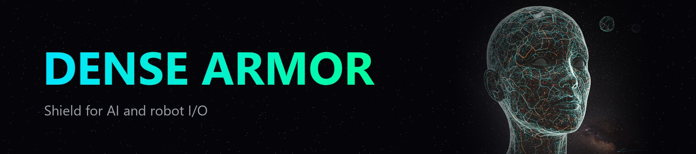

<p align="center">
  
</p>

<p align="center">
  
  <a href="https://codecov.io/gh/tatopenn-cell/Dense-Armor"></a>
  <a href="https://pypi.org/project/dense-armor"></a>
  <a href="https://doi.org/10.5281/zenodo.23436071"></a>
  
  
  
  
  
  
  <a href="https://tatopenn-cell.github.io/Dense-Armor/"></a>
</p>

<h3 align="center">Robot-AI Online Shielding &amp; Learning</h3>

<p align="center"><strong>A library for online learning on robot, vision, and AI streams, one sample at a time, with streaming statistics and protection, drift and anomaly detection, and safe robot commands.</strong></p>

<p align="center">📖 <a href="https://tatopenn-cell.github.io/Dense-Armor/"><strong>Full documentation, API reference, quick guide →</strong></a></p>

---

## Who is this for

Python developers working on systems where data arrives one sample at a time and the model has to learn or stay stable *while it runs*: robot control loops, sensor pipelines, agent runtimes, any streaming workload. If you train on a fixed dataset and then deploy, this library is probably not what you need.

## Use cases

The primitives are domain-agnostic: anything that ingests data one sample at a time and has to react when the stream changes. It has been measured on a robot arm (CASPER on a UR3e), on stock and crypto prices, card transactions, network flows and a telemarketing log (the [finance pages](https://tatopenn-cell.github.io/Dense-Armor/finance/)), and on synthetic streams with known drift; the layers above and below the model are the same shape everywhere.

| domain | what Dense-Armor brings |
|---|---|
| Robot control loops | bounded commands (rate limits, CBF), drift and anomaly on joint streams, calibrated intervals |
| Deployed ML models | input drift detection, runtime shielding of `NaN` and spikes, no retraining required |
| Antivirus / security | event stream statistics, behavioural drift, anomaly scoring one event at a time |
| Fraud detection | per-transaction scoring, drift on the user profile, streaming statistics |
| Search / ranking | monitoring layer around the ranker: drift on user behaviour, streaming metrics |
| Live monitoring | Prometheus-style metrics with drift detection, sketches, quantiles in constant memory |
| IoT / sensor fusion | the same shape as a robot joint: noisy multichannel input, drift, anomalies, shields |

## What it expects from you

No specific model. Any estimator that follows the same contract: `learn_one(x, y)` updates the model from one sample, `predict_one(x)` returns a prediction, `transform_one(x)` returns a transform or a residual, `score_one(x)` returns an anomaly score (high = anomalous), `update(x)` advances a drift detector. Inputs and outputs are dicts of numpy-compatible scalars or arrays. Runs on CPU or GPU through JAX. A shield can wrap any callable from tensor to tensor.

## What changes when you use it

- The model keeps learning even when the stream has `NaN`, spikes, or missing samples — they are cleaned before the model sees them, and every correction reports how far it moved.
- Concept drift is caught by an explicit detector instead of silently degrading accuracy.
- Anomalies come back as a score, one sample at a time.
- Robot commands are bounded (rate limits, control barrier functions) before they reach the actuator.
- Predictions can carry a calibrated uncertainty interval.

In this library, *shielding* means cleaning the data a model sees (NaN, spikes, anomalous samples) and bounding the commands a robot receives, around any online learner that follows the `learn_one` / `score_one` contract. It is not the formal shield of safe reinforcement learning.

## What it does

Dense-Armor is a Python library for online learning. Every estimator learns one sample at a time, at control-loop speed, on JAX: nothing is retrained in batch, nothing revisits the past. The same `learn_one` / `predict_one` / `transform_one` contract runs on a table, a time series, a robot joint stream, a video frame, a token stream, and a shield can sit in front of any of them.

---

## Quickstart

As a quick example, we'll train an online Gaussian naive Bayes classifier to classify a drift stream with 5 features and one sudden concept change. Here's a look at the first observation in the dataset.

```python
>>> from dense_armor.utility.datasets import DriftStream

>>> dataset = DriftStream(n_samples=2000, n_features=5, n_drifts=1, kind="sudden", seed=0)

>>> for x, y in dataset.stream():
...     print(x.to_dict())
...     print(y)
...     break
{'x0': 0.00889176732883129, 'x1': 0.7559062648510446, 'x2': -2.788269695138754, 'x3': 0.0168051027297742, 'x4': 1.9630566360240487}
0
```

Now let's run the model on the dataset in a streaming fashion. We sequentially interleave predictions and model updates. Meanwhile, we update a performance metric to see how well the model is doing.

```python
>>> from dense_armor.utility.learn.online_classifiers import OnlineGaussianNB
>>> from dense_armor.utility.metrics import Accuracy

>>> model = OnlineGaussianNB()

>>> metric = Accuracy()

>>> for x, y in dataset.stream():
...     y_pred = model.predict_one(x)
...     if y_pred is not None:
...         metric.update(y, y_pred)
...     model.learn_one(x, y)

>>> metric
Accuracy(n=1999, value=0.9989994997498749)
```

Of course, this is just a contrived example. Check the [getting started](https://tatopenn-cell.github.io/Dense-Armor/getting-started/) section of the documentation for a more thorough tutorial.

---

## On a robot

A joint torque stream from `SyntheticArm` (real Panda URDF, real rigid-body dynamics) carries a `1e6` spike at sample 50. A rate-limited follower caps the applied jump at `max_vel` per step, so a downstream controller never sees the spike:

```python
from pathlib import Path
import numpy as np
from dense_armor.utility.datasets import SyntheticArm
from dense_armor.utility.control.rate_limiter import rate_limited_follower

ds = SyntheticArm(
    Path("test/fixtures/urdf/panda.urdf"),
    period_s=1.0, rate_hz=50.0, n_cycles=2,
    fault_at_s=None, fault=None, seed=0,
)
tau = np.array([float(sig["tau_1"]) for sig, _ in ds.stream()])
tau[50] = 1e6

safe = rate_limited_follower(tau, max_vel=2.0, max_accel=1.0)
print(round(float(np.max(np.abs(tau))), 1), round(float(np.max(np.abs(safe))), 1))
```

```
1000000.0 272.2
```

`RigidBodyModel` loads dynamics from the same URDF (`.xacro` and `<mimic>` joints included), `quintic_trajectory` generates a minimum-jerk path, and `cbf_safety_filter` enforces a spatial barrier around an obstacle.

---

## Install

```bash
pip install dense-armor                 # core: numpy + jax
pip install "dense-armor[vision]"       # + camera (OpenCV), image folder (Pillow), in-memory
pip install "dense-armor[ros]"          # + rosbag readers
pip install "dense-armor[audio,data]"   # + WAV, HDF5, NetCDF
pip install "dense-armor[mcp]"          # + MCP server for LLM agents
pip install "dense-armor[quantum]"      # + Dense-Evolution (NISQ simulator)
```

Works on Python 3.10+. JAX is the backend for every estimator.

---

## Features

Dense-Armor provides online implementations of the following families of algorithms:

- Linear models, with a wide array of optimizers
- Decision trees (including FIMT-DD regression model trees), online forests (adaptive random forest, aggregated Mondrian forests, online extra trees) and rule sets (adaptive model rules)
- Naive Bayes, nearest neighbours, multiclass and multi-output wrappers, conjugate distributions
- [Ensembles](https://tatopenn-cell.github.io/Dense-Armor/ensemble/) (online bagging and boosting, exponentially weighted average, voting, stacking)
- [Bandits](https://tatopenn-cell.github.io/Dense-Armor/bandit/) (epsilon-greedy, UCB, Thompson sampling, Bayes-UCB, Exp3, LinUCB, offline replay)
- [Active learning](https://tatopenn-cell.github.io/Dense-Armor/active/) (random, fixed, variable and randomised uncertainty with a labelling budget)
- Factorization machines ([plain, field-aware, field-weighted, higher-order](https://tatopenn-cell.github.io/Dense-Armor/facto/)) and [recommenders](https://tatopenn-cell.github.io/Dense-Armor/reco/) (baseline, biased and plain matrix factorization, sliding DFT, skyline)
- Clustering
- Anomaly detection (including the local outlier factor)
- Drift detection
- Time series (AR, VAR, Kalman, adaptive Kalman, cycle residual)
- Online classifiers
- Online dynamics
- Calibration and metric learning
- Imbalanced learning
- [Vision](https://tatopenn-cell.github.io/Dense-Armor/vision/) (video files, frame features, patches, vocabulary, online reduction, motion, tracking, registration, dense flow)
- Robot control (rate limits, control barrier functions, trajectories, kinematic tracking)
- Robot dynamics (URDF, passivity + CBF controllers)
- Shielding (1D series cleanup, input/output shield, per-point routing)
- [Finance pipelines](https://tatopenn-cell.github.io/Dense-Armor/finance/): sixteen pipelines for markets, fraud, intrusion, credit scoring, regime, portfolio, order book, stress, streaming and timing, each page opening with the question it answers
- [Offline learning](https://tatopenn-cell.github.io/Dense-Armor/offline/): `fit` feeds a whole dataset to any online algorithm

Dense-Armor also provides other online utilities:

- Feature extraction and selection
- Online statistics and sketches
- Metrics for streams and robots
- Preprocessing
- Streams (CSV, arrays, rosbag, frame folders, merge by time, shuffle)
- Built-in datasets
- Progressive model validation
- Model pipelines
- LLM bridge (embeddings as features, estimators as JSON tools)
- Checks (`check_estimator`, p99 budget, memory growth, clone, pickle, state dict, roc_auc)
- Core engine (`DynamicAICodegen` JIT compiler, `ImageChunker`, `UniversalMemoryGuard`, `AdaptiveSignalStabilizer`, `AIHardwareProfiler`, `StochasticAdversarialNoise`)

Check out [the API](https://tatopenn-cell.github.io/Dense-Armor/api/) for a comprehensive overview.

---

## Should I be using Dense-Armor?

The answer is probably no. Most of the time, batch learning does the job just fine. An online approach fits when:

- you want a model that learns from new data without revisiting past data
- you want a model that is robust to concept drift
- the production context is event-based, not batch-based, and you want the code to look like it
- you want the model to be protected from corrupted input, NaN, spikes, or slow drift without retraining it
- you work with a real robot and need command-side safety in the same library that learns the model

Some specifics:

- It focuses on clarity and user experience, more than on raw speed.
- It runs on JAX, so the same code runs on CPU, GPU or TPU.
- It plays nicely with the rest of Python's ecosystem: numpy in, numpy out.

---

## Useful links

- [Documentation](https://tatopenn-cell.github.io/Dense-Armor/)
- [Getting started](https://tatopenn-cell.github.io/Dense-Armor/getting-started/)
- [API reference](https://tatopenn-cell.github.io/Dense-Armor/api/)
- [Changelog](https://tatopenn-cell.github.io/Dense-Armor/changelog/)
- [Package releases](https://pypi.org/project/dense-armor/#history)
- [Sister project (Dense-Evolution)](https://github.com/tatopenn-cell/Dense-Evolution)
- [DOI](https://doi.org/10.5281/zenodo.23436071)

---

## Contributing

Contributions are welcome. The library is built to be extended one estimator at a time, following the same interface (`learn_one` / `predict_one` / `transform_one`) and the same checks (`dense_armor.checks`).

---

## Citation

```bibtex
@software{pennacchio_dense_armor,
  author    = {Pennacchio, Salvatore},
  title     = {Dense-Armor: Robot-AI Online Shielding \\& Learning},
  year      = 2026,
  publisher = {Zenodo},
  doi       = {10.5281/zenodo.23436071}
}
```

---

## License

Business Source License 1.1 — free non-commercial use, converts to Apache 2.0
on `2029-06-01`. See [LICENSE.md](LICENSE.md).

`© 2026 Salvatore Pennacchio <jtatopenn@libero.it>`

Twin project of [Dense-Evolution](https://github.com/tatopenn-cell/Dense-Evolution)
(NISQ quantum circuit simulator).


## Speed

The per-sample cost of the main estimators, measured by
`benchmarks/speed.py` on an Intel Xeon 2.20 GHz with 2 cores, 20 seeds,
2000 samples per seed, first 200 discarded. Full table and machine in
`benchmarks/speed_log.md`.

| component | median µs | p99 µs |
|---|---|---|
| Hoeffding tree | 9.1 | 18.1 |
| Gaussian naive Bayes | 44.2 | 85.8 |
| Adaptive random forest (10 models) | 754.1 | 1374.0 |
| Half-Space Trees (25 trees) | 1285.2 | 2412.3 |
| ADWIN (`update`) | 9.5 | 16.2 |

The robot-side components stay inside a 1 kHz control-loop budget
(1000 µs) at the median: 36.5 µs for the rate-limited follower, 0.9 µs
for the control barrier function filter, 8.1 µs for the kinematic
tracking controller, 66 µs for the rigid-body mass matrix and 55 µs for
the gravity forces (the last two through `jax.jit`).

## Acknowledgements

Dense-Armor takes inspiration from [River](https://riverml.xyz) (Montiel et al., 2020, [arXiv:2012.04740](https://arxiv.org/abs/2012.04740)), the online machine learning library.

- Drones: [Actuator fault](docs/drones/actuator_fault.md).
- Drones: [Sensor consistency](docs/drones/sensor_consistency.md).
- Drones: [Propeller health: is a propeller damaged?](docs/drones/propeller_health.md).
- Drones: [Battery endurance: how many minutes of flight are left, and how sure?](docs/drones/battery_endurance.md).
- Drones: [Safety filter: is the next move safe?](docs/drones/safety_filter.md).
- Drones: [Link health: is the radio link about to fail?](docs/drones/link_health.md).
- Drones: [Visual landing: is the pad where I think it is, and is the camera moving?](docs/drones/visual_landing.md).
- Drones: [Static vs online: a CART tree and an online Hoeffding tree on the same stream](docs/drones/static_vs_online.md).
- Drones: [Start here: a drone and a board](docs/drones/start_here.md).
- Drones: [ArduPilot against PX4](docs/drones/ardupilot.md).
- Drones: [Jetson power: how much does the power mode change the time per sample?](docs/drones/jetson_power.md).
