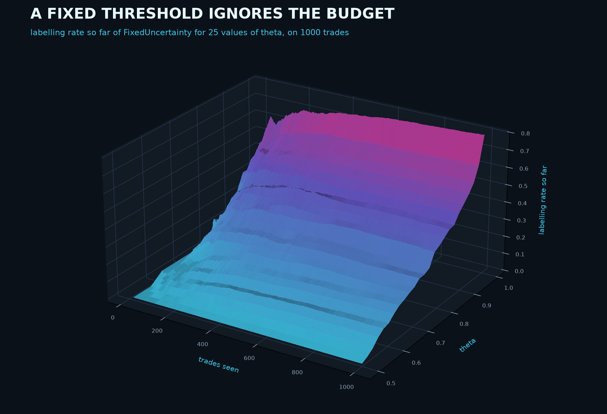
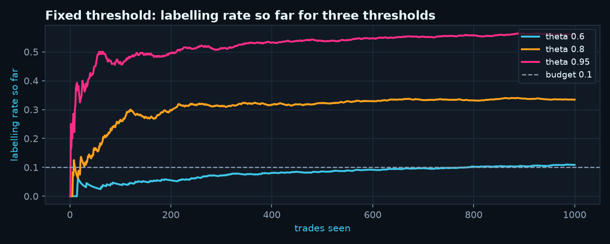

# Fixed threshold: ask when unsure

[← Active learning](index.md)

A desk reviews a trade only when its classifier is less than 70 % sure of its answer. The rule is easy to explain and it looks smart, but it knows nothing about the number of reviews the desk can afford: it can spend them all in the first hour, or never spend them. A robot that asks the technician when its own reading is doubtful has the same rule.



## 1. A first example: review a trade when the classifier is less than 70 % sure

The same stream of trades. The desk asks for the true label when the confidence of the classifier in its best answer is below `theta = 0.7`.

```python
import numpy as np
from dense_armor.core.online.active import FixedUncertainty
from dense_armor.core.online.learn.online_classifiers import OnlineGaussianNB

rng = np.random.default_rng(0)
desk = OnlineGaussianNB()
for c in (0, 1):
    for _ in range(2):
        desk.learn_one({"score": float(rng.normal(2.0 * c, 1.0))}, c)
review = FixedUncertainty(theta=0.7)
for _ in range(1000):
    y = int(rng.random() < 0.3)
    x = {"score": float(rng.normal(2.0 * y, 1.0))}
    if review.should_label(x, desk):
        desk.learn_one(x, y)
print(round(review.n_labelled_ / review.n_seen_, 3))
```

```
0.239
```

The share of reviewed trades is not 0.1: nothing in the rule knows the budget. It depends only on how many trades the classifier is unsure of, and that number changes as the classifier learns. With `theta` near 0.5 the strategy asks for almost nothing, and with `theta` near 1 for most trades.



On the same stream and 10 seeds, the median labelling rate so far reads 0 at every point for `theta = 0.5`, 0.09, 0.177 and 0.206 after 50, 200 and 1000 trades for `theta = 0.704`, and 0.57, 0.693 and 0.794 for `theta = 0.99`. A budget of 0.1 would be met only by chance, for one value of `theta` and one stream.

| class or function | what it does |
|---|---|
| `FixedUncertainty` | asks for the label when the confidence in the best answer is below `theta` |

## 2. What it does

Label the instance when the model's confidence in its best guess is below a fixed threshold ``theta``: ``P(y_hat | x) < theta``. No budget is enforced (the paper notes the fixed strategy can exhaust the budget or starve). When the model returns no probabilities, the strategy asks. The confidence of a model that has seen one class only is 1, so such a model is never doubtful and the strategy starves: this is why the first example teaches the classifier two trades of each class first.

**Source:** Zliobaite, I., Bifet, A., Holmes, G., Pfahringer, B. (2011). Labeling strategies for active learning in data streams. Machine Learning 100(1). Algorithm 3, page 4.

## 3. The parameters

| Parameter | Meaning | Default |
|---|---|---|
| `theta` | confidence threshold, in `(0, 1)` | 0.5 |
| `budget` | kept for the interface, not enforced | 0.1 |
| `seed` | seed of the random generator | 0 |

`FixedUncertainty` raises `ValueError` if `theta` is outside `(0, 1)` or if `budget` is outside `(0, 1]`. The methods that every strategy shares (`should_label`, `n_seen_`, `n_labelled_`, `state_dict`, `clone`...) are on the [shared methods page](strategy.md).

## 4. The same strategy on a robot

A robot has the same problem on a sensor stream: a technician can check only a fraction of the readings. The classifier is replaced here by one that returns a confidence taken from the stream, so the strategy alone decides.

```python
import numpy as np
from dense_armor.core.online.active import FixedUncertainty

class Fixed:
    def predict_proba_one(self, x):
        return {0: 1.0 - x["conf"], 1: x["conf"]}

rng = np.random.default_rng(0)
confs = [float(rng.uniform(0.5, 1.0)) for _ in range(1000)]
strategy = FixedUncertainty(theta=0.7)
for c in confs:
    strategy.should_label({"conf": c}, Fixed())
print(round(strategy.n_labelled_ / strategy.n_seen_, 3))
```

```
0.373
```

The threshold ignores the budget: 37 % labelled against a budget of 10 %. The paper describes this failure mode; the theta = 0.7 here is a choice.

## API reference

::: dense_armor.core.online.active.strategies.FixedUncertainty

---

## Details

### Choices

- **The figures** are drawn with the library by `docs/assets/active/make_active_figures.py` on the stream of the first page: 1000 trades, median over 10 seeds, classifier taught two trades of each class first.
- **`theta` is checked:** before pull request 480 the code accepted a value outside `(0, 1)`, although the docstring said it was in that interval.
- **The benchmark of the index** uses `theta = 0.7` on a drifting stream and finds the opposite failure, a labelling rate of 0.001, because the classifier is almost always above the threshold.
