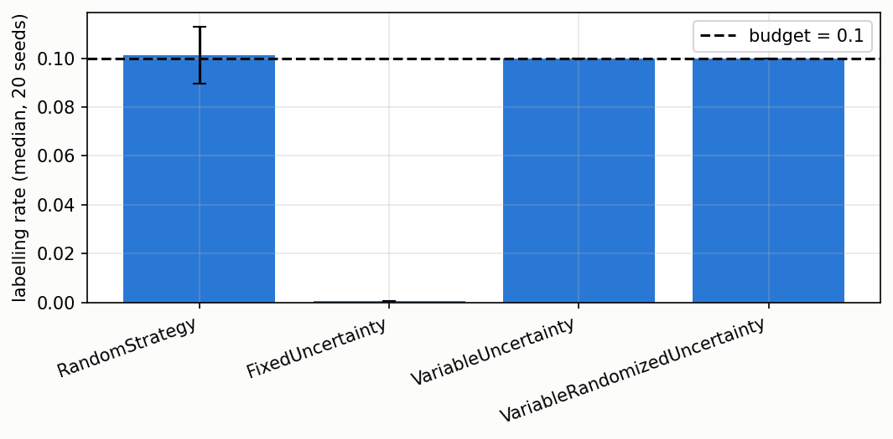

# Active learning: ask for the label only when unsure

## The map of active learning

Click a page to open it, or the job on the left (or the button at the top) to go back to the [map of the library](../index.md#the-library-folder-by-folder).

<object type="image/svg+xml" data="../assets/maps/active.svg" style="width:100%"></object>

## Gamestory

### The example of the mushrooms

Imagine going into the woods with your uncle to pick mushrooms. You find 100 of them one after the other.

Some you recognize immediately (they are the classic delicious porcini), others instead are strange and you don't know if they are good or poisonous (to label means precisely to give the right name to the mushroom: "good" or "poisonous"). Your uncle, however, is a bit lazy and tells you: "Look, you can ask me if a mushroom is good only 10 times during the whole walk (budget). Choose well when to ask me the question!".

Here are the 4 ways (strategies) you have to use your 10 questions:

1. **Ask at random (Random strategy / RandomStrategy).** Every 10 mushrooms you find, you call him and ask: "Uncle, is this edible?". Risk: you waste a question on a gigantic porcino that you already knew how to recognize, and then when you find a strange mushroom you have no more questions.
2. **Give yourself a fixed rule (Fixed threshold / FixedUncertainty).** You decide: "I ask my uncle only if I am less than 70% sure that the mushroom is good". The problem is that this rule ignores your limit of 10 questions: if in the first 5 minutes you find 10 strange mushrooms, you immediately burn through all your questions! And for the rest of the walk you can't ask him anything anymore.
3. **Adjust as you go (Variable threshold / VariableUncertainty).** This is the smart method. You check how many questions you have left. If you see that you have already used many at the beginning, you become more cautious and ask questions only for the truly mysterious mushrooms. If instead you are halfway through the walk and have asked very few questions, you can ask him for confirmation even if you have only a very small doubt. This way you get to the end using all 10 questions at the right moment.
4. **Ask a "surprise" question (Randomized threshold / VariableRandomizedUncertainty).** You use the smart method from before, but every now and then you take a mushroom that seems 100% delicious to you and ask anyway: "Uncle, this is good, right?". It serves to be sure you haven't made a blunder out of overconfidence!

That's all. This trick (Active learning) serves only not to waste the few questions you have available.

## The problem, in one line

A compliance desk receives a stream of trades, and a classifier says for each one whether it is suspicious. The true answer comes only from a human review, which is expensive, so only about one trade in ten can be reviewed. **Active learning** decides which trades to review, so that the classifier learns as much as possible from a limited number of reviews.

## The words

| Word | What it means here | In the example |
|---|---|---|
| label | the true answer for one item, given by a person | suspicious or normal, after a review |
| budget | the fraction of the stream that can be labelled, in `(0, 1]` | 0.1: one trade in ten |
| strategy | the rule that decides which items to label | the four classes below |

## A first example: the four strategies on the same trades

The desk has 1000 trades. A trade is suspicious (1) or normal (0), the score is higher for a suspicious one, and the classifier is taught the true label only of the trades that the strategy chooses to review. The budget is 0.1 for all four.

```python
import numpy as np
from dense_armor.core.online.active import (
    FixedUncertainty,
    RandomStrategy,
    VariableRandomizedUncertainty,
    VariableUncertainty,
)
from dense_armor.core.online.learn.online_classifiers import OnlineGaussianNB

makers = {
    "RandomStrategy": lambda: RandomStrategy(budget=0.1, seed=0),
    "FixedUncertainty": lambda: FixedUncertainty(theta=0.7),
    "VariableUncertainty": lambda: VariableUncertainty(budget=0.1, s=0.01, seed=0),
    "VariableRandomizedUncertainty": lambda: VariableRandomizedUncertainty(budget=0.1, s=0.01, delta=0.05, seed=0),
}
for name, make in makers.items():
    rng = np.random.default_rng(0)
    desk = OnlineGaussianNB()
    for c in (0, 1):
        for _ in range(2):
            desk.learn_one({"score": float(rng.normal(2.0 * c, 1.0))}, c)
    review = make()
    for _ in range(1000):
        y = int(rng.random() < 0.3)
        x = {"score": float(rng.normal(2.0 * y, 1.0))}
        if review.should_label(x, desk):
            desk.learn_one(x, y)
    print(name, round(review.n_labelled_ / review.n_seen_, 3))
```

```
RandomStrategy 0.089
FixedUncertainty 0.239
VariableUncertainty 0.1
VariableRandomizedUncertainty 0.1
```

Read the four numbers as the share of trades that were reviewed. The random strategy is near the budget, and a bit under it, because each trade is a coin toss. The two variable strategies are exactly on it. The fixed strategy is not near it: its rule never looks at the budget, and here it asks for about a quarter of the trades. The pages below show each strategy alone, with its figure and its parameters.

## The pages of the section

| Page | Class | What it does |
|---|---|---|
| [Random labelling](random_strategy.md) | `RandomStrategy` | asks for the label with probability `budget` |
| [Fixed threshold](fixed_uncertainty.md) | `FixedUncertainty` | asks when the classifier is less sure than `theta` |
| [Variable threshold](variable_uncertainty.md) | `VariableUncertainty` | asks under the budget, with a threshold that follows the stream |
| [Randomised threshold](randomized_uncertainty.md) | `VariableRandomizedUncertainty` | the same, with a random multiplier on the threshold |
| [The shared methods](strategy.md) | `ActiveStrategy` | the counts, the budget check, `set_params`, `state_dict`, `clone`, `fit` |

## What the numbers say



| strategy | median rate | IQR |
|---|---|---|
| RandomStrategy | 0.101 | 0.005 |
| FixedUncertainty | 0.001 | 0.001 |
| VariableUncertainty | 0.100 | 0.000 |
| VariableRandomizedUncertainty | 0.100 | 0.000 |

FixedUncertainty labels 0.05 % of the stream: the classifier is almost always
above the threshold, so the strategy starves and the budget is unused. The
two variable strategies land on the budget exactly.


## The same problem on a robot

A robot observes a stream but the true label of a sample is expensive: a technician has to check it. Active learning decides which samples to label, so a classifier can learn with a limited labelling budget. The library provides four strategies, from the naive (label at random) to the one that balances the budget while asking the most uncertain samples. Each page above ends with the same strategy on a robot stream.

## Details

- Benchmark: benchmarks/bandit_quality.py, JSON: benchmarks/bandit_quality.json.
- Papers: Zliobaite, Bifet, Holmes and Pfahringer (2011) Machine Learning 100(1). Algorithm 2 page 3, Algorithm 3 page 4, Algorithm 4 page 5, Algorithm 5 page 5. Settles (2009) is background only.
- Machine: Intel Xeon 2.20 GHz, 2 cores, Python 3.13.16.
- The classifier is OnlineGaussianNB. The choice matters for the fixed threshold, not for the variable strategies whose rate is at the budget by construction.
