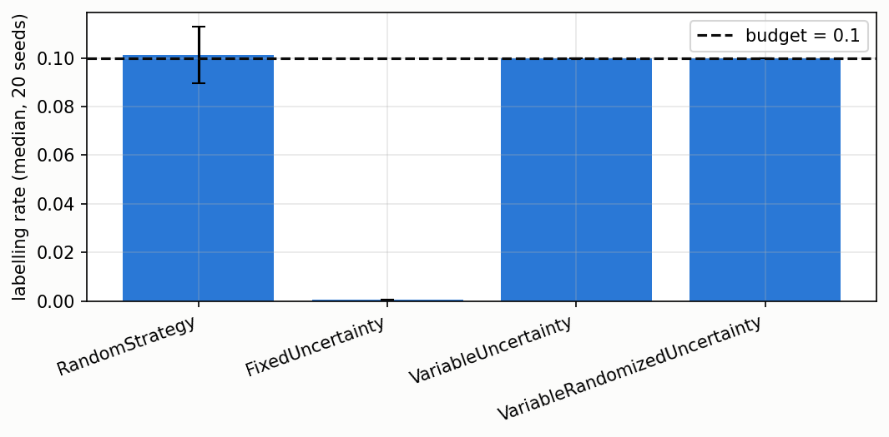

# Active learning: ask for the label only when unsure

A robot observes a stream but the true label of a sample is expensive. Active
learning decides which samples to label, so a classifier can learn with a
limited labelling budget. The library provides four strategies, from the
naive (label at random) to the one that balances the budget while asking the
most uncertain samples.

## 1. The budget

A labelling budget B in (0, 1]: B = 0.1 means at most 10 % of the incoming
samples can be labelled. The strategies differ in which 10 % to pick.

```python
import numpy as np
from dense_armor.utility.active import RandomStrategy
rng = np.random.default_rng(0)
strategy = RandomStrategy(budget=0.1, seed=0)
for _ in range(1000):
    strategy.should_label({"x": float(rng.random())}, None)
print(round(strategy.n_labelled_ / strategy.n_seen_, 3))
```

```
0.089
```

## 2. Fixed threshold: label when the classifier is unsure

```python
import numpy as np
from dense_armor.utility.active import FixedUncertainty

class Fixed:
    def predict_proba_one(self, x):
        return {0: 1.0 - x["conf"], 1: x["conf"]}

rng = np.random.default_rng(0)
confs = [float(rng.uniform(0.5, 1.0)) for _ in range(1000)]
strategy = FixedUncertainty(theta=0.7)
for c in confs:
    strategy.should_label({"conf": c}, Fixed())
print(round(strategy.n_labelled_ / strategy.n_seen_, 3))
```

```
0.373
```

The threshold ignores the budget: 37 % labelled against a budget of 10 %.
The paper describes this failure mode; the theta = 0.7 here is a choice.

## 3. Variable threshold: spend the budget evenly over time

The threshold starts at 1 and adjusts after every sample: when a sample is
labelled it shrinks by (1 - s), when it is not it grows by (1 + s). The
adjustment keeps the labelling rate at the budget over time.

```python
import numpy as np
from dense_armor.utility.active import VariableUncertainty

class Fixed:
    def predict_proba_one(self, x):
        return {0: 1.0 - x["conf"], 1: x["conf"]}

rng = np.random.default_rng(0)
confs = [float(rng.uniform(0.5, 1.0)) for _ in range(1000)]
strategy = VariableUncertainty(budget=0.1, s=0.001, seed=0)
for c in confs:
    strategy.should_label({"conf": c}, Fixed())
print(round(strategy.n_labelled_ / strategy.n_seen_, 3))
```

```
0.1
```

## 4. Randomised threshold: do not ignore the confident samples

The randomised variant multiplies the threshold by eta ~ Normal(1, delta)
before the comparison, so occasionally a confident sample is labelled too.

```python
import numpy as np
from dense_armor.utility.active import VariableRandomizedUncertainty

class Fixed:
    def predict_proba_one(self, x):
        return {0: 1.0 - x["conf"], 1: x["conf"]}

rng = np.random.default_rng(0)
confs = [float(rng.uniform(0.5, 1.0)) for _ in range(1000)]
strategy = VariableRandomizedUncertainty(budget=0.1, s=0.001, delta=0.05, seed=0)
for c in confs:
    strategy.should_label({"conf": c}, Fixed())
print(round(strategy.n_labelled_ / strategy.n_seen_, 3))
```

```
0.1
```

## 5. What the numbers say



| strategy | median rate | IQR |
|---|---|---|
| RandomStrategy | 0.101 | 0.005 |
| FixedUncertainty | 0.001 | 0.001 |
| VariableUncertainty | 0.100 | 0.000 |
| VariableRandomizedUncertainty | 0.100 | 0.000 |

FixedUncertainty labels 0.05 % of the stream: the classifier is almost always
above the threshold, so the strategy starves and the budget is unused. The
two variable strategies land on the budget exactly.

## Details

- Benchmark: benchmarks/bandit_quality.py, JSON: benchmarks/bandit_quality.json.
- Papers: Zliobaite, Bifet, Holmes and Pfahringer (2011) Machine Learning 100(1). Algorithm 2 page 3, Algorithm 3 page 4, Algorithm 4 page 5, Algorithm 5 page 5. Settles (2009) is background only.
- Machine: Intel Xeon 2.20 GHz, 2 cores, Python 3.13.16.
- The classifier is OnlineGaussianNB. The choice matters for the fixed threshold, not for the variable strategies whose rate is at the budget by construction.
