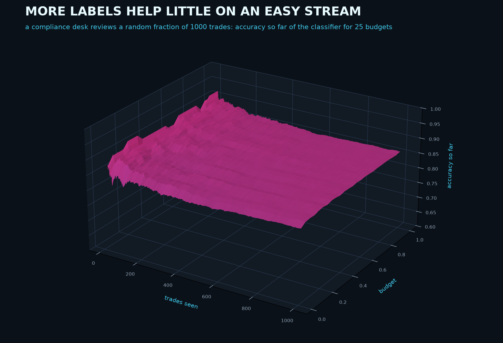
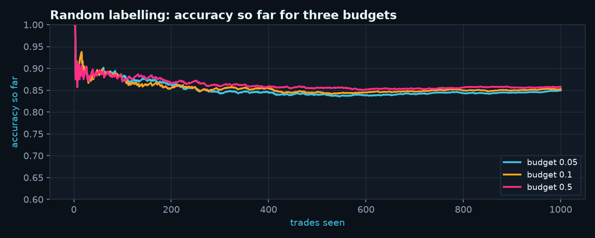

# Random labelling: ask with a fixed probability

[← Active learning](index.md)

A compliance desk receives thousands of trades and a human review of a trade is expensive, so only about one in ten can be reviewed. The simplest rule needs no judgement: for each trade, review it with probability 0.1, whatever the classifier thinks. A robot that can ask a technician to check only a few readings can ask in the same way.



## 1. A first example: a desk that reviews one trade in ten

A trade is suspicious (1) or normal (0). Its score is higher for a suspicious one, 3 trades in 10 are suspicious, and the desk reviews a trade at random with probability 0.1 and teaches the classifier the true label. The classifier is first taught two trades of each class, so that it knows both.

```python
import numpy as np
from dense_armor.core.online.active import RandomStrategy
from dense_armor.core.online.learn.online_classifiers import OnlineGaussianNB

rng = np.random.default_rng(0)
desk = OnlineGaussianNB()
for c in (0, 1):
    for _ in range(2):
        desk.learn_one({"score": float(rng.normal(2.0 * c, 1.0))}, c)
review = RandomStrategy(budget=0.1, seed=0)
for _ in range(1000):
    y = int(rng.random() < 0.3)
    x = {"score": float(rng.normal(2.0 * y, 1.0))}
    if review.should_label(x, desk):
        desk.learn_one(x, y)
print(round(review.n_labelled_ / review.n_seen_, 3))
```

```
0.089
```

`review.should_label(x, desk)` says whether to ask for the true label of the trade `x`; here it answers yes with probability `budget`, whatever `x` is, so after 1000 trades the share of reviewed trades is close to 0.1. `review.n_labelled_` counts the reviewed trades and `review.n_seen_` all the trades.



On the same stream and 10 seeds, the median accuracy of the classifier so far reads 0.84, 0.843 and 0.84 after 50, 200 and 1000 trades for a budget of 0.02, 0.89, 0.855 and 0.853 for a budget of 0.1, and 0.89, 0.865 and 0.86 when every trade is reviewed (budget 1.0). On this easy stream a tenth of the labels is almost as good as all of them, and the surface shows it: it is flat for the budgets above a few percent.

| class or function | what it does |
|---|---|
| `RandomStrategy` | asks for the label with probability `budget`, whatever the classifier says |

## 2. What it does

Baseline: with probability ``B`` the true label of the instance is requested, independently of the model. The model is not used, so the strategy spends the budget on trades that the classifier already knows as well as on trades that it does not. The share of labelled trades is close to the budget on average but not exact: it is a binomial count.

**Source:** Zliobaite, I., Bifet, A., Holmes, G., Pfahringer, B. (2011). Labeling strategies for active learning in data streams. Machine Learning 100(1). Algorithm 2, page 3: the budget is the probability that a sample is labelled.

## 3. The parameters

| Parameter | Meaning | Default |
|---|---|---|
| `budget` | labelling budget `B`, in `(0, 1]` | 0.1 |
| `seed` | seed of the random generator | 0 |

`RandomStrategy` raises `ValueError` if `budget` is outside `(0, 1]`. The methods that every strategy shares (`should_label`, `n_seen_`, `n_labelled_`, `state_dict`, `clone`...) are on the [shared methods page](strategy.md).

## 4. The same strategy on a robot

A robot has the same problem on a sensor stream: a technician can check only a fraction of the readings. The classifier is replaced here by one that returns a confidence taken from the stream, so the strategy alone decides.

```python
import numpy as np
from dense_armor.core.online.active import RandomStrategy

class Fixed:
    def predict_proba_one(self, x):
        return {0: 1.0 - x["conf"], 1: x["conf"]}

rng = np.random.default_rng(0)
confs = [float(rng.uniform(0.5, 1.0)) for _ in range(1000)]
strategy = RandomStrategy(budget=0.1, seed=0)
for c in confs:
    strategy.should_label({"conf": c}, Fixed())
print(round(strategy.n_labelled_ / strategy.n_seen_, 3))
```

```
0.089
```

The strategy never reads the confidence: 0.089 of the 1000 readings are labelled, a bit under the budget of 0.1, because each reading is a coin toss.

## API reference

::: dense_armor.core.online.active.strategies.RandomStrategy

---

## Details

### Choices

- **The figures** are drawn with the library by `docs/assets/active/make_active_figures.py`: 1000 trades, 30 % suspicious, score Normal(0, 1) for a normal trade and Normal(2, 1) for a suspicious one, classifier `OnlineGaussianNB` taught two trades of each class first, median over 10 seeds, accuracy so far computed before each trade is labelled.
- **The robot example** uses a stand-in classifier on purpose: the confidence is a number taken from the stream, so the strategy is the only thing that changes.
