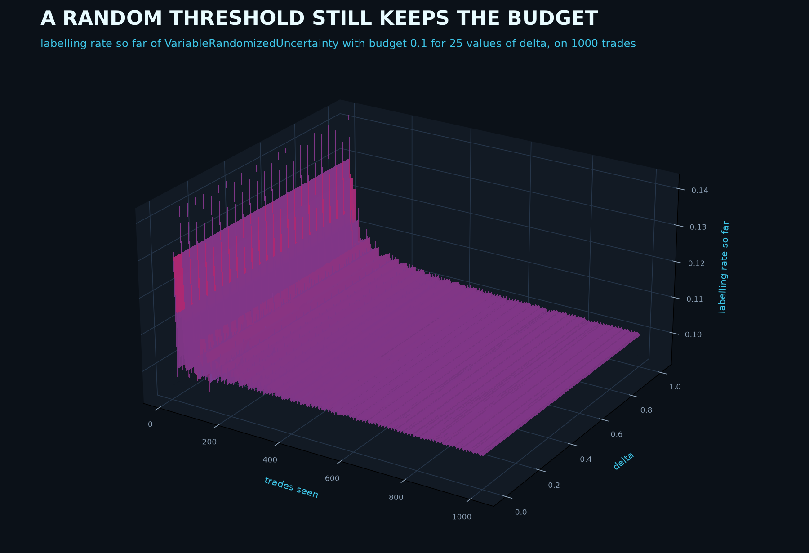
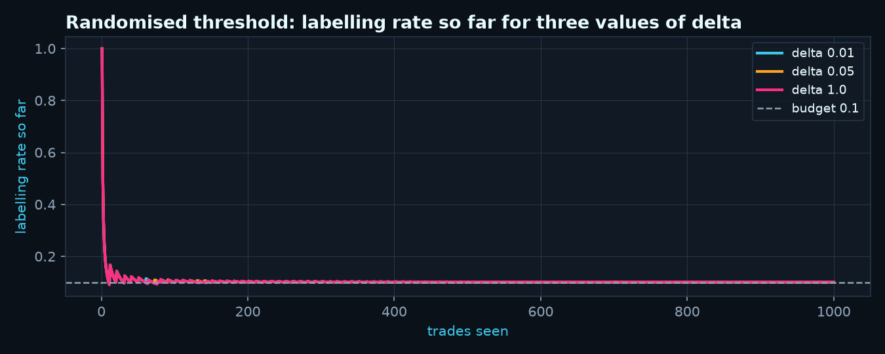

# Randomised threshold: ask a surprise question

[← Active learning](index.md)

The desk follows the variable-threshold rule, but now and then it reviews a trade of which the classifier is very sure. If the world changes, a classifier that is wrong and confident would otherwise never be corrected. A robot that checks a reading it believes is fine does the same.



## 1. A first example: the same desk with a noisy threshold

Before comparing the confidence, the threshold is multiplied by a random number around 1, drawn from a normal distribution with variance `delta`. A trade the classifier is sure of is then sometimes reviewed.

```python
import numpy as np
from dense_armor.core.online.active import VariableRandomizedUncertainty
from dense_armor.core.online.learn.online_classifiers import OnlineGaussianNB

rng = np.random.default_rng(0)
desk = OnlineGaussianNB()
for c in (0, 1):
    for _ in range(2):
        desk.learn_one({"score": float(rng.normal(2.0 * c, 1.0))}, c)
review = VariableRandomizedUncertainty(budget=0.1, s=0.01, delta=0.05, seed=0)
for _ in range(1000):
    y = int(rng.random() < 0.3)
    x = {"score": float(rng.normal(2.0 * y, 1.0))}
    if review.should_label(x, desk):
        desk.learn_one(x, y)
print(round(review.n_labelled_ / review.n_seen_, 3))
```

```
0.1
```

The share of reviewed trades is still 0.1: the noise changes which trades are reviewed, not how many. With a large `delta` the random number can be negative, the threshold is then negative and no label is asked at that step.



On the same stream and 10 seeds, the median labelling rate so far reads 0.1 after 50, 200 and 1000 trades for `delta` of 0.001, 0.043 and 1.0. The flat surface is the result: the randomisation does not disturb the budget.

| class or function | what it does |
|---|---|
| `VariableRandomizedUncertainty` | the variable threshold, multiplied by a random number around 1 before the comparison |

## 2. What it does

Same threshold schedule as `VariableUncertainty`, but before comparing the confidence the threshold is multiplied by ``eta ~ Normal(1, delta)``. The randomisation occasionally labels instances far from the decision boundary, which the paper argues catches concept drift in regions the plain uncertainty strategy ignores. The code draws `eta` with the standard deviation `sqrt(delta)`, so `delta` is a variance.

**Source:** Zliobaite, I., Bifet, A., Holmes, G., Pfahringer, B. (2011). Labeling strategies for active learning in data streams. Machine Learning 100(1). Algorithm 5, page 6.

## 3. The parameters

| Parameter | Meaning | Default |
|---|---|---|
| `budget` | labelling budget `B`, in `(0, 1]` | 0.1 |
| `s` | adjusting step | 0.01 |
| `delta` | variance of the random multiplier, positive, as the paper states it; the default 0.01 is a choice of the library | 0.01 |
| `seed` | seed of the random generator | 0 |

`VariableRandomizedUncertainty` raises `ValueError` if `delta <= 0` or if `budget` is outside `(0, 1]`. With a large `delta` the multiplier `eta` is negative with probability `P(Normal(1, delta) < 0)` (about 16 % for `delta = 1`); then the threshold `theta * eta` is negative and no label is requested at that step. The methods that every strategy shares (`should_label`, `n_seen_`, `n_labelled_`, `state_dict`, `clone`...) are on the [shared methods page](strategy.md).

## 4. The same strategy on a robot

A robot has the same problem on a sensor stream: a technician can check only a fraction of the readings. The classifier is replaced here by one that returns a confidence taken from the stream, so the strategy alone decides.

```python
import numpy as np
from dense_armor.core.online.active import VariableRandomizedUncertainty

class Fixed:
    def predict_proba_one(self, x):
        return {0: 1.0 - x["conf"], 1: x["conf"]}

rng = np.random.default_rng(0)
confs = [float(rng.uniform(0.5, 1.0)) for _ in range(1000)]
strategy = VariableRandomizedUncertainty(budget=0.1, s=0.001, delta=0.05, seed=0)
for c in confs:
    strategy.should_label({"conf": c}, Fixed())
print(round(strategy.n_labelled_ / strategy.n_seen_, 3))
```

```
0.1
```

The randomised variant multiplies the threshold by eta ~ Normal(1, delta) before the comparison, so occasionally a confident sample is labelled too.

## API reference

::: dense_armor.core.online.active.strategies.VariableRandomizedUncertainty

---

## Details

### Choices

- **The figures** are drawn with the library by `docs/assets/active/make_active_figures.py` on the stream of the first page: 1000 trades, budget 0.1, `s = 0.01`, median over 10 seeds.
- **The stream has no drift**, so the surface shows that the budget is kept, not that the surprise questions catch a change; the index shows the strategies on a drifting stream.
