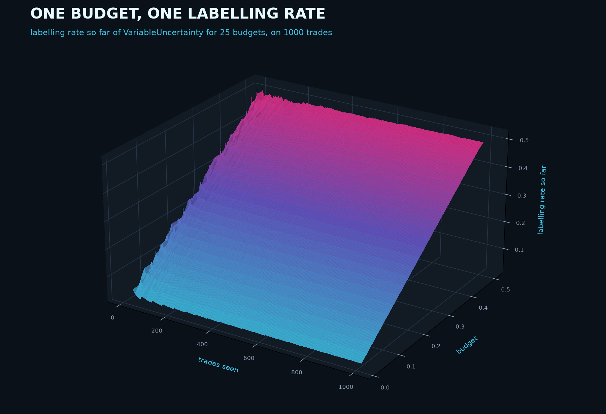
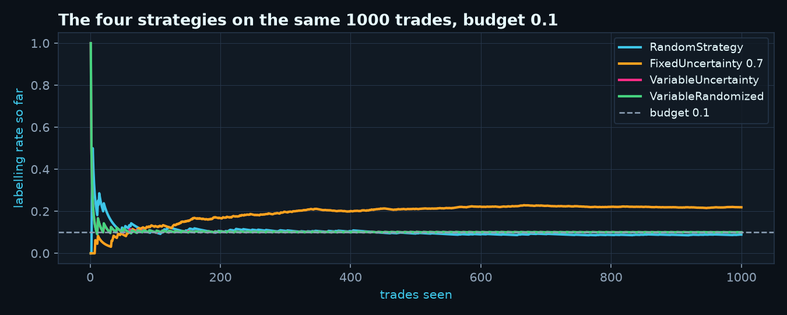

# The shared methods: what every strategy inherits

[← Active learning](index.md)

A desk that uses any of the four strategies calls the same few methods: ask whether to review a trade, count how many were reviewed, copy the strategy, save it, change its settings. They come from one base class, `ActiveStrategy`, and this page shows each one on the variable threshold. A robot calls the same methods.



## 1. Ask, and count

`should_label(x, model)` answers whether to request the true label of `x`, and the strategy counts the trades it has seen and the labels it has asked for.

```python
import numpy as np
from dense_armor.core.online.active import VariableUncertainty
from dense_armor.core.online.learn.online_classifiers import OnlineGaussianNB

rng = np.random.default_rng(0)
desk = OnlineGaussianNB()
for c in (0, 1):
    for _ in range(2):
        desk.learn_one({"score": float(rng.normal(2.0 * c, 1.0))}, c)
review = VariableUncertainty(budget=0.1, s=0.01, seed=0)
for _ in range(200):
    y = int(rng.random() < 0.3)
    x = {"score": float(rng.normal(2.0 * y, 1.0))}
    if review.should_label(x, desk):
        desk.learn_one(x, y)
print(review.n_seen_, review.n_labelled_, review.n_missing)
```

```
200 20 0
```

`n_seen_` is the number of trades given to `should_label`, `n_labelled_` the number for which it answered yes, and `n_missing` is a count that the strategies do not use and that stays 0. `model` is any object with `predict_proba_one(x)` that returns a dict from class to probability; the random strategy does not read it.



On the same stream and 10 seeds, the median labelling rate so far of `VariableUncertainty` reads 0.02 for a budget of 0.02, 0.1 for a budget of 0.1 and 0.49 for a budget of 0.5, after 50, 200 and 1000 trades alike (0.49, 0.485 and 0.493 for 0.5). In the figure the strategies are compared on the same stream: the random one is near the budget, the variable ones are on it, and the fixed one with `theta = 0.7` is above it.

| class or function | what it does |
|---|---|
| `ActiveStrategy` | the base: the budget, the counts, the random generator, `should_label` to be written by each strategy |

## 2. The budget is checked

The budget is a fraction of the stream, so it must be in `(0, 1]`.

```python
from dense_armor.core.online.active import RandomStrategy

try:
    RandomStrategy(budget=0.0)
except ValueError as e:
    print(e)
```

```
budget must be in (0, 1]
```

## 3. Change a setting: `mutate` or `set_params`

`get_params()` returns the settings, and `set_params()` changes them in place.

```python
import numpy as np
from dense_armor.core.online.active import VariableUncertainty
from dense_armor.core.online.learn.online_classifiers import OnlineGaussianNB

rng = np.random.default_rng(0)
desk = OnlineGaussianNB()
for c in (0, 1):
    for _ in range(2):
        desk.learn_one({"score": float(rng.normal(2.0 * c, 1.0))}, c)
review = VariableUncertainty(budget=0.1, s=0.01, seed=0)
for _ in range(200):
    y = int(rng.random() < 0.3)
    x = {"score": float(rng.normal(2.0 * y, 1.0))}
    if review.should_label(x, desk):
        desk.learn_one(x, y)
print(review.get_params())
review.set_params(budget=0.2)
print(review.budget)
review.mutate({"budget": 0.3})
print(review.budget)
try:
    review.mutate({"budget": 0.0})
except ValueError as e:
    print(e, review.budget)
```

```
{'budget': 0.1, 's': 0.01, 'seed': 0}
0.2
0.3
budget must be in (0, 1] 0.3
```

`set_params(budget=0.2)` changes the budget to 0.2, and it checks the settings that `mutate` may change in the same way. `mutate` changes, in place and after the same check as the constructor, the settings that the strategy reads at every decision: the `budget` of every strategy, the `theta` of `FixedUncertainty`, the step `s` of the variable strategies and the `delta` of the randomised one. `mutate({"budget": 0.3})` sets 0.3, and `mutate({"budget": 0.0})` is refused as the constructor refuses it, so the budget stays 0.3. The names that are not mutable, such as `seed` or the counts, are left alone and nothing raises.

## 4. Save and copy

`state_dict()` returns what the strategy has learned, and `clone()` returns a new strategy with the same settings and nothing learned.

```python
import numpy as np
from dense_armor.core.online.active import VariableUncertainty
from dense_armor.core.online.learn.online_classifiers import OnlineGaussianNB

rng = np.random.default_rng(0)
desk = OnlineGaussianNB()
for c in (0, 1):
    for _ in range(2):
        desk.learn_one({"score": float(rng.normal(2.0 * c, 1.0))}, c)
review = VariableUncertainty(budget=0.1, s=0.01, seed=0)
for _ in range(200):
    y = int(rng.random() < 0.3)
    x = {"score": float(rng.normal(2.0 * y, 1.0))}
    if review.should_label(x, desk):
        desk.learn_one(x, y)
print(list(review.state_dict()))
fresh = review.clone()
print(fresh.n_seen_, fresh.budget)
```

```
['n_seen_', 'n_labelled_', 'n_missing_', 'theta_']
0 0.1
```

The saved state is the two counts, `n_missing_` and, for the variable strategies, the threshold `theta_`. The clone has the same budget and step and has seen no trade, so its counts and its threshold start again.

## 5. `fit` refuses a table and says what to use

Every estimator of the library has `fit`, which feeds a table to `learn_one` row by row. A strategy does not learn from labels: it decides which items to label, so `fit` stops with an error that says so.

```python
import numpy as np
from dense_armor.core.online.active import VariableUncertainty
from dense_armor.core.online.learn.online_classifiers import OnlineGaussianNB

rng = np.random.default_rng(0)
desk = OnlineGaussianNB()
for c in (0, 1):
    for _ in range(2):
        desk.learn_one({"score": float(rng.normal(2.0 * c, 1.0))}, c)
review = VariableUncertainty(budget=0.1, s=0.01, seed=0)
for _ in range(200):
    y = int(rng.random() < 0.3)
    x = {"score": float(rng.normal(2.0 * y, 1.0))}
    if review.should_label(x, desk):
        desk.learn_one(x, y)
try:
    review.fit([{"score": 1.0}], [1])
except TypeError as e:
    print(e)
```

```
VariableUncertainty is not fitted on a table: it decides with should_label(x, model) and does not learn from labels
```

Use `should_label` in a loop, as on the other pages.

## 6. Describe the strategy

`describe()` returns the name, the module, the parameters with their types and defaults, and the two limits that the real-time tools read.

```python
import numpy as np
from dense_armor.core.online.active import VariableUncertainty
from dense_armor.core.online.learn.online_classifiers import OnlineGaussianNB

rng = np.random.default_rng(0)
desk = OnlineGaussianNB()
for c in (0, 1):
    for _ in range(2):
        desk.learn_one({"score": float(rng.normal(2.0 * c, 1.0))}, c)
review = VariableUncertainty(budget=0.1, s=0.01, seed=0)
for _ in range(200):
    y = int(rng.random() < 0.3)
    x = {"score": float(rng.normal(2.0 * y, 1.0))}
    if review.should_label(x, desk):
        desk.learn_one(x, y)
print(review.describe()["parameters"])
print(review.budget_s, review.memory_class)
```

```
{'budget': {'type': 'float', 'default': 0.1}, 's': {'type': 'float', 'default': 0.01}, 'seed': {'type': 'int', 'default': 0}}
0.001 O(1)
```

`budget_s` is the time allowed for one decision, 0.001 s, and `memory_class` is `O(1)`: the strategy keeps two counts and a threshold, whatever the length of the stream.

## 7. The same methods on a robot

A robot has the same counts. The stand-in classifier returns a confidence taken from the stream.

```python
import numpy as np
from dense_armor.core.online.active import VariableUncertainty

class Fixed:
    def predict_proba_one(self, x):
        return {0: 1.0 - x["conf"], 1: x["conf"]}

rng = np.random.default_rng(0)
strategy = VariableUncertainty(budget=0.1, s=0.001, seed=0)
for _ in range(1000):
    strategy.should_label({"conf": float(rng.uniform(0.5, 1.0))}, Fixed())
print(strategy.n_seen_, strategy.n_labelled_)
```

```
1000 100
```

## API reference

::: dense_armor.core.online.active.base.ActiveStrategy

---

## Details

### Choices

- **What is shown here is the behaviour of the code:** the outputs above are printed by the examples, not stated from the docstrings.
- **`fit` and `mutate` share a base with the bandit policies:** `ActiveStrategy` comes from `_PullPolicy`, the same base as `BanditPolicy`, `LinUCBDisjoint` and `RobotKpSelector`. Before pull request 483 `set_params` accepted a budget outside `(0, 1]`. Before pull request 480 `fit` failed with "has no learn_one", an accident of inheriting `Root.fit`, and `mutate` changed nothing because no class declared a mutable setting.
- **The figures** are drawn with the library by `docs/assets/active/make_active_figures.py` on the stream of the first page.
