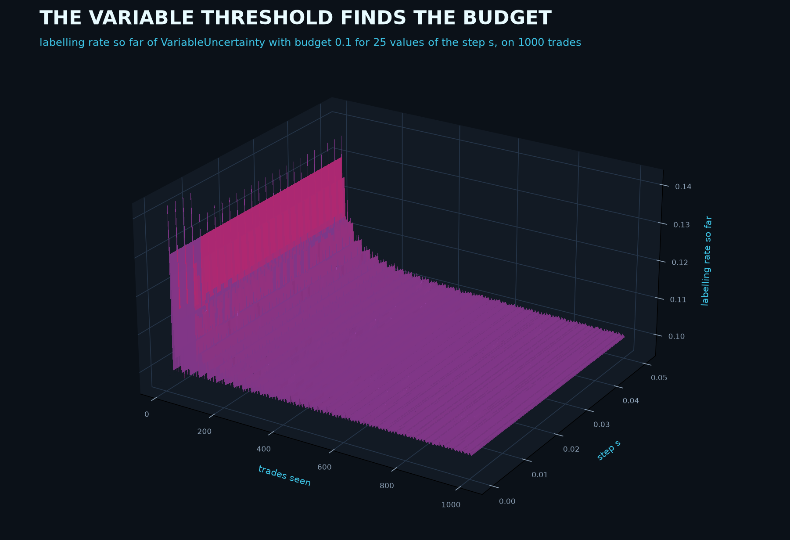
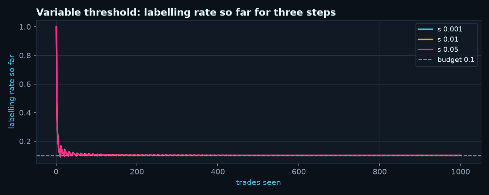

# Variable threshold: spend the budget evenly over time

[← Active learning](index.md)

The desk watches its own count of reviews. When it has reviewed too many trades so far it becomes stricter, and when it has reviewed too few it becomes more willing to ask. The threshold moves after every trade, so the share of reviewed trades settles on the budget. A robot that spreads a few technician checks over a long run does the same.



## 1. A first example: a desk with a budget of one trade in ten

The same stream. The threshold starts at 1 and, after each review, shrinks by a factor `1 - s`; after each trade that is not reviewed it grows by `1 + s`. The strategy asks only while the share of reviewed trades so far is under the budget.

```python
import numpy as np
from dense_armor.core.online.active import VariableUncertainty
from dense_armor.core.online.learn.online_classifiers import OnlineGaussianNB

rng = np.random.default_rng(0)
desk = OnlineGaussianNB()
for c in (0, 1):
    for _ in range(2):
        desk.learn_one({"score": float(rng.normal(2.0 * c, 1.0))}, c)
review = VariableUncertainty(budget=0.1, s=0.01, seed=0)
for _ in range(1000):
    y = int(rng.random() < 0.3)
    x = {"score": float(rng.normal(2.0 * y, 1.0))}
    if review.should_label(x, desk):
        desk.learn_one(x, y)
print(round(review.n_labelled_ / review.n_seen_, 3))
```

```
0.1
```

The share of reviewed trades is the budget, 0.1, not an approximation of it: the strategy refuses to ask whenever the share so far has reached 0.1, and the threshold makes it ask for the trades that the classifier is least sure of. `review.theta_` is the threshold at this moment.



On the same stream and 10 seeds, the median labelling rate so far reads 0.1 after 50, 200 and 1000 trades for steps `s` of 0.0005, 0.0108 and 0.05. The step changes how fast the threshold moves, not where the rate settles.

| class or function | what it does |
|---|---|
| `VariableUncertainty` | asks for the label while the share asked is under the budget, with a threshold that follows the stream |

## 2. What it does

The threshold starts at 1 and adjusts on every sample so the fraction of labelled samples stays close to the budget: after a labelled sample the threshold shrinks by ``(1 - s)``, after an unlabelled one it grows by ``(1 + s)``. Budget enforced: ``u / t < B``. The strategy asks only if the share of labelled samples so far is under the budget and the confidence is under the threshold.

**Source:** Zliobaite, I., Bifet, A., Holmes, G., Pfahringer, B. (2011). Labeling strategies for active learning in data streams. Machine Learning 100(1). Algorithm 4, page 5.

## 3. The parameters

| Parameter | Meaning | Default |
|---|---|---|
| `budget` | labelling budget `B`, in `(0, 1]` | 0.1 |
| `s` | adjusting step, a small positive float | 0.01 |
| `seed` | seed of the random generator | 0 |

`VariableUncertainty` raises `ValueError` if `s <= 0` or if `budget` is outside `(0, 1]`. The methods that every strategy shares (`should_label`, `n_seen_`, `n_labelled_`, `state_dict`, `clone`...) are on the [shared methods page](strategy.md).

## 4. The same strategy on a robot

A robot has the same problem on a sensor stream: a technician can check only a fraction of the readings. The classifier is replaced here by one that returns a confidence taken from the stream, so the strategy alone decides.

```python
import numpy as np
from dense_armor.core.online.active import VariableUncertainty

class Fixed:
    def predict_proba_one(self, x):
        return {0: 1.0 - x["conf"], 1: x["conf"]}

rng = np.random.default_rng(0)
confs = [float(rng.uniform(0.5, 1.0)) for _ in range(1000)]
strategy = VariableUncertainty(budget=0.1, s=0.001, seed=0)
for c in confs:
    strategy.should_label({"conf": c}, Fixed())
print(round(strategy.n_labelled_ / strategy.n_seen_, 3))
```

```
0.1
```

The threshold starts at 1 and adjusts after every reading: when a reading is labelled it shrinks by (1 - s), when it is not it grows by (1 + s). The adjustment keeps the labelling rate at the budget over time.

## API reference

::: dense_armor.core.online.active.strategies.VariableUncertainty

---

## Details

### Choices

- **The figures** are drawn with the library by `docs/assets/active/make_active_figures.py` on the stream of the first page: 1000 trades, budget 0.1, median over 10 seeds.
- **The step `s` is checked:** before pull request 480 the code accepted `s <= 0`.
