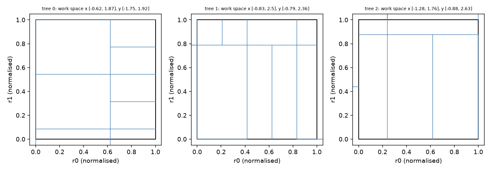
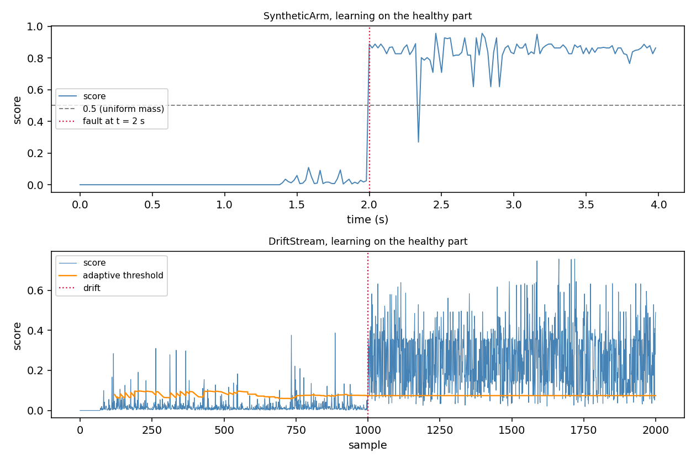

# Half-Space Trees

**In plain words:** Half-Space Trees tell you when a new reading from your robot looks strange. A robot sends you numbers all the time, for example how hard each joint is pushing; when everything is fine they stay in a familiar range. Half-Space Trees learn that range from healthy readings. For every new reading they check how many recent healthy readings were close to it, and give back a score between 0 and 1: close to 0 means 'normal', close to 1 means 'I have almost never seen anything like this'.

Half-Space Trees score each sample by how few normal samples fall in the region around it.
In a control loop they answer one question per joint reading: does this torque residual come
from a part of the space we usually see, or from a region we almost never visit?

## Streaming Anomaly Detection for AI & Robots

### 💡 Quick Overview (TL;DR)
Imagine a digital "security guard" living inside a robot's computer. Its only job is to monitor the robot's motors and ask one simple question: *"Is this movement normal, or is something strange happening?"*

Instead of reading the whole database at once, this algorithm works while the robot is moving. It divides the robot's movement data into physical "boxes" (or spaces). Every time the robot performs a healthy, normal action, the guard drops a token into that specific box. 

Over time, boxes representing normal behavior become packed with tokens, while areas representing broken gears, loose cables, or sudden overloads remain completely empty. If a new movement falls into an empty box, the score rises close to **1.0** (Alarm!). If it falls into a crowded box, the score stays near **0.0** (All good!). 

This allows a robot to detect if it is damaged or carrying the wrong payload within milliseconds, protecting itself before a mechanical failure happens.


## 1. What it is

A robot's torque residual is the difference between the torque the motors actually deliver
and the torque the URDF model predicts. On a healthy joint this residual is small, always
in the same range. When the payload changes, or a gear wears, or a cable slackens, the
residual moves to a range the model has never seen. The task is to notice the move.

Half-Space Trees look at the residual of every joint at once, as one point in a
`d`-dimensional space. They cut that space with random axis-parallel cuts, always at the
middle of the piece they are cutting, and keep a count of how many recent healthy samples
fall in each piece. A new sample that lands in a piece with few healthy samples is
suspicious; a sample that lands where many healthy samples fall is normal.

## 2. How it works

The detector keeps an ensemble of `n_trees` complete binary trees, each `depth` levels deep.

**A work space for every tree.** The features are first rescaled to `[0, 1]` with the range
seen in the first `range_init` samples. For every tree and every dimension `q` the
detector draws `s_q` uniformly in `[0, 1]` and gives the tree the range
`s_q ± 2 · max(s_q, 1 − s_q)` on that dimension. The ranges are wider than `[0, 1]` and
different for every tree, so the trees cut the space in different places.

**The cuts.** A node picks a dimension at random and cuts it at the middle of the node's
current range. The two children inherit the two halves.



The three trees own the same plane, shown for the first two features, and cut it at
different places. The black square is the data domain `[0, 1]²`; each title gives the work
space of the tree.

**Two windows of counts.** Every node keeps two counters: `r`, the number of samples of the
reference window that reached the node, and `l`, the number of samples of the latest window.
The first `window` samples fill `r`. Afterwards every sample is scored with `r` and counted in
`l`; when `window` samples have been counted, `r` takes the value of `l` and `l` starts again
from zero. The reference always describes the last full window.

**The score.** A sample follows its path in each tree down to the terminal node: the first
node that is at the last level or holds `size_limit_frac · window` reference samples or fewer
(`0.1 · window` by default). With `r*` the count of that node and `k*` its depth, the tree
contributes `r* · 2^k*`, and the sum over the trees is

    S = sum over the trees of  r* · 2^k*

A node at depth `k` that holds a share `1/2^k` of the window has `r · 2^k = window`, so
under uniform mass every tree contributes `window` and `S` is about `n_trees · window`.
The score reports that against the uniform case:

    score = M / (M + S),    M = n_trees · window

It is 1 for a region with no reference sample, `0.5` for uniform mass, and goes to 0 in
regions where many healthy samples fall. High means anomalous.

A small case with real numbers: one tree of depth 2 on one feature, cut at `0.5`, then at
`0.25` and `0.75`; `window = 4`, `size_limit_frac = 0.25`, reference samples `0.1, 0.1, 0.2, 0.9`.
The counts are 4 at the root, 3 on the left, 1 on the right.

| sample | terminal node | `r* · 2^k*` | score |
|---|---|---|---|
| `0.15` | left-left, depth 2, `r = 3` | `3 · 4 = 12` | `4 / 16 = 0.25` |
| `0.9` | right, depth 1, `r = 1 ≤ 1` | `1 · 2 = 2` | `4 / 6 = 0.667` |
| `0.4` | left-right, depth 2, `r = 0` | `0` | `4 / 4 = 1.0` |

## 3. Smallest example

```python
import numpy as np
from dense_armor.utility.anomaly.hst import HalfSpaceTrees

rng = np.random.default_rng(0)
det = HalfSpaceTrees(n_trees=15, depth=8, window=100, range_init=10, seed=0)

for _ in range(200):
    det.learn_one({
        "a": float(rng.normal(0.0, 0.05)),
        "b": float(rng.normal(0.0, 0.05)),
    })

print(f"healthy  {det.score_one({'a': 0.0, 'b': 0.0}):.3f}")
print(f"anomaly  {det.score_one({'a': 10.0, 'b': 10.0}):.3f}")
```

```
healthy  0.082
anomaly  0.875
```

The healthy point sits where the healthy samples sit, in nodes with many reference
samples, so its score is close to 0. The far point is outside the range seen in the first
ten samples and falls in nodes with few reference samples, so its score is close to 1.
The line between the two is `0.5`.

## 4. On a real arm

The residual of joints 0-3 on a `SyntheticArm` payload fault. The fault (5 kg added at
t = 2 s) shifts the residual by tens of N·m; the healthy run stays within ±0.15 N·m. The
detector learns only from the healthy part and scores the whole stream.

```python
from pathlib import Path
from dense_armor.utility.anomaly.hst import HalfSpaceTrees
from dense_armor.utility.datasets import SyntheticArm

ds = SyntheticArm(
    Path("test/fixtures/urdf/panda.urdf"),
    period_s=2.0, rate_hz=50.0, n_cycles=2,
    fault_at_s=2.0, fault="payload", payload_mass=5.0,
    noise_std=(1e-3, 5e-3, 5e-2), seed=0,
)

det = HalfSpaceTrees(feature_keys=["r0", "r1", "r2", "r3"], seed=0)

rows = []
for sig, y in ds.stream():
    q, qd, qdd = ds.trajectory(sig.t)
    tau_nom = ds.nominal_torque(q, qd, qdd)
    x = {f"r{j}": float(sig[f"tau_{j}"] - tau_nom[j]) for j in range(4)}
    rows.append((det.score_one(x), y))
    if y == 0:
        det.learn_one(x)

healthy = [s for s, y in rows if y == 0 and s > 0.0]
fault = [s for s, y in rows if y == 1]
print(f"healthy scored {len(healthy)}  max {max(healthy):.3f}")
print(f"fault   scored {len(fault)}  min {min(fault):.3f}")
```

```
healthy scored 30  max 0.109
fault   scored 100  min 0.269
```

Thirty healthy samples are scored (the first 70 fix the ranges and fill the reference) and
the highest of them is `0.109`. All 100 fault samples are scored and the lowest is `0.269`,
above every healthy score.



Top: SyntheticArm. The score is 0 for the first samples: the detector needs `range_init`
samples to fix the ranges and `window` more to fill the reference. Then the healthy
samples score close to 0 and the fault jumps above `0.5`. Bottom: `DriftStream`, with the
adaptive threshold (the 0.95 quantile of the last 500 scores) in orange.

## 5. Numbers

`SyntheticArm` (200 samples, 100 healthy, 100 fault) and `DriftStream` (2000 samples, one
sudden drift at half), the detector at its defaults. The script
`benchmarks/anomaly_streaming.py` regenerates these numbers with two protocols:
`learn-on-healthy` (the detector learns only from the healthy part) and `learn-on-all`.

| Stream | Protocol | ROC-AUC | False alarms on the healthy part | Threshold at the last healthy sample |
|---|---|---|---|---|
| SyntheticArm | learn-on-healthy | 1.000 | 0.000 | 1e9 |
| SyntheticArm | learn-on-all | 0.863 | 0.000 | 1e9 |
| DriftStream | learn-on-healthy | 0.982 | 0.044 | 0.0741 |
| DriftStream | learn-on-all | 0.500 | 0.044 | 0.0741 |

On SyntheticArm the threshold is still `1e9` (flag nothing) at the last healthy sample:
the detector scores from sample 70 on and the adaptive threshold needs 50 scores more, and
the healthy part has 100 samples; the false-alarm value `0.000` follows from that. With
`learn-on-all` the reference follows the data: after the drift of `DriftStream` the two
windows hold the new regime within `2 · window` samples, and the ROC-AUC over the whole
stream is `0.500`.

The trees and the work spaces are random. Six seeds (0 to 5) give, with `learn-on-healthy`,
ROC-AUC 1.000 on SyntheticArm for every seed and 0.982, 0.985, 0.976, 0.986, 0.983 and
0.969 on DriftStream.

## Details

### Where the rules come from

The algorithm is Streaming HS-Trees of Tan, Ting and Liu (2011), *Fast anomaly detection
for streaming data*, IJCAI. Page 3: the work space `s_q ± 2 · max(s_q, 1 − s_q)`,
Algorithm 1 (a random dimension cut at the mid-point of the current range), Algorithm 2
(the update of the masses `r` and `l`), the anomaly score `Node*.r × 2^Node*.k` summed over
the trees, `sizeLimit` of `0.1 ψ`, and the defaults `maxDepth = 15`, `ψ = 250`, 25 trees.
Page 4: Algorithm 3 (the reference and the latest window, the update every `ψ` samples).
The rule that a split is the mid-point of the node's range is also the one of Ulrich et
al. (2025), section 5.2.

### Choices stated explicitly

- **Window.** The paper's window size `ψ` is `window`; the default is 50, the paper uses
  250. The detector scores only after `range_init + window` samples, and a stream with 100
  healthy samples would not reach 250. Measured on the benchmarks with `learn-on-healthy`:
  on SyntheticArm `window` 25, 50 and 70 give ROC-AUC 1.000; on DriftStream `window` 50, 100
  and 250 give 0.982, 0.982 and 0.989.
- **Normalisation.** The paper assumes features in `[0, 1]`. The ranges come from
  `feature_ranges` or from the first `range_init` samples (minimum and maximum with a 10 %
  margin). A value outside the range is not clipped: it falls in the outermost leaves.
- **Score scale.** `M / (M + S)` with `M = n_trees · window`, instead of the raw sum of the
  paper (high for normal samples). It is 1 for an empty region, `0.5` for uniform mass and
  0 for dense regions; the value `0.0` returned before the first reference window is complete
  is the lowest score. A scale where that placeholder falls in the middle of the healthy
  scores lowers the ROC-AUC: the 70 samples before the detector is ready look anomalous.
- **Size limit.** `size_limit_frac · window`, with `size_limit_frac = 0.1`, the value the
  paper suggests.
- **Threshold.** `None` means adaptive: the `threshold_quantile`-quantile (default 0.95) of
  the last `threshold_window` scores (default 500); until `threshold_warmup` scores
  (default 50) have been seen the effective threshold is `1e9`, so nothing is flagged. A
  float means fixed; `0.5` is the score of uniform mass.

### Measured cost

At `n_trees=25, depth=15, window=50` with 4 features, on one CPU thread:

- `0.65 ms` median and `1.0 ms` p99 per `learn_one`;
- the sample that fixes the ranges builds the trees once and takes `71` to `80 ms`;
- memory flat, `52 MB`, independent of the stream length (two count tables of
  `n_trees · (2^(depth+1) − 1)` integers).

The `budget_s` declared by the class is `0.1 s`: the p99 of a short run includes the one-time
construction of the trees.

### Limits

The detector counts, it does not model. Two different fault shapes that land in the same
region give the same score. The first score comes after `range_init + window` samples and
the first adaptive flag after `threshold_warmup` more. With `learn-on-all` a fault that
lasts longer than two windows becomes the reference. Other detectors on the same two streams
are compared in the [overview](index.md).

### Development diary

The first version of this page described a different detector: a sliding window of exact
counts at the leaf, scored `-log2((c + 1) / (N + 1))`, with one working range for all trees.
A review found that its split values were the mid-point of the node's range only when
there is one feature (they came from the position of the node in the tree). With
`learn-on-healthy` that version measured ROC-AUC 0.941 on SyntheticArm and 0.907 on
DriftStream. Correcting only the split values gave 1.000 and 0.756, and its smallest example
did not separate the healthy point from the far one. Replacing the window, the work space and
the score with the design of Tan et al. gave the numbers of section 5.
