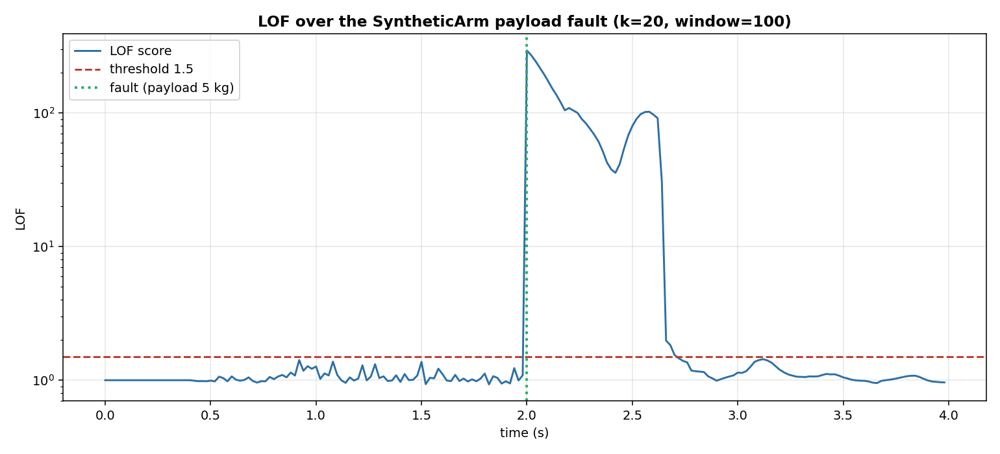
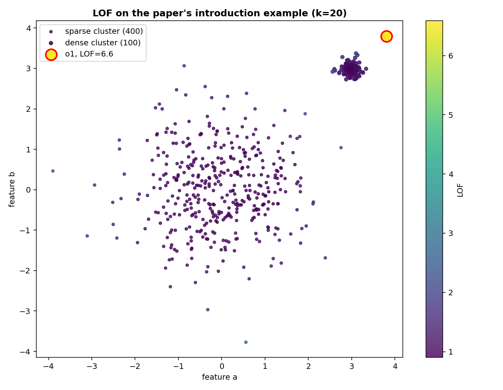
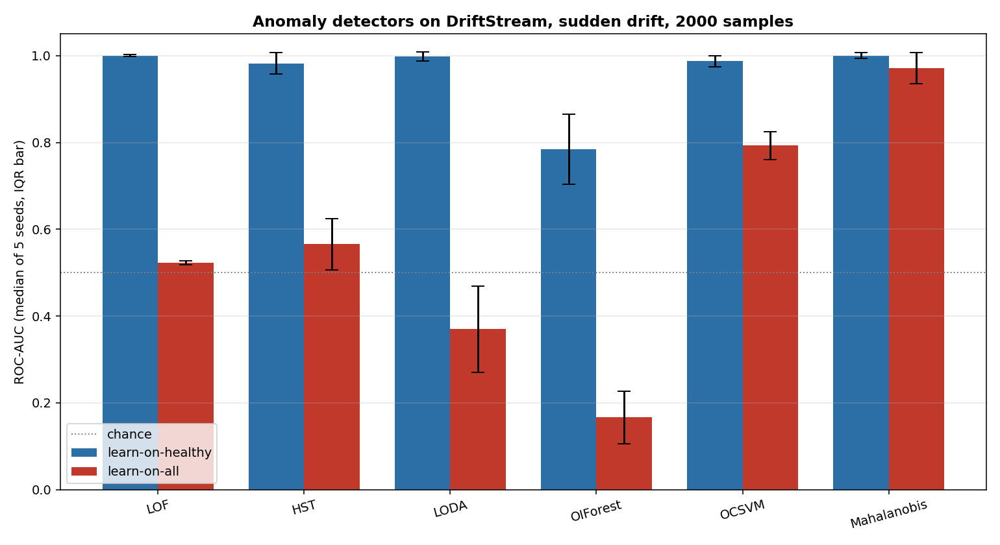
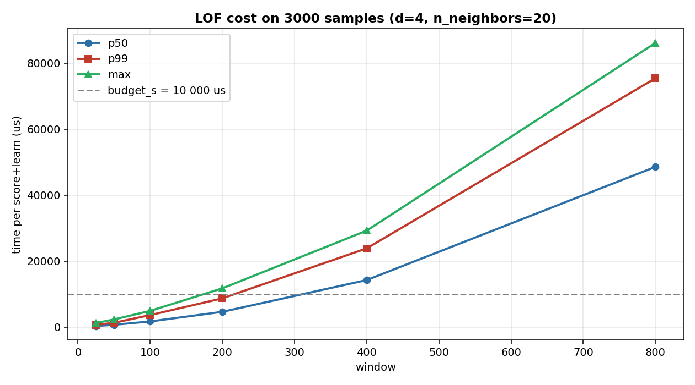

# Local Outlier Factor (LOF)

**In plain words:** Local Outlier Factor gives each reading a score of how isolated it is from the readings around it. A reading surrounded by similar readings scores about 1; a reading far from its neighbours scores higher. It is *local*: the comparison is against the readings that happen to be near it, not against the whole dataset, so a strange reading next to a dense cluster is caught even when its distance to the cluster is small.

Imagine following the residual of a robot joint as the arm moves. Most of the time the residual stays in a small cloud near zero, the region the arm visits on every cycle. Occasionally it drifts into a corner of the space the arm reaches only rarely. A point in that corner is not necessarily a fault, because the arm passes through it normally every few cycles. It is a fault only when it is more isolated than the points that are normally around it. LOF measures exactly that.

## 1. What it is

The recent samples of a joint residual form a cloud of points in the joint space. Some regions of that cloud are dense, where the arm spends most of its time, and some are sparse, the corners the arm visits every few seconds. The question LOF answers is whether a new sample sits in a region less dense than the region of its nearest neighbours.

The score is a ratio. In the numerator is the average local density of the `n_neighbors` nearest window samples; in the denominator is the local density of the query point itself. Density here is the inverse of the average distance to the closest neighbours. A point in a sparse region whose neighbours sit in a dense one has a low density and a high neighbour density, so the ratio rises; a point among neighbours of similar density has ratio close to 1.

The reference set changes as the stream goes on. The detector keeps the `window` most recent samples and drops the oldest when the window is full, so `learn_one(x)` appends and `score_one(x)` computes the LOF of x against what is currently in the window.

The formal definitions are the five of Breunig, Kriegel, Ng and Sander (2000), Section 4. They come in a chain. Definition 3 fixes the k-distance of a point `p`, the distance to its k-th nearest neighbour, and Definition 4 turns that into a neighborhood: every point within the k-distance of `p`. Definition 5, the reachability distance, is the plain distance between `p` and a neighbour `o`, floored at the k-distance of `o` itself; the floor is what keeps a point inside a very dense cluster from sending the local density to infinity. Definition 6 sums these floored distances over the neighborhood and divides the count by the sum: that is the local reachability density of `p`. Definition 7 closes the chain, and the LOF of `p` is the mean ratio between the local densities of its neighbours and the local density of `p` itself. In symbols:

    k-distance(p)      distance to the k-th nearest neighbour of p
    N_k(p)             { q : d(p, q) <= k-distance(p) }
    reach-dist_k(p,o)  max{ k-distance(o), d(p, o) }
    lrd_k(p)           1 / mean_{o in N_k(p)} reach-dist_k(p, o)
    LOF_k(p)           mean_{o in N_k(p)} lrd_k(o) / lrd_k(p)

## 2. How it works

Every call to `score_one` recomputes everything from scratch. The window is turned into a distance matrix, the k-distance of each window point is read from its sorted row, the local density of each is computed from the reachability distances, and the same is done for the query point. The LOF is the mean ratio of the neighbours' densities to the query's density. No gradient, no running average, no state beyond the window: the algorithm is a fresh k-NN search on every call.

The cost is `O(window^2 * d)` for the distance matrix plus `O(window * n_neighbors * d)` for the two densities. `learn_one` is constant time, an append to a bounded deque. A bigger window buys more stable densities, at a quadratic cost per call.

The paper's Section 4 notes a corner case that matters here. If the sum of the reachability distances is zero, which happens when a sample is duplicated at least `n_neighbors + 1` times, the local density is infinite and Definition 7 has no value. The paper assumes there are no duplicates and moves on. This class adds a term 1e-10 to the mean reachability distance, as a general-purpose machine-learning library does, so the density is at most 1e10 and every score is finite: a point inside a window of identical samples scores 1.0, a far point scores of the order of 1e10 times its distance. The class returns 1.0 when the window has fewer than `n_neighbors + 1` samples, because the neighborhood is not defined, and 0.0 on a malformed or non-finite input, like the other detectors. All of this is in the class docstring.

## 3. Smallest example

```python
import numpy as np
from dense_armor.utility.anomaly.lof import LocalOutlierFactor

rng = np.random.default_rng(0)
det = LocalOutlierFactor(feature_keys=["a", "b"], n_neighbors=20, window=200)

for _ in range(500):
    x = rng.standard_normal(2)
    det.learn_one({"a": float(x[0]), "b": float(x[1])})

print(f"healthy  {det.score_one({'a': 0.0, 'b': 0.0}):.3f}")
print(f"far      {det.score_one({'a': 5.0, 'b': 5.0}):.3f}")
```

```
healthy  0.973
far      6.565
```

The healthy point sits in the middle of the standard Gaussian that has filled the window. Its distance to the 20 nearest window samples is about the same as their own distances, so its LOF stays close to 1. The far point is five standard deviations from the center along both axes: its local density is much lower than the density of the neighbours around it, and the score rises above the default threshold of 1.5.

## 4. On a real arm

The residual of joints 0-3 on a `SyntheticArm` payload fault. The fault, 5 kg added at `t = 2 s`, shifts the residual on joints 0-3 by tens of N-m; during the healthy phase the residual stays within 0.15 N-m. Two hundred samples at 50 Hz, `n_cycles=2`, `n_neighbors=20`, `window=100`.

```python
from pathlib import Path
from dense_armor.utility.anomaly.lof import LocalOutlierFactor
from dense_armor.utility.datasets import SyntheticArm

ds = SyntheticArm(
    Path("test/fixtures/urdf/panda.urdf"),
    period_s=2.0, rate_hz=50.0, n_cycles=2,
    fault_at_s=2.0, fault="payload", payload_mass=5.0,
    noise_std=(1e-3, 5e-3, 5e-2), seed=0,
)

det = LocalOutlierFactor(
    feature_keys=["r0", "r1", "r2", "r3"],
    n_neighbors=20, window=100, threshold=1.5,
)

for sig, _ in ds.stream():
    q, qd, qdd = ds.trajectory(sig.t)
    tau_nom = ds.nominal_torque(q, qd, qdd)
    x = {f"r{j}": float(sig[f"tau_{j}"] - tau_nom[j]) for j in range(4)}
    _ = det.score_one(x)
    _ = det.learn_one(x)
```



The window fills with the healthy residuals during the first two seconds, and the LOF of a healthy sample stays close to 1. At `t = 2 s` the payload appears, the score jumps above the threshold and stays high for several samples, then it falls back toward 1 as the window starts to fill with the post-fault residuals and the local density around the fault stops being anomalous. The detector is meant to be trained on the healthy phase and used afterwards, so the short high score at the start of the fault is the signal.

On the benchmark of `benchmarks/anomaly_streaming.py`, the same detector reaches:

| stream   | protocol          | ROC-AUC | FA@thr | ms/sample |
|----------|-------------------|---------|--------|-----------|
| arm      | learn-on-healthy  | 1.000   | 0.000  | 1.675     |
| arm      | learn-on-all      | 0.778   | 0.000  | 0.855     |
| drift    | learn-on-healthy  | 0.997   | 0.007  | 2.277     |
| drift    | learn-on-all      | 0.519   | 0.007  | 1.153     |

The `learn-on-all` protocol is the one the paper describes, learn from every sample, and here it is worse. On both streams half of the samples are anomalies, so the sliding window ends up full of them; once half the window is fault, a new fault looks normal against it, and the score drops. The detector is built for the `learn-on-healthy` deployment, and the numbers above show why.

## 5. The paper's introduction example

The two-dimensional example of the paper's Section 3 has a dense cluster `C2` of 100 points, a sparse cluster `C1` of 400 points, and one point `o1` just outside `C2`. LOF must label `o1` as outlying and every point of the two clusters as inlier, even though the distance from `o1` to its own cluster is small.



Points colored by their LOF value. The near point, marked with a red border, scores `6.586`. The maximum LOF on the sparse cluster is `2.734`, on the dense cluster `2.238`. The score of the near point is more than twice the highest score inside either cluster, so the outlier is detected as *local*: the detector does not look for the farthest point in the space, it looks for the point whose neighborhood is emptier than its own neighbours'.

## 6. Comparison with the other detectors

On the same `DriftStream` sudden drift, median of five seeds, every detector at its default parameters, the library's six anomaly detectors line up like this:



| detector       | protocol          | AUC med | IQR   | us/sample |
|----------------|-------------------|---------|-------|-----------|
| LOF            | learn-on-healthy  | 1.000   | 0.003 | 1.1       |
| LOF            | learn-on-all      | 0.523   | 0.004 | 1.1       |
| HalfSpaceTrees | learn-on-healthy  | 0.983   | 0.016 | 0.1       |
| LODA           | learn-on-healthy  | 1.000   | 0.011 | 0.2       |
| OCSVM (SONAR)  | learn-on-healthy  | 0.989   | 0.010 | 0.0       |
| OIForest       | learn-on-healthy  | 0.842   | 0.135 | 0.1       |
| Mahalanobis    | learn-on-healthy  | 1.000   | 0.007 | 0.0       |
| Mahalanobis    | learn-on-all      | 0.971   | 0.036 | 0.0       |

On `learn-on-healthy`, LOF, LODA and Mahalanobis all reach AUC 1.000, and LOF is the slowest of the three, 1.1 us per sample against 0.2 for LODA and 0.0 for Mahalanobis, because the exact k-NN search over the window is heavier than the projection-based or matrix-based methods. On `learn-on-all`, Mahalanobis stays at 0.971 because its state is the whole history, while LOF drops to 0.523 because its window is a sliding one. This is the shape of the two protocols at work, not a defect of LOF.

## 7. Numbers

`SyntheticArm` (200 samples, 100 healthy, 100 fault) and `DriftStream` (2000 samples, one sudden drift at half), every detector built with its defaults.

| Stream | Protocol | ROC-AUC | False alarms on the healthy part | Threshold |
|---|---|---|---|---|
| SyntheticArm | learn-on-healthy | 1.000 | 0.000 | 1.5000 |
| SyntheticArm | learn-on-all | 0.778 | 0.000 | 1.5000 |
| DriftStream | learn-on-healthy | 0.997 | 0.007 | 1.5000 |
| DriftStream | learn-on-all | 0.519 | 0.007 | 1.5000 |

In the protection test of `test/protect/test_protected_anomaly_stream.py` the detector is wrapped in an `AnomalyGate` inside a `Protected`, next to a bare `RecursiveLeastSquares` model, on the same arm residuals. LOF flags `100` of the `100` fault samples and the protected model keeps the offset of the healthy phase: `err_prot = 0.0015` against `err_bare = 3.2886` for the model that keeps learning through the fault.

## Details

### Where the rules come from

Breunig, M. M., Kriegel, H.-P., Ng, R. T., Sander, J. (2000). *LOF: Identifying Density-Based Local Outliers.* In Proceedings of the 2000 ACM SIGMOD International Conference on Management of Data, pages 93-104. Section 4 (pages 3-4 of the PDF) holds the five definitions: k-distance (Definition 3), k-distance neighborhood (Definition 4), reachability distance (Definition 5), local reachability density (Definition 6), local outlier factor (Definition 7). Section 5 proves the two properties used in the description: for objects deep inside a cluster the LOF is close to 1 (Lemma 1), and the general bounds on LOF are Theorem 1.

### Choices stated explicitly

- **Exact k-NN search.** Every score recomputes the pairwise distances of the whole window. The incremental insertion and deletion of Pokrajac, Lazarevic and Latecki (CIDM 2007) is not implemented: the paper is not in this folder, and the asymptotic cost documented here (`O(window^2 * d)`) is what the code actually does. A caller who needs a larger window can raise `budget_s`, at the cost of a per-sample time that grows with `window` squared.
- **Duplicate convention.** The paper states that the local reachability density can be infinite when the reachability distances in the summation are zero, and assumes there are no duplicates. This implementation adds 1e-10 to the mean reachability distance (the same convention as a general-purpose machine-learning library), so the density is capped at 1e10 and no score is infinite or silently 1.0.
- **Sliding window, not the whole history.** The paper's LOF is defined over a static dataset `D`. In a stream the dataset grows without bound, so the reference set is a sliding window of the `window` most recent samples. This is a choice of the streaming implementation, not part of the paper.
- **Threshold.** A fixed float, default 1.5. The paper does not prescribe one; the value is a rule of thumb for flagging, and the caller calibrates it on their data.
- **Feature keys.** `feature_keys=None` takes the sorted keys of the first dict seen, the convention of the other detectors of the library.

### Measured cost

At the benchmark defaults (`n_neighbors=20`, 4 features), on one CPU thread, 3000 samples, p50 / p99 / max of one `score_one` plus one `learn_one`:

| window | p50 | p99 | max |
|---|---|---|---|
| 100 | 1 120 us | 2 130 us | 3 747 us |
| 200 | 3 768 us | 6 570 us | 8 160 us |
| 300 | 7 540 us | 12 466 us | 15 041 us |



The declared `budget_s` is `0.01 s` (10 000 us). It holds at window up to about 200; at `window=300` the p99 exceeds the budget. The class docstring states the three measured values, so a caller who needs a bigger window knows they are over the declared budget.

Memory: the state is a deque of `window` vectors of `d` floats. Constant in the stream length, linear in `window` and in `d`. Declared `memory_class = "O(window)"`.

### Development diary

The task asked for the incremental update of Pokrajac, Lazarevic and Latecki (CIDM 2007). The paper is not in this folder, and writing it from memory was against the rule. The exact search is the safe choice and the only one whose cost can be documented from a real run. When the paper is uploaded, the incremental version can be added as a separate class, the exact one kept as the reference.

The duplicate case is the paper's own open point: LOF on a stream of identical samples does not have a defined score. The class uses the 1e-10 term and states it in the docstring; the alternative, k-distinct-distance, in the paper's parenthetical note, is not implemented. The scores agree with a reference implementation to within 1e-8 on three window/k/d settings (test `test_matches_scikit_learn`).

[One-Class SGD (SONAR)](ocsvm.md) is the alternative when the fault is a change of the distribution's shape rather than a locally isolated point.
