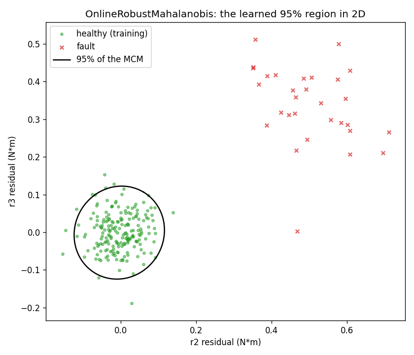
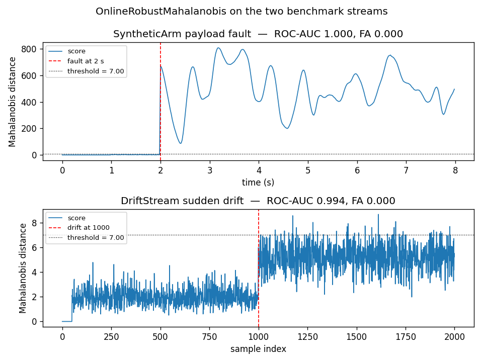

# Online Robust Mahalanobis

**How far is today from usual — in units the market actually uses.**

A single strange day should not ruin what the detector has learned. Online Robust Mahalanobis learns where the normal days sit and how they move together, then reports how far a new day is from that centre, measured in the usual spread. A distance of `0` means exactly usual; the default alarm is `7`. A few strange days do not spoil the estimate.

---

## The problem

A detector fitted with the sample mean and covariance can be spoiled by the very outliers it is meant to catch. A single extreme sample drags the mean away from the cloud and inflates the covariance along its own direction — so the outlier ends up looking *normal* under the new metric. This is the **masking effect**, and it is the reason classical Mahalanobis distance is dangerous on a live market stream.

Online Robust Mahalanobis fixes this with two `50 %`-breakdown estimators: the **geometric median** for location and the **median covariation matrix (MCM)** for scatter. Half the samples must be corrupted before the estimate moves. One bad day moves the median by at most one step of length `gamma_n`.

---

## One example: a crash among normal days

Each day has two numbers: the return in percent and the log volume. The detector learns `500` normal days (returns around `0.05 %` with a spread of `0.8 %`), then scores `100` new normal days and `100` days of a crash (returns around `-3 %`, volume up).

```python
import numpy as np
from dense_armor.utility.online.anomaly.mahalanobis import OnlineRobustMahalanobis

rng = np.random.default_rng(0)

def day(crash):
    if crash:
        return {"ret": float(rng.normal(-3.0, 1.5)), "vol": float(rng.normal(1.5, 0.3))}
    return {"ret": float(rng.normal(0.05, 0.8)), "vol": float(rng.normal(0.0, 0.3))}

det = OnlineRobustMahalanobis(feature_keys=["ret", "vol"], n_init=200)
for _ in range(500):
    det.learn_one(day(False))

ok = np.median([det.score_one(day(False)) for _ in range(100)])
cr = np.median([det.score_one(day(True)) for _ in range(100)])
print(f"normal days  {ok:.3f}")
print(f"crash days   {cr:.3f}")
```

```
normal days  1.325
crash days   7.038
```

The median crash day lands **right at the default threshold of `7.0`**. This crash is a mild one in volume, so half of its days are not flagged: a limit of the default threshold on this stream, not a feature. The distance still rises **more than five times** over the normal days.

In this example: `1.3` on a normal day, `7.0` on a crash day. The threshold is not universal: calibrate it on your own normal days.

---

## What the detector actually learns

The Mahalanobis distance is a scalar, but the metric behind it is an ellipsoid in the feature space. The ellipsoid *is* the model: inside it, the day is usual; outside it, the day is flagged.



Two joints' residuals of the robot case study below: first `200` healthy samples (green dots), then `30` fault samples (red crosses). The black ellipse is the `95 %` quantile of the current MCM; the fault samples all fall outside.

---

## How it works

Two running estimates, updated one sample at a time by **averaged stochastic gradient (ASGD)**:

- **`m`** — the geometric median. Each step has the same length `gamma_n`, so a distant sample moves `m` by at most `gamma_n`, no matter how far it is. That normalisation *is* the robustness.
- **`V`** — the MCM. The centred outer product of each new sample is folded in with a unit-Frobenius-norm step, and the iterates are averaged to accelerate convergence (Cardot, Cénac and Zitt 2013; Cardot and Godichon-Baggioni 2017).

The score of a sample is the Mahalanobis distance under the current `V_bar`, computed from the eigendecomposition rather than by inverting the matrix:

```
D(x) = sqrt( sum_j (1 / delta_j) * <x - m_bar, P_j>^2 )
```

The first `n_init` samples are used for an offline initialisation (Weiszfeld for the median, average of centred outer products for the MCM) — without it the unit-normalised ASGD steps would start from the identity matrix and never reach the scale of the data.

---

## Why the score stays bounded

The literal Section 3.2 update of Guillot et al. (2025, page 7), run without safeguards, **crosses the zero matrix** on the SyntheticArm payload fault: with `c_gamma = 1.0` the final `trace(V_bar)` is `-2.88e-04`, `19` of `80` steps have a non-positive eigenvalue, and the maximum score reaches `11.36` on *healthy* samples. The cause is the scale of the normalised step (`~0.04` in Frobenius norm) against the scale of `V` (`~2.6e-03`): the average oscillates through the origin and `1 / delta` blows up.

Two numerical guards keep the score bounded **without changing the algorithm**:

- **`max_step_frac = 0.1`** — a single large sample cannot move `V` by more than a fraction of its own norm.
- **Eigenvalue floor** at `trace(V_bar) / d * 1e-3` — keeps the metric well-defined while the ASGD is still converging.

With the guards, on the same `80` samples, the maximum score stays below the threshold (see `test_mahalanobis_healthy_scores_stay_below_threshold`).

---

## What it is not

Two steps of the full paper are **not** implemented:

- the Robbins–Monro reconstruction of the true covariance eigenvalues from the MCM (Section 2.3, eqs. 4–5);
- the `chi2_d(0.5) / med(D_1..n)` scaling of the distances (eq. 1).

Neither is needed for flagging: the MCM metric with a calibrated `threshold` is already usable, and the `7.0` default is the classical value for low-dimensional Gaussians. The threshold is the one **you** calibrate.

---

## Parameters

`OnlineRobustMahalanobis(...)`, in `dense_armor.utility.online.anomaly.mahalanobis`. `learn_one(x)` takes a dict with one key per channel; `score_one(x)` returns the distance as a float, `0.0` until the offline initialisation is done.

| Parameter | Default | Meaning |
|---|---|---|
| `feature_keys` | `None` | the dict keys, one per channel; `None` takes the sorted keys of the first dict |
| `n_init` | `100` | samples accumulated before the offline initialisation; at least `d + 1` for `d` channels |
| `threshold` | `7.0` | the alarm level on the distance |
| `c_gamma` | `1.0` | numerator of the step size `gamma_n = c_gamma * (n + n0) ** (-gamma_exp)` |
| `gamma_exp` | `0.7` | exponent of the step size, in `(1/2, 1)` |
| `n0` | `0` | warm-up offset in the step size |
| `max_step_frac` | `0.1` | cap on the step length, as a fraction of the norm of `V` and `m`; a numerical safeguard, not part of the paper |
| `eps` | `1e-9` | numerical guard for divisions and degenerate eigenvalues |

---

## Cost

At the benchmark defaults (`n_init=100`, 4 features), on one CPU thread:

- **`0.036 ms`** per sample for `learn_one` + `score_one`, measured on the arm stream;
- **memory flat**: `d + d^2` arrays, independent of stream length;
- declared `budget_s = 0.005`.

---

## Where it comes from

Guillot, Godichon-Baggioni, Robin and Sansonnet (2025), *Streaming robust covariance estimation and sequential outlier detection*, arXiv:2601.03957. Section and equation numbers on this page are those of arXiv v1 (7 January 2026), whose title is *Online robust covariance matrix estimation and outlier detection*. Geometric median recurrence: eq. 8. MCM recurrence: eq. 10. Mahalanobis distance under the MCM: eq. 1, Section 2.2. Step size `gamma_n = c * n ** -gamma` with `gamma` in `(1/2, 1)`: Cardot, Cénac and Zitt (2013); Cardot and Godichon-Baggioni (2017).

## Appendix — technical notes

The sections below are for implementers and auditors: the robot case study, the measured numbers and the development notes.

## On a robot: the SyntheticArm payload fault

The residual of joints 1-4 on a `SyntheticArm` payload fault. The fault (5 kg added at
t = 2 s) shifts the residual on joints 1-5 by tens of N·m; the healthy run stays within
±0.15 N·m.

```python
from pathlib import Path
from dense_armor.utility.online.anomaly.mahalanobis import (
    OnlineRobustMahalanobis,
)
from dense_armor.utility.signals.datasets import SyntheticArm

ds = SyntheticArm(
    Path("test/fixtures/urdf/panda.urdf"),
    period_s=2.0, rate_hz=50.0, n_cycles=4,
    fault_at_s=2.0, fault="payload", payload_mass=5.0,
    noise_std=(1e-3, 5e-3, 5e-2), seed=0,
)

det = OnlineRobustMahalanobis(
    feature_keys=["r0", "r1", "r2", "r3"],
    threshold=7.0,
)

for sig, _ in ds.stream():
    q, qd, qdd = ds.trajectory(sig.t)
    tau_nom = ds.nominal_torque(q, qd, qdd)
    x = {f"r{j}": float(sig[f"tau_{j}"] - tau_nom[j]) for j in range(4)}
    _ = det.score_one(x)
    _ = det.learn_one(x)
```



Top: SyntheticArm. The fault sends the score past 100 in the first few samples after
t = 2 s, then the score drops as the ASGD updates the location and the scatter estimate
towards the new distribution — but the detector has already flagged every post-fault
sample until the update catches up. Bottom: `DriftStream`. The score rises cleanly at the
drift and stays above the threshold.

## The learned 95 % region on the robot case

The ellipse learned on the residuals of two joints is the one drawn in [What the detector actually learns](#what-the-detector-actually-learns): a new sample inside it has a Mahalanobis distance below `chi2_2(0.95)`, outside it the sample is flagged. On the fault of this case the fault samples all fall outside.

## Numbers

`SyntheticArm` (200 samples, 100 healthy, 100 fault) and `DriftStream` (2000 samples, one
sudden drift at half), every detector built with its defaults.

| Stream | Protocol | ROC-AUC | False alarms on the healthy part | Threshold at the last healthy sample |
|---|---|---|---|---|
| SyntheticArm | learn-on-healthy | 1.000 | 0.000 | 7.0000 |
| SyntheticArm | learn-on-all | 1.000 | 0.000 | 7.0000 |
| DriftStream | learn-on-healthy | 0.993 | 0.000 | 7.0000 |
| DriftStream | learn-on-all | 0.938 | 0.000 | 7.0000 |

The default `n_init` is `100`, and on `SyntheticArm` the healthy part has exactly `100`
samples: in the benchmark run the detector is still in its initialisation when the healthy
part ends, so every healthy score is `0.0` and the false-alarm value `0.000` on
`SyntheticArm` follows from that, not from a decision of the detector. On these two streams, with the defaults, the ROC-AUC is `1.000` and `0.993`, at
`0.036 ms` per sample on the arm.

## Details

### Where the rules come from

Guillot, Godichon-Baggioni, Robin and Sansonnet (arXiv:2601.03957) introduce the online median and MCM in
Section 3. The recurrence for the geometric median is equation 8, for the MCM equation 10.
The Mahalanobis distance under the MCM is Equation (1) in Section 2.2. The step size
`gamma_n = c * n ** -gamma` with `gamma` in `(1/2, 1)` is from Cardot, Cénac and Zitt
(2013) and Cardot and Godichon-Baggioni (2017).

The paper's full method also reconstructs the eigenvalues of the true covariance from the
MCM by a Robbins-Monro scheme (equations 4-5) and scales the distances by
`chi2_d(0.5) / med(D_1..n)` (equation 1). Neither step is implemented here.

### Choices stated explicitly

- **Offline initialisation.** The geometric median is initialised by the Weiszfeld
  algorithm (Guillot et al., equation 6). The MCM is initialised by the empirical
  average of the centred outer products, not the Weiszfeld offline MCM of Section A.2:
  with `n_init` of tens of samples the average is more stable than the Weiszfeld iteration,
  which for small samples can converge to a rank-one solution. The online ASGD refines the
  estimate as soon as new samples arrive.
- **Step length cap.** A `max_step_frac` cap on the ASGD step (default 0.1) prevents a
  single large sample from moving `V` by more than a fraction of its own norm. Without the
  cap, `c_gamma = 1` and `gamma_exp = 0.7` can move `V` by 1 in Frobenius norm in one
  step, much larger than the scale of the data, and the average oscillates through zero.
  This is a numerical safeguard, not part of the paper.
- **Eigenvalue floor.** Every eigenvalue of `V_bar` is floored at `trace(V_bar) / d * 1e-3`.
  The floor keeps the score bounded when the ASGD first steps drive `V` through zero,
  without changing the shape of the metric. Also a numerical safeguard.
- **No chi-squared scaling.** The paper's equation 1 divides the distances by the median of
  the past distances, so that the calibrated threshold is the median of a `chi2_d`
  distribution. This module does not apply the scaling: the threshold is the one the user
  calibrates, and the default `7.0` is the classical value for low-dimensional Gaussians.
- **Step index.** Guillot et al. use `gamma_n = c_gamma (n + n0)^(-gamma)` with `n` counted
  from the first sample (`0.0395 c_gamma` for the first update after `n_init = 100` with
  `gamma = 0.7`). Here `n` also counts from the first sample (`n = n_init + k` at the `k`-th
  update) and the offset is one larger, `gamma_n = c_gamma (n + n0 + 1)^(-gamma)`: the first
  update after `n_init = 100` uses `0.0393 c_gamma`. The averaged estimates use the weight
  `1 / (n + 1)` with the same `n`, which is the paper's `1 / (n + 2)` for the previous step
  index. The offset of one in `gamma_n` is a choice of this implementation.
- **Threshold.** A fixed float, default `7.0`.

### Measured cost

At the benchmark defaults (`n_init=100`, 4 features), on one CPU thread:

- `0.036 ms` per sample for `learn_one` + `score_one` on the arm stream;
- memory flat: `d + d^2` arrays, independent of the stream length.

The `budget_s` declared by the class is `0.005 s`.

### The bug the module fixes

The literal Section 3.2 update of Guillot et al. (page 7) without the step cap and
without the eigenvalue floor was reimplemented outside the library and run on the 80
healthy residuals that follow `n_init = 20`, on the issue scenario (joint 1 of the
`SyntheticArm` payload fault, `period_s=2.0`, `rate_hz=50.0`, `n_cycles=2`,
`payload_mass=5.0`, seed 0).

With `c_gamma = 1.0` the running average `V_bar` crosses the zero matrix: the final
`trace(V_bar)` is `-2.88e-04`. Scoring each sample before the update, 19 of the 80 steps
have a non-positive eigenvalue and the maximum score is `11.36`; scoring after the
update, 20 steps and a maximum of `5.96`. The cause is the scale of the normalised step
against the scale of `V`: the step has Frobenius norm ~`0.04`, while `V` itself is of
order `2.6e-03`, so `V_bar` moves through the origin and `1 / delta` diverges. With
`c_gamma` equal to the variance of the residual (`2.57e-03`): 0 steps, `trace(V_bar) =
+1.37e-03`, maximum `3.70`.

The two guards are `max_step_frac = 0.1` and the eigenvalue floor `trace(V_bar) / d *
1e-3`. On the same 80 samples with the guards the maximum stays below the threshold. The
reproduction is the module's test `test_mahalanobis_healthy_scores_stay_below_threshold`,
which uses the 100 healthy residuals of the issue scenario with `n_init = 20` and asserts
the maximum is `3.739 < 7` (80 of the 100 scores non-zero).

[OCSVM](ocsvm.md) is the alternative when the fault is not a shift but a change of the
distribution's shape.

---

*Appendix — the robotics case study (`SyntheticArm`, payload fault on joints 1–4), the measured benchmark numbers and the development notes are in the sections above, from "On a robot" to "Details". [OCSVM](ocsvm.md) is the alternative when the fault is not a shift but a change of the distribution's shape.*