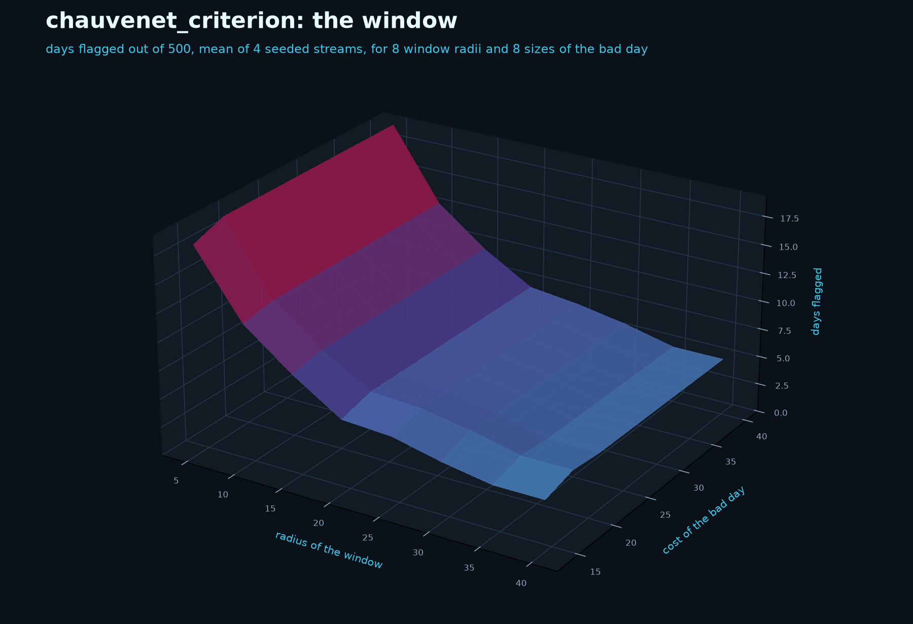
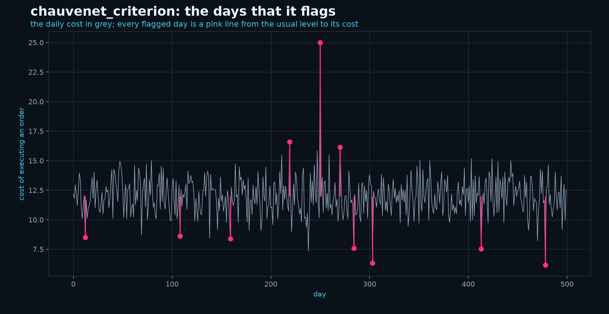

# chauvenet_criterion

[← Robust filters](index.md)

`chauvenet_criterion` is one of the other three classic rules, with the same `(clean, idx)` return as [hampel_filter](hampel_filter.md). Chauvenet rejects when the expected number of samples that far out, $N \cdot P$, is below 0.5.



The surface shows how many days the function flags out of 500 on the stream of the example, for 8 window radii and 8 costs of the bad day. The height is the number of days flagged.

## A first example: daily order execution cost

The stream is the one of the [first example of the section](index.md#a-first-example-daily-order-execution-cost): 500 days of the cost of executing an order, and one bad day, day 250, at 25.0.

```python
import numpy as np
from dense_armor.core.online.anomaly.robust_filters import chauvenet_criterion

rng = np.random.default_rng(0)
cost = 12.0 + 1.5 * rng.standard_normal(500)
cost[250] = 25.0
clean, idx = chauvenet_criterion(cost, radius=15)
print(250 in idx, round(float(clean[250]), 2), len(idx))
```

```
True 11.48 10
```

The function flags day 250 and replaces it with the local median, 11.48. It also flags 9 ordinary days, 10 positions in all.



The pink lines are the 10 days that the function flags.

## The same on a robot

```python
import numpy as np
from dense_armor.core.online.anomaly.robust_filters import chauvenet_criterion

rng = np.random.default_rng(42)
v = 0.5 + 0.1 * rng.standard_normal(3000)
v[1500] = 2.5
clean, idx = chauvenet_criterion(v, radius=15)
print(1500 in idx, len(idx))
```

```
True 48
```

It catches the collision and also flags 47 ordinary samples.

## How it works

It returns `(clean, idx)`, as explained on the page of [Robust filters](index.md).

For point $i$, with the window as the sample (mean $\mu$, standard deviation $\sigma$, size $N$), $d = |x_i - \mu| / \sigma$ and $P = \mathrm{erfc}(d / \sqrt 2)$. If $N \cdot P < 0.5$ the point is rejected. It uses the mean and the standard deviation, not robust ones, as in the original formulation: on a window with more than one outlier they are already distorted before point $i$ is judged. For such windows [hampel_filter](hampel_filter.md) or [tukey_fences](tukey_fences.md), which use robust statistics, are the better choice.

## The parameters

`chauvenet_criterion(x, radius=10)`

| Parameter | Default | What it does |
|---|---|---|
| `x` | required | the whole series, a one-dimensional array |
| `radius` | 10 | half-width of the window, which is centred on each sample: `radius = 15` is a window of 31 samples |

## API reference

::: dense_armor.core.online.anomaly.robust_filters.chauvenet_criterion

## Details

- **Sources.** Chauvenet, W. (1863), *A Manual of Spherical and Practical Astronomy*, vol. 2.
