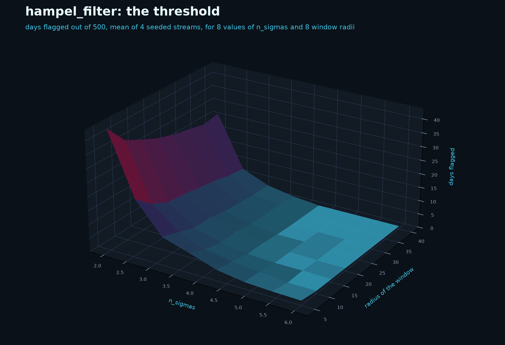
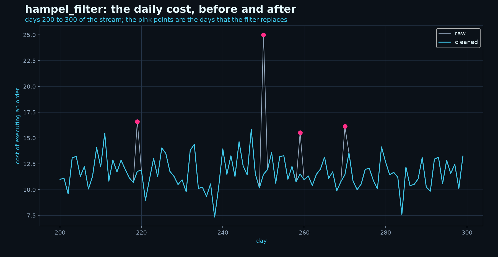

# hampel_filter

[← Robust filters](index.md)

The batch Hampel filter uses a window centred on each point (it sees the future) and replaces
outliers with the window median. Each one takes the whole series and returns the series with the flagged samples replaced by a local estimate, and the list of positions it flagged.



The surface shows how many days the filter flags out of 500 on the stream of the example, for 8 values of `n_sigmas` and 8 window radii. The height is the number of days flagged.

## A first example: daily order execution cost

The stream is the one of the [first example of the section](index.md#a-first-example-daily-order-execution-cost): 500 days of the cost of executing an order, and one bad day, day 250, at 25.0.

```python
import numpy as np
from dense_armor.core.online.anomaly.robust_filters import hampel_filter

rng = np.random.default_rng(0)
cost = 12.0 + 1.5 * rng.standard_normal(500)
cost[250] = 25.0
clean, idx = hampel_filter(cost, radius=15, n_sigmas=3.0)
print(250 in idx, round(float(clean[250]), 2), len(idx))
```

```
True 11.48 8
```

The filter flags day 250 and replaces it with the local median, 11.48. It also flags 7 ordinary days, 8 positions in all: with a window of 31 days and a threshold of 3 in the Hampel rule, some noise values fall beyond it.



The filter leaves the days it does not flag as they are and swaps the flagged days for the median of their window.

## The same on a robot

```python
import numpy as np
from dense_armor.core.online.anomaly.robust_filters import hampel_filter

rng = np.random.default_rng(42)
v = 0.5 + 0.1 * rng.standard_normal(3000)
v[1500] = 2.5
clean, idx = hampel_filter(v, radius=15, n_sigmas=3.0)
print(1500 in idx, round(float(clean[1500]), 3), len(idx))
```

```
True 0.498 35
```

The stream is a joint velocity at 100 Hz: a level of 0.5, Gaussian noise with standard
deviation 0.1, and one collision at sample 1500 that drives the reading to 2.5.

The Hampel filter flags the collision and replaces it with the local median, 0.498. It also
flags 34 ordinary samples: with a 31-point window and a threshold of 3 in the Hampel rule,
some noise values fall beyond it. The total is 35 flagged positions.

## How it works

It returns `(clean, idx)`, as explained on the page of [Robust filters](index.md).

The rule is `|x_k - m_k| > t * S_k`, where `m_k` is the median of the window centred on
sample `k`, `S_k = 1.4826 * MAD` is the robust estimate of the standard deviation of that
window, and `t` is the threshold (Pearson et al., 2016, eqs. 3 and 4; step by step on
[streamDD](../streaming/streaming_deviation_detector.md)).

## The parameters

`hampel_filter(x, radius=10, n_sigmas=3.0)`

| Parameter | Default | What it does |
|---|---|---|
| `x` | required | the whole series, a one-dimensional array |
| `radius` | 10 | half-width of the window, which is centred on each sample: `radius = 15` is a window of 31 samples |
| `n_sigmas` | 3.0 | the threshold `t` of the rule |

## API reference

::: dense_armor.core.online.anomaly.robust_filters.hampel_filter

## Details

- **Sources.** Pearson, R. K. et al. (2016), "Generalized Hampel filters", *EURASIP J. Adv. Signal Process.*, eqs. 3–4.
