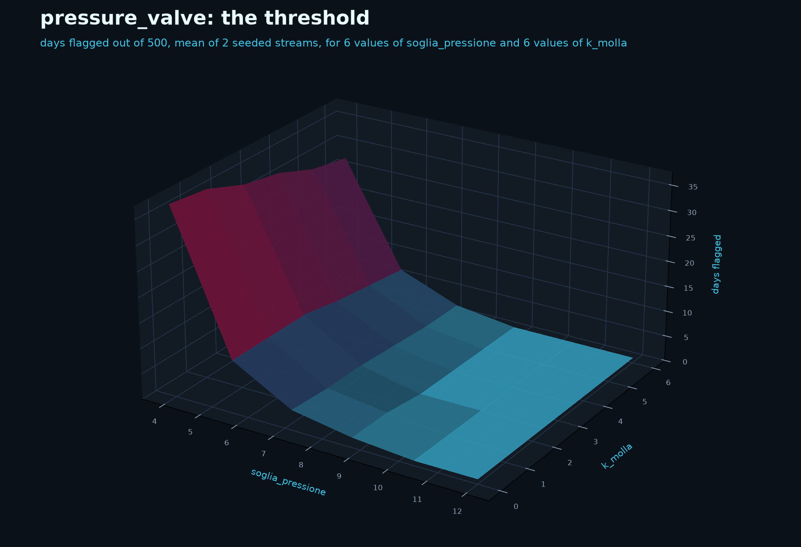
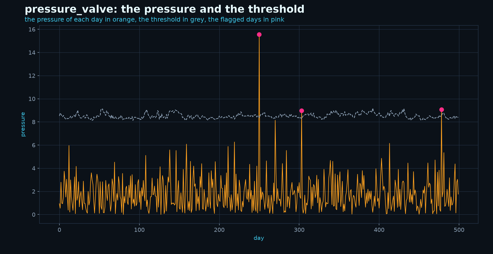

# pressure_valve

[← Robust filters](index.md)

`pressure_valve` settles the disagreement: it runs all four, weighs them by how confident each
one is, and returns one cleaned series, one list of flagged positions, and one pressure score
per sample.



The surface shows how many days the function flags out of 500 on the stream of the example, for 6 values of `soglia_pressione`, the base threshold, and 6 values of `k_molla`. The height is the number of days flagged.

## A first example: daily order execution cost

The stream is the one of the [first example of the section](index.md#a-first-example-daily-order-execution-cost): 500 days of the cost of executing an order, and one bad day, day 250, at 25.0.

```python
import numpy as np
from dense_armor.core.online.anomaly.robust_filters import pressure_valve

rng = np.random.default_rng(0)
cost = 12.0 + 1.5 * rng.standard_normal(500)
cost[250] = 25.0
clean, idx, p, thr = pressure_valve(cost, radius=15)
print(idx, round(float(p[250]), 1), round(float(np.median(thr)), 2))
```

```
[250, 303, 478] 15.6 8.48
```

The function flags three days: day 250, the bad one, with a pressure of 15.6, and two ordinary days, 303 and 478. The median of the threshold over the 500 days is 8.48.



The orange line is the pressure of each day, the dashed grey line is the threshold and the pink points are the three flagged days.

## The same on a robot

```python
import numpy as np
from dense_armor.core.online.anomaly.robust_filters import pressure_valve

rng = np.random.default_rng(42)
v = 0.5 + 0.1 * rng.standard_normal(3000)
v[1500] = 2.5
clean, idx, p, thr = pressure_valve(v, radius=15)
print(idx, round(float(p[1500]), 1), round(float(np.median(thr)), 2))
```

```
[949, 1500, 2707] 42.7 8.46
```

Of the 3,000 samples, the filter flags three: the collision at 1500 (pressure 42.7) and two
noise values at 949 and 2707.

## How it works

Like the four filters it returns the cleaned series and the flagged positions, and also the pressure and the threshold of each sample, as explained on the page of [Robust filters](index.md).

Each of the four methods (Hampel, Tukey fences, Chauvenet, sigma clipping) returns two
numbers for every sample. The first is a **centre** `c_k`: the method's estimate of the
true value at that sample. The second is a **scale** `s_k`: the method's estimate of its own
uncertainty. Both come from the window around the sample, and the pair differs per method:

| method | centre `c_k` | scale `s_k` |
|---|---|---|
| Hampel | median | 1.4826 * MAD |
| Tukey fences | median | IQR / 1.349 |
| Chauvenet | mean | standard deviation |
| sigma clipping | clipped mean | standard deviation |

The four scales can differ a lot: a method whose window already contains an outlier reports
a large scale, a method whose window is clean reports a small one.

`pressure_valve` weights each centre by the inverse of its variance, so a method that is
sure of itself counts more than one that is not. The weight of method `k` is

$$w_k = \frac{1/s_k^2}{\sum_j 1/s_j^2},$$

the minimum-variance (inverse-variance) combination of independent estimates. No weight is
chosen by hand.

```python
import numpy as np

s = np.array([0.10, 0.12, 0.10, 0.30])
w = (1 / s**2) / np.sum(1 / s**2)
print(np.round(w, 3), round(float(1 / np.sqrt(np.sum(1 / s**2))), 4))
```

```
[0.356 0.248 0.356 0.04 ] 0.0597
```

A method with a small scale gets a large weight; a method with a large scale gets a small
one. The combined estimate is more precise than any single method, and its scale is

$$s = \frac{1}{\sqrt{\sum_j 1/s_j^2}}.$$

The pressure of a new sample `x` is how far it lies from the combined centre, measured in
units of the combined scale:

$$p = \frac{\left|x - \sum_k w_k c_k\right|}{s}.$$

In the code above the four scales are 0.10, 0.12, 0.10 and 0.30. The method with scale 0.30
gets weight 0.04; the two methods with scale 0.10 get weight 0.36 each. The combined scale is
0.0597, smaller than any of the four. The four weights are the solution of the calculation
above, not numbers chosen by hand. This is the minimum-variance combination of independent
estimates.

The threshold is not the same at every sample. At each sample it depends on how different
the local window looks from a wider reference window of size `radius * ref_mult`. The
difference is measured by the Jensen–Shannon divergence, a number in `[0, 1]`: near `0` when
the two windows have the same shape (steady noise), near `1` when they have different shapes
(a real change of level is under way). The threshold is

$$\text{threshold}_i = \text{soglia\_pressione} \cdot (1 + k_{\text{molla}} \cdot \mathrm{JSD}_i),$$

where `soglia_pressione` (default 8.0) and `k_molla` are the two parameters of the code.

When the two windows look the same, `JSD` is near `0` and the threshold stays at its base
value, 8.0. When they differ, the threshold rises and the filter tolerates a larger
deviation, so a genuine change of level is not flagged as an anomaly. On the 3,000 samples
above the median threshold is 8.46.

## The parameters

`pressure_valve(x, radius=10, soglia_pressione=8.0, n_sigmas=3.0, ref_mult=3, k_molla=3.0)`

| Parameter | Default | What it does |
|---|---|---|
| `x` | required | the whole series, a one-dimensional array |
| `radius` | 10 | half-width of the window, which is centred on each sample: `radius = 15` is a window of 31 samples |
| `soglia_pressione` | 8.0 | the base threshold of the pressure |
| `n_sigmas` | 3.0 | the parameter of the internal methods |
| `ref_mult` | 3 | the wider reference window has `radius * ref_mult` samples |
| `k_molla` | 3.0 | how much the threshold rises when the two windows differ: `threshold = soglia_pressione * (1 + k_molla * JSD)` |

It returns `(clean, idx, pressure, threshold)`: `pressure` is the combined deviation of each sample and `threshold` is the threshold actually applied at that sample.

## API reference

::: dense_armor.core.online.anomaly.robust_filters.pressure_valve

## Details

- **Why the base threshold is 8.0.** On pure stationary noise (N = 300, fixed seed) the
  pressure percentiles are 50% = 1.4, 95% = 4.6, 99% = 6.0, 99.9% = 7.6. A base
  threshold of 8.0 sits above the 99.9th percentile, so on average fewer than one sample
  in 300 crosses it. A true outlier reaches a pressure well above the base threshold: the
  collision in the example above, for instance, has pressure 42.7.

- **Why Chauvenet keeps its non-robust scale.** The Chauvenet rule is used here in its
  original 1863 formulation, with the mean and the standard deviation of the window.
  When the window contains an outlier, that scale inflates, and the minimum-variance
  weights automatically lower Chauvenet's influence. Replacing Chauvenet's mean and
  standard deviation with a robust centre and scale would change the rule; keeping the
  original and letting the weighting handle the outlier is the choice made here.

- **Jensen–Shannon on small windows.** `_jensen_shannon` uses adaptive bins and Laplace
  smoothing. A naive version with fixed bins gave a higher divergence on stationary
  noise than on a real transition, the opposite of what the threshold formula needs: the
  threshold would rise on noise and would not rise near a transition. Adaptive bins fix
  this by sizing the histogram to the range the window actually covers.

- **Sources.** Pearson, R. K. et al. (2016), "Generalized Hampel filters", *EURASIP J. Adv. Signal Process.*, eqs. 3–4. Chauvenet, W. (1863), *A Manual of Spherical and Practical Astronomy*, vol. 2. Tukey, J. W. (1977), *Exploratory Data Analysis*.
