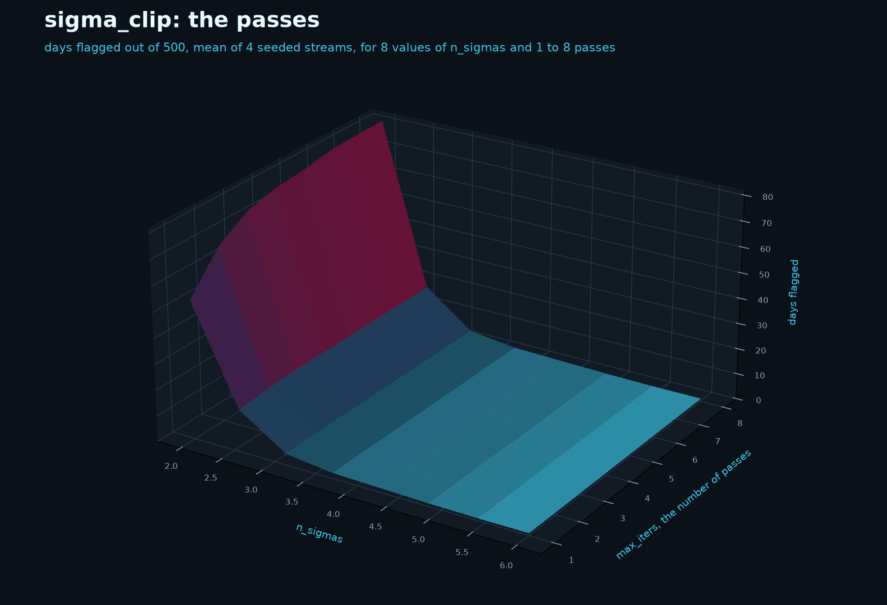
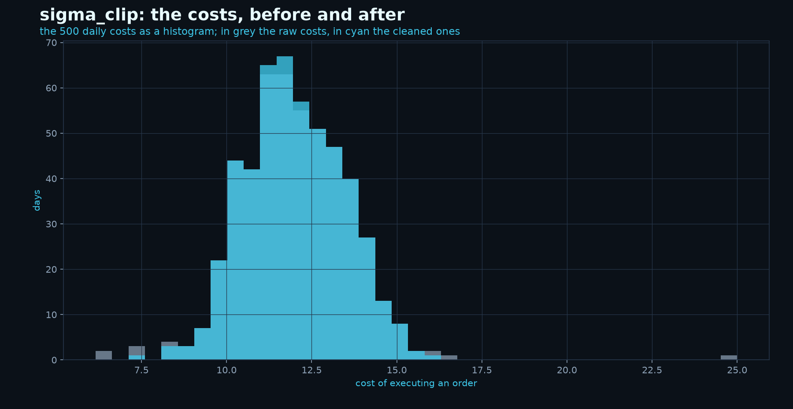

# sigma_clip

[← Robust filters](index.md)

`sigma_clip` is one of the other three classic rules, with the same `(clean, idx)` return as [hampel_filter](hampel_filter.md). Sigma clipping removes values beyond `n_sigmas` standard deviations and repeats on what remains.



The surface shows how many days the function flags out of 500 on the stream of the example, for 8 values of `n_sigmas` and for 1 to 8 passes. The height is the number of days flagged.

## A first example: daily order execution cost

The stream is the one of the [first example of the section](index.md#a-first-example-daily-order-execution-cost): 500 days of the cost of executing an order, and one bad day, day 250, at 25.0.

```python
import numpy as np
from dense_armor.core.online.anomaly.robust_filters import sigma_clip

rng = np.random.default_rng(0)
cost = 12.0 + 1.5 * rng.standard_normal(500)
cost[250] = 25.0
clean, idx = sigma_clip(cost, radius=15)
print(250 in idx, round(float(clean[250]), 2), len(idx))
```

```
True 11.48 8
```

The function flags day 250 and replaces it with the local median, 11.48. It also flags 7 ordinary days, 8 positions in all.



The cleaned costs lose the far values that the function flags.

## The same on a robot

```python
import numpy as np
from dense_armor.core.online.anomaly.robust_filters import sigma_clip

rng = np.random.default_rng(42)
v = 0.5 + 0.1 * rng.standard_normal(3000)
v[1500] = 2.5
clean, idx = sigma_clip(v, radius=15)
print(1500 in idx, len(idx))
```

```
True 24
```

It catches the collision and also flags 23 ordinary samples.

## How it works

It returns `(clean, idx)`, as explained on the page of [Robust filters](index.md).

On the window, excluding point $i$ itself so that a true outlier at the centre cannot protect itself by inflating its own standard deviation, it computes the mean and the standard deviation, discards the points beyond `n_sigmas`, recomputes on the remaining ones and repeats until it is stable or `max_iters` is reached. Point $i$ is an outlier if it is outside `n_sigmas` of the final mean and standard deviation, which are cleaned of the other outliers of the window, unlike [chauvenet_criterion](chauvenet_criterion.md), which uses the raw ones.

## The parameters

`sigma_clip(x, radius=10, n_sigmas=3.0, max_iters=5)`

| Parameter | Default | What it does |
|---|---|---|
| `x` | required | the whole series, a one-dimensional array |
| `radius` | 10 | half-width of the window, which is centred on each sample: `radius = 15` is a window of 31 samples |
| `n_sigmas` | 3.0 | the clipping threshold, in standard deviations |
| `max_iters` | 5 | the maximum number of passes |

## API reference

::: dense_armor.core.online.anomaly.robust_filters.sigma_clip

## Details

- **Sources.** The standard method of astronomy (stacking, photometry), applied here to a local window.
