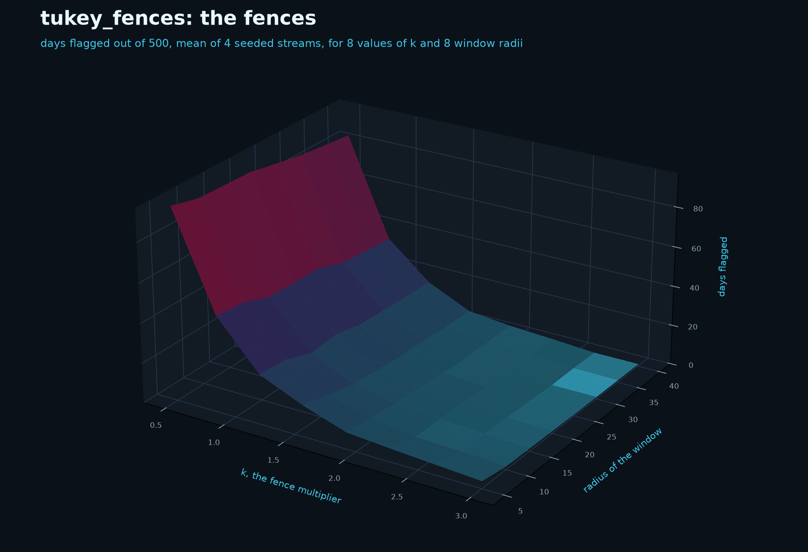
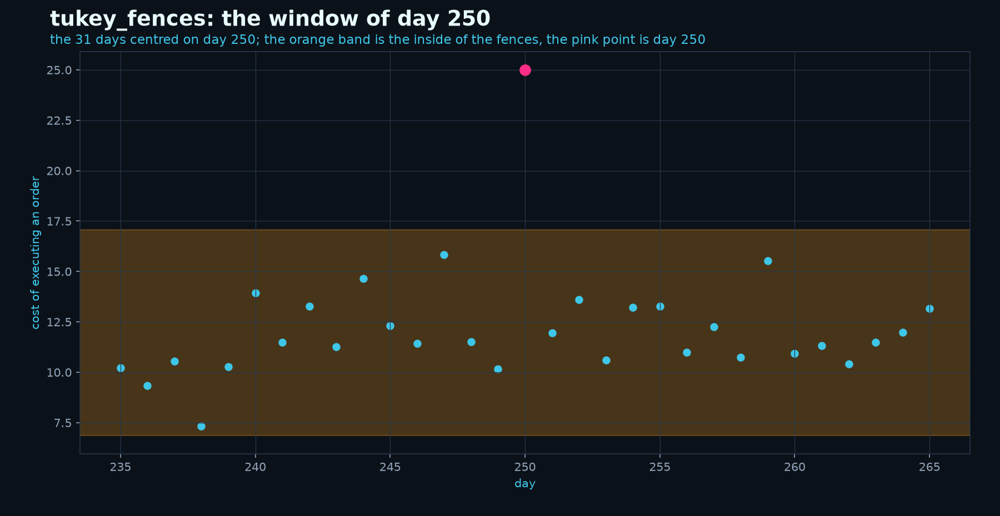

# tukey_fences

[← Robust filters](index.md)

`tukey_fences` is one of the other three classic rules, with the same `(clean, idx)` return as [hampel_filter](hampel_filter.md). Tukey uses the quartiles (outside $[Q_1 - 1.5\,\mathrm{IQR},\, Q_3 + 1.5\,\mathrm{IQR}]$).



The surface shows how many days the function flags out of 500 on the stream of the example, for 8 values of `k` and 8 window radii. The height is the number of days flagged.

## A first example: daily order execution cost

The stream is the one of the [first example of the section](index.md#a-first-example-daily-order-execution-cost): 500 days of the cost of executing an order, and one bad day, day 250, at 25.0.

```python
import numpy as np
from dense_armor.core.online.anomaly.robust_filters import tukey_fences

rng = np.random.default_rng(0)
cost = 12.0 + 1.5 * rng.standard_normal(500)
cost[250] = 25.0
clean, idx = tukey_fences(cost, radius=15)
print(250 in idx, round(float(clean[250]), 2), len(idx))
```

```
True 11.48 11
```

The function flags day 250 and replaces it with the local median, 11.48. It also flags 10 ordinary days, 11 positions in all. For the window of 31 days centred on day 250 the fences are 6.85 and 17.08, and 25.0 is outside them.



The orange band is the inside of the fences, from $Q_1 - 1.5\,\mathrm{IQR}$ to $Q_3 + 1.5\,\mathrm{IQR}$ of this window.

## The same on a robot

```python
import numpy as np
from dense_armor.core.online.anomaly.robust_filters import tukey_fences

rng = np.random.default_rng(42)
v = 0.5 + 0.1 * rng.standard_normal(3000)
v[1500] = 2.5
clean, idx = tukey_fences(v, radius=15)
print(1500 in idx, len(idx))
```

```
True 65
```

It catches the collision and also flags 64 ordinary samples.

## How it works

It returns `(clean, idx)`, as explained on the page of [Robust filters](index.md).

Point $i$ is an outlier if it is outside $[Q_1 - k\,\mathrm{IQR},\, Q_3 + k\,\mathrm{IQR}]$, with $Q_1$ and $Q_3$ the 25th and 75th percentiles of the window and $\mathrm{IQR} = Q_3 - Q_1$.

## The parameters

`tukey_fences(x, radius=10, k=1.5)`

| Parameter | Default | What it does |
|---|---|---|
| `x` | required | the whole series, a one-dimensional array |
| `radius` | 10 | half-width of the window, which is centred on each sample: `radius = 15` is a window of 31 samples |
| `k` | 1.5 | the multiplier of the fences: 1.5 is the standard, 3.0 the variant for extreme outliers |

## API reference

::: dense_armor.core.online.anomaly.robust_filters.tukey_fences

## Details

- **Sources.** Tukey, J. W. (1977), *Exploratory Data Analysis*.
