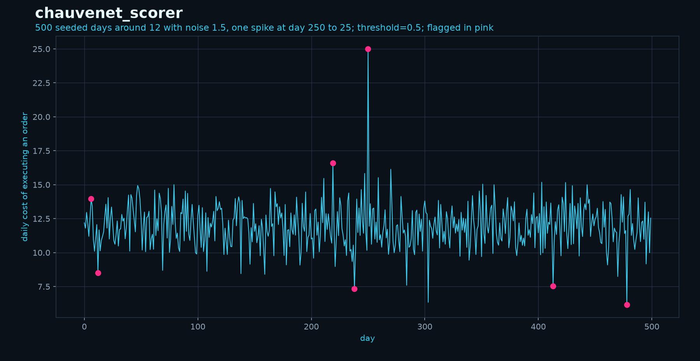

# Chauvenet: how unlikely a value is

[← Stream](index.md)

`ChauvenetScorer` scores a new value with `N * P(|Z| >= z)`, the expected number of observations in a normal sample of size N that would lie at least this far from the mean. Unlike the other scorers, a **low** score means anomalous: `is_outlier` is `True` when the score is below `threshold` (`0.5`). `mu` and `sigma` are the ordinary mean and standard deviation of a causal window of `2 * radius` samples strictly before the value. It is an `AnomalyDetector`, causal.


On a seeded noise stream with one injected spike, this surface shows how often the spike is flagged. The horizontal axis is the spike amplitude in standard deviations; the other axis is `threshold`. Higher threshold flags more.

## A first example: a daily cost of executing an order

A desk watches the daily cost of executing an order. Each day it tells the scorer the new cost, then asks if the day is an outlier.

```python
import numpy as np
from dense_armor.core.online.anomaly.filters import ChauvenetScorer

rng = np.random.default_rng(0)
cost = 12.0 + 1.5 * rng.standard_normal(500)
cost[250] = 25.0
s = ChauvenetScorer(radius=15)
for v in cost[:250]:
    s.learn_one({"x": float(v)})
print(s.is_outlier({"x": float(cost[250])}), round(s.score_one({"x": float(cost[250])}), 2))
```

```
True 0.0
```



On the same seeded daily-cost stream, the spike day is flagged; `is_outlier` is `score < threshold`, not `score > threshold`.

## The same on a robot

```python
import numpy as np
from dense_armor.core.online.anomaly.filters import ChauvenetScorer

rng = np.random.default_rng(0)
s = ChauvenetScorer(radius=10)
for v in rng.normal(0, 1, 20):
    s.learn_one({"v": float(v)})
print(s.is_outlier({"v": 50.0}))
```

```
True
```

The robot case comes last. A reading of 50 is an outlier because the score is tiny, not large.

## How it works

The score is the expected number of points in a normal sample that would be at least this far out; too small means too unlikely. Chauvenet asks: in a normal sample, would we expect less than half a point this far out? If yes, reject. The direction is opposite to the other scorers, which is why `score_is_inverted` is set.

The score is

$$\mathrm{score} = N \cdot P(|Z| \ge z), \qquad z = \frac{|x - \mu|}{\sigma}, \qquad P = \mathrm{erfc}\!\left(\frac{z}{\sqrt{2}}\right),$$

where $x$ is the new value; $\mu$ is the window mean; $\sigma$ is the window standard deviation; $N$ is `2 * radius`, the number of samples in the causal window strictly before the value. `mu` and `sigma` are the ordinary mean and standard deviation, not robust; a window that already has outliers can distort them. `is_outlier` is `score_one(x)` below `threshold`, with `threshold = 0.5`, Chauvenet's value. The window is `2 * radius` strictly before; it is never part of its own window. `score_one` returns `positive infinity` while fewer than four values have been learned or for an unusable value. On a flat window, `score` is `N` if the value does not deviate, `0.0` if it does. `score_one` does not change anything.

`ChauvenetScorer` is `robust_filters.chauvenet_criterion` applied to a causal window. See the comparison on [HampelScorer](hampel_scorer.md).

**Not usable with the gates.** `score_is_inverted = True`, so `AnomalyGate` and `Protected` refuse it: their constructors raise `ValueError`. Use `HampelScorer`, `TukeyScorer`, `SigmaClipScorer`, or call `is_outlier` directly. (This behavior is in the source.)

## The parameters

`ChauvenetScorer` is an `AnomalyDetector`. `learn_one(x)`, `score_one(x)`, `is_outlier(x)`, `n_missing`. Signature:

`(self, radius: int = 10, threshold: float = 0.5, feature: str | None = None, eps: float = 1e-09)`

| Parameter | Default | What it does |
|---|---|---|
| `radius` | 10 | with a `2 * radius` causal window; also `N` in `N * P` |
| `threshold` | 0.5 | `is_outlier` when score `< threshold`; Chauvenet's value `0.5` |
| `feature` | `None` | key of the feature to watch; `None` takes the feature with the smallest key, order-independent |
| `eps` | 1e-9 | below this scale the window is treated as flat |

No `n_sigmas`. `score_is_inverted = True`.

## API reference

::: dense_armor.core.online.anomaly.filters.ChauvenetScorer

## Details

- **Sources.** Chauvenet, W. (1863). *A Manual of Spherical and Practical Astronomy*, Vol. II, Appendix on the Method of Least Squares. Batch `robust_filters.chauvenet_criterion`.
- **Direction.** reject when `N * P < threshold`; opposite of "high score = anomalous"; not usable with `AnomalyGate` / `Protected`.
- **Scale.** non-robust mean + std; known limitation of original criterion.
- **Comparison.** table on [HampelScorer](hampel_scorer.md).
