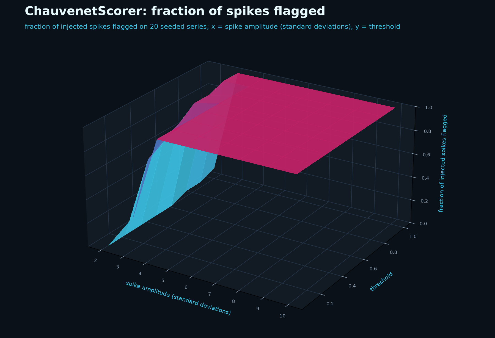

# ChauvenetScorer

[← Streaming anomaly detection](index.md)

ChauvenetScorer evaluates each new sample by calculating $N \cdot P(|Z| \ge z)$, i.e., the expected number of observations in a normal sample of size N that would fall at least this far from the mean. Unlike the other scorers, a low score indicates an anomaly: is_outlier returns True when the score drops below threshold (0.5). The parameters μ and σ represent the ordinary mean and standard deviation computed over a causal window composed of the 2 * radius samples strictly preceding the current data point. It is a causal AnomalyDetector.

Like the other scorers in the library, it examines exclusively the 2 * radius samples preceding the value to be evaluated; the reasons for the differences compared to the batch counterparts are illustrated on the [HampelScorer](hampel_scorer.md) page.



The score represents the expected number of observations equally far from the mean: it therefore grows as the window size increases and decreases as the value moves further away from the center. For the same deviation, a sample may be rejected in a short window but accepted in a long window.

## A first example: daily order execution cost

A trading desk monitors the daily execution cost of orders, which fluctuates around 12 with a noise of 1.5. The same cost equal to 16.5 — roughly 3 standard deviations above the mean — is evaluated over both a 30-day window and a 300-day window.

```python
import numpy as np
from dense_armor.core.online.anomaly.filters import ChauvenetScorer

rng = np.random.default_rng(3)
for radius in (15, 150):
    c = ChauvenetScorer(radius=radius)
    for v in rng.normal(12.0, 1.5, 2 * radius):
        c.learn_one({"x": float(v)})
    print(2 * radius, round(c.score_one({"x": 16.5}), 2), c.is_outlier({"x": 16.5}))
```

```
30 0.29 True
300 0.89 False
```

Over a 30-day window, the score is 0.29, below 0.5: Chauvenet's criterion rejects the value (True). Over 300 days, the score rises to 0.89: the value is accepted (False). The wider the observation window, the higher the probability of physiologically encountering values far from the mean, making that deviation less surprising. Remember the convention adopted: for Chauvenet, a low score signals an outlier.


The orange curve corresponds to the 30-day window, while the blue one corresponds to the 300-day window; the gray line marks the 0.5 threshold. At z = 3, the orange curve drops below the threshold, whereas the blue one remains above it.

## The same applies to a robot

```python
from dense_armor.core.online.anomaly.filters import ChauvenetScorer

c = ChauvenetScorer(radius=5)
for v in [10, 11, 9, 10, 12, 10, 11, 9, 10]:
    c.learn_one({"v": float(v)})
print(round(c.score_one({"v": 10.0}), 2), round(c.score_one({"v": 14.0}), 4), c.is_outlier({"v": 14.0}))
```

```
7.28 0.0003 True
```

A reading at the center of the window (10.0) obtains a high score (7.28), while a very distant reading (14.0) obtains a score close to zero (0.0003) and is rejected (True). A low score corresponds to an outlier.

## How it works

Chauvenet's criterion rejects a sample when $N \cdot P(|Z| \ge z) < 0.5$; since score_one directly returns $N \cdot P(|Z| \ge z)$, for this scorer a low score indicates an anomaly.

The score expresses the expected number of points, in a Gaussian sample of size N, that would fall at least that far from the mean: a value that is too small indicates a statistically overly improbable event. The question underlying Chauvenet's method is: "In a normal sample of N elements, would we expect less than half a point at this distance?" If the answer is yes, the data point is rejected. Since the direction of the score is opposite to that of the other scorers, the class sets the attribute score_is_inverted = True.

The score is calculated via the following formulas:

$$z = \frac{|x - \mu|}{\sigma}, \qquad \mathrm{score} = N \cdot P(|Z| \ge z) = N \cdot \mathrm{erfc}\!\left(\frac{z}{\sqrt{2}}\right)$$

Where:

- x is the new value to be evaluated;
- μ is the mean of the recent window;
- σ is the standard deviation of the recent window;
- N = 2 ⋅ radius is the number of samples in the causal window strictly preceding the current data point (or the number of learned samples during warm-up).

The parameters μ and σ are the ordinary, non-robust mean and standard deviation: a window already contaminated by outliers can therefore distort their estimation. The is_outlier method returns True when score_one(x) < threshold (with threshold = 0.5, Chauvenet's classic value). The window always comprises the 2 * radius strictly preceding samples (the current data point is never part of its own window). score_one returns +inf (float('inf')) in the presence of invalid values (NaN, inf) or until at least four samples have been learned. On a flat window (sigma < eps), the score is equal to N if the value coincides with the mean, or 0.0 if it deviates from it. score_one never modifies the internal state.

ChauvenetScorer corresponds to applying robust_filters.chauvenet_criterion on a causal window. For the comparative table among the scorers, refer to the [HampelScorer](hampel_scorer.md) page.

Not usable with gates: since score_is_inverted = True, the AnomalyGate and Protected classes reject this scorer (their respective constructors raise a ValueError). For use with gates, it is recommended to employ HampelScorer, TukeyScorer, or SigmaClipScorer, or to invoke is_outlier directly.

## The parameters

ChauvenetScorer is an AnomalyDetector equipped with the learn_one(x), score_one(x), is_outlier(x) methods and the n_missing attribute.

Signature:

`ChauvenetScorer(radius: int = 10, threshold: float = 0.5, feature: str | None = None, eps: float = 1e-09)`

| Parameter | Default | Description |
|---|---|---|
| radius | 10 | Half-width unit; defines a causal window of 2 * radius samples (also determines N in N ⋅ P). |
| threshold | 0.5 | Rejection threshold: is_outlier returns True when score < threshold (Chauvenet's standard value: 0.5). |
| feature | None | Key of the feature to monitor; if None, selects the lexicographically smallest key, regardless of order. |
| eps | 1e-9 | Scale threshold: below this value the window is considered flat. |

ChauvenetScorer does not include the n_sigmas parameter and sets score_is_inverted = True.

## API reference

::: dense_armor.core.online.anomaly.filters.ChauvenetScorer

## Details

- Sources: Chauvenet, W. (1863), A Manual of Spherical and Practical Astronomy, Vol. II, Appendix on the Method of Least Squares; batch counterpart in robust_filters.chauvenet_criterion.
