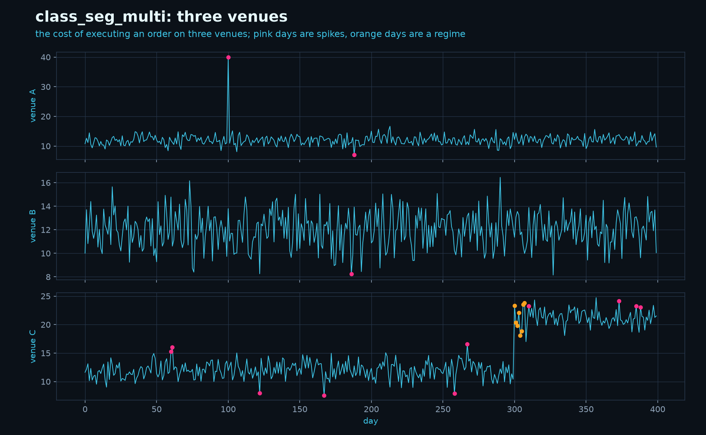

# class_seg_multi

[← Streaming anomaly detection](index.md)

class_seg_multi takes a table of readings as input — one column per channel — and applies classify_segments independently to each column. It returns three arrays stacked side by side per channel: one label for each sample, a deviation score, and an uncertainty measure. A spike (spike) is a brief deviation, whereas a regime change (regime) is a sustained shift over time. It is a batch/offline analysis tool for quick post-hoc triage, not a zero-latency streaming detector.

The name class_seg_multi is short for classify segments, multi-channel: it classifies the segments of a recording, channel by channel, into the three categories spike, regime, or clean.


A brief anomalous sequence is always classified as spike, regardless of its amplitude. Instead, it becomes a regime only when it persists over time: with a shift of 15 standard deviations, sequences lasting 2, 6, and 12 days are labeled as spike, whereas on a 24-day sequence roughly half (0.53) is recognized as regime. Going further, the sliding window gradually learns the new level and subsequent days return to being labeled as clean, bringing the overall regime share on a 60-day sequence to 0.21.

## A first example: three venues

Let us analyze 400 days of order execution costs across three markets (trading venues). Venue A experiences an isolated anomaly on day 100, while venue C records a permanent jump of +9 starting from day 300.

```python
import numpy as np
from dense_armor.core.online.anomaly.streaming import class_seg_multi

rng = np.random.default_rng(5)
X = 12.0 + 1.5 * rng.standard_normal((400, 3))
X[100, 0] = 40.0
X[300:, 2] += 9.0
labels = class_seg_multi(X, radius=10)[0]
for c in range(3):
    print(c, {k: labels[:, c].tolist().count(k) for k in ("spike", "regime")})
```

```
0 {'spike': 2, 'regime': 0}
1 {'spike': 1, 'regime': 0}
2 {'spike': 10, 'regime': 8}
```

Venue A shows 2 days labeled as spike, venue B has 1 (due to noise), and venue C, whose average level shifted, totals 10 days of spike and 8 days of regime. The function processes each channel separately, producing the exact same result as invoking it column by column.



Venue A shows a single anomalous spike, venue B presents no significant events, and venue C highlights a sharp level jump.

## The same applies to a robot

```python
import numpy as np
from dense_armor.core.online.anomaly.streaming import class_seg_multi

rng = np.random.default_rng(0)
X = rng.normal(0.0, 0.1, (300, 2))
X[100, 0] = 5.0
X[200:, 1] += 2.0
labels = class_seg_multi(X, radius=10)[0]
print([{k: labels[:, c].tolist().count(k) for k in ("spike", "regime")} for c in range(2)])
```

```
[{'spike': 4, 'regime': 0}, {'spike': 11, 'regime': 15}]
```

Joint 1 records a spurious reading: 4 samples are classified as spike and none as regime. Joint 2 instead transitions to a new operating level from sample 200: 15 samples are labeled as regime and 11 as spike.

## How it works

class_seg_multi applies the classify_segments function (defined in dense_armor.core.online.protect.arbiter) independently to each column of the matrix X. The result per single channel is identical to an individual call, but it is returned in vectorized form without requiring a manual loop. Each channel maintains its own robust window and never influences the others.

The matrix X has dimensions (n_samples, n_channels). The causal window contains radius * ref_mult values. The spike_run_max parameter sets the maximum duration of a continuous sequence for it to be classified as spike; longer sequences are labeled as regime. n_sigmas represents the activation threshold in units of robust standard deviation, while eps acts as a numerical safeguard against degenerate scales.

Being a batch analysis, the algorithm observes the entire sequence until its conclusion in order to distinguish a spike from a regime: it is therefore not a zero-latency streaming flag and does not raise exceptions in the online stream, operating instead as a post-hoc analysis function.

## The parameters

class_seg_multi is a function.

Signature:

`class_seg_multi(X: numpy.ndarray, radius: int = 10, ref_mult: int = 3, n_sigmas: float = 3.0, spike_run_max: int = 2, eps: float = 1e-09)`

| Parameter | Default | Description |
|---|---|---|
| X | required | Input matrix of shape (n_samples, n_channels). |
| radius | 10 | Base unit of the window; together with ref_mult it defines the capacity (radius * ref_mult). |
| ref_mult | 3 | Window length multiplier. |
| n_sigmas | 3.0 | Activation threshold expressed in units of robust sigma. |
| spike_run_max | 2 | Maximum length of a continuous sequence classified as spike. |
| eps | 1e-9 | Numerical safeguard against degenerate scales (zero variance). |

Return value: a tuple (labels, deviation, uncertainty), where each element is an array of shape (n_samples, n_channels); labels contains the labels assigned to each sample and channel ("clean", "spike", or "regime").

## API reference

::: dense_armor.core.online.anomaly.streaming.class_seg_multi

## Details

- Sources: dense_armor/core/online/anomaly/streaming.py; classify_segments in dense_armor/core/online/protect/arbiter.py. See classify_segments for details on the point-by-point rule and label logic; for the sample-by-sample multi-channel streaming version, see MultistreamDD instead.
- Provenance: promoted from Dense-Evolution-Discovery; class_seg_multi extends its application on a column-wise basis.
