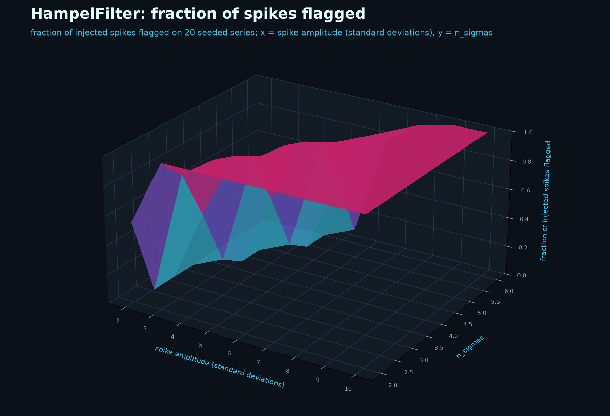

# class_seg_multi

[← Streaming anomaly detection](index.md)

`class_seg_multi` reads a table of readings, one column per channel, and applies `classify_segments` independently to each column. It returns three stacked arrays, one per channel: a label for every sample, a deviation score, and an uncertainty. A spike is a short deviation; a regime is a sustained change. A short batch, offline triage, not the zero-latency streaming flag.



On a seeded noise stream with one injected spike, this surface shows how often the spike is flagged. The horizontal axis is the spike amplitude in standard deviations; the other axis is `n_sigmas`. Higher means the spike is caught more often.

## A first example: several order-cost streams

A desk watches order-execution cost on several markets. It records a table, one column per market, and wants, for each market, which samples are spikes and which are regimes.

```python
import numpy as np
from dense_armor.core.online.anomaly.streaming import class_seg_multi

rng = np.random.default_rng(0)
X = 12.0 + 1.5 * rng.standard_normal((200, 3))
X[100, 0] = 25.0
e, d, u = class_seg_multi(X, radius=30, ref_mult=3, n_sigmas=4.0)
print(e[100].tolist(), round(float(d[100, 0]), 2))
```

```
['spike', 'clean', 'clean'] 7.75
```


On three seeded order-cost streams, one spike day on one channel is labelled `spike` on that channel only.

## The same on a robot

A robot logs every joint into a table; `class_seg_multi` labels each joint independently.

```python
import numpy as np
from dense_armor.core.online.anomaly.streaming import class_seg_multi

rng = np.random.default_rng(0)
X = 0.1 * rng.standard_normal((500, 6))
X[300, 2] = 3.0
e, d, u = class_seg_multi(X, radius=30, ref_mult=3, n_sigmas=4.0)
print(e[300].tolist())
```

```
['clean', 'clean', 'spike', 'clean', 'clean', 'clean']
```

The robot case comes last. Joint 2 at sample 300 is labelled `spike`; the others `clean`.

## How it works

`class_seg_multi` applies `classify_segments` (`dense_armor.core.online.protect.arbiter`) independently to each column. Exactly the same result per channel as calling it individually, only stacked instead of requiring a manual loop. Each channel has its own robust window; channels never influence each other. `X` has shape `(n_samples, n_channels)`. The causal window holds `radius * ref_mult` values. `spike_run_max` sets the maximum run length counted as a spike; longer runs are `regime`. `n_sigmas` is the flagging threshold in robust-sigma units; `eps` is the numerical guard for a degenerate scale. This is batch: it can see the end of a run to decide `spike` versus `regime`; it is not the zero-latency streaming flag. It does not raise in the streaming flow in the same way; it is an analysis function.

## The parameters

`class_seg_multi` is a function. Signature:

`(X: numpy.ndarray, radius: int = 10, ref_mult: int = 3, n_sigmas: float = 3.0, spike_run_max: int = 2, eps: float = 1e-09)`

| Parameter | Default | What it does |
|---|---|---|
| `X` | required | array of shape `(n_samples, n_channels)` |
| `radius` | 10 | with `ref_mult`, the causal window holds `radius * ref_mult` values |
| `ref_mult` | 3 | window length multiplier |
| `n_sigmas` | 3.0 | flag threshold in robust-sigma units |
| `spike_run_max` | 2 | maximum run length counted as a spike |
| `eps` | 1e-9 | numerical guard for a degenerate scale |

**Returns:** `(labels, deviation, uncertainty)`, each `(n_samples, n_channels)`; `labels` per sample and channel (`clean`, `spike`, `regime`).

## API reference

::: dense_armor.core.online.anomaly.streaming.class_seg_multi

## Details

- **Sources.** `dense_armor/core/online/anomaly/streaming.py`; `classify_segments` in `dense_armor/core/online/protect/arbiter.py`. See `classify_segments` for the per-point rule and labels; `MultistreamDD` is the per-call multi-channel version, see [Multi](multi_channel_streaming_deviation_detector.md). Provenance: promoted from Dense-Evolution-Discovery; `class_seg_multi` applies it per column.
