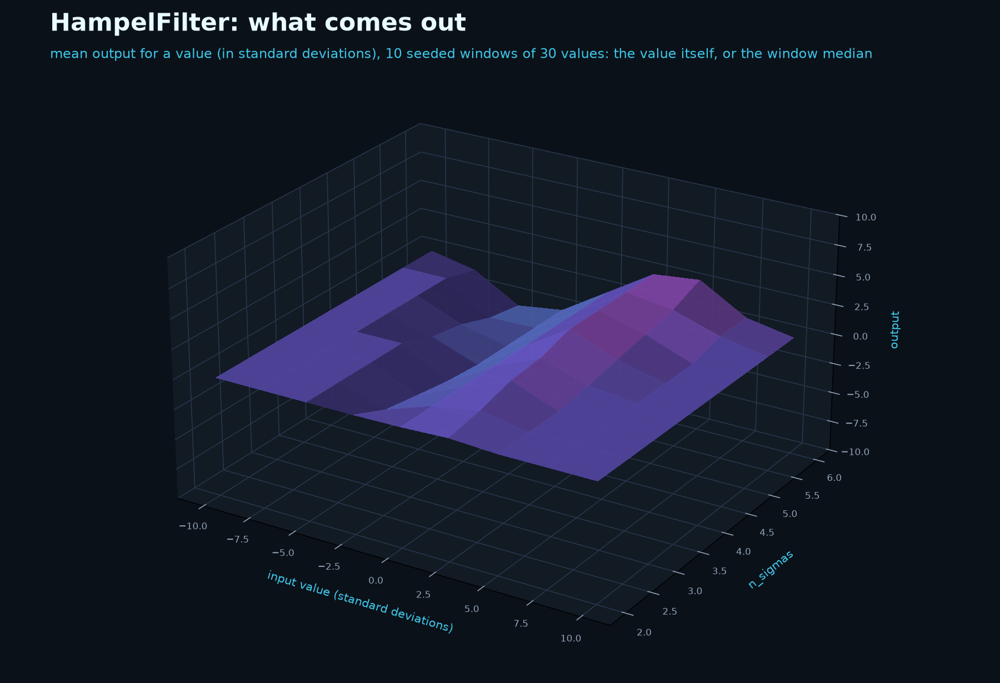

# HampelFilter

[← Streaming anomaly detection](index.md)

HampelFilter reads one value per call and returns the stream with any anomalies replaced by a clean value. When a reading falls within the norm, the filter returns it unchanged; when it detects an outlier instead, it replaces it with the median of the recent past. It applies the exact same Hampel rule as HampelScorer on a causal window, but produces a cleaned series as output rather than a score. All other keys present in the input dictionary are forwarded without modification.

Like the other scorers in the library, it examines exclusively the 2 * radius samples preceding the current data point; the reasons for the differences compared to the batch counterparts are illustrated on the [HampelScorer](hampel_scorer.md) page.



Within the normal band, the output value coincides with the input value; outside of it, it is clamped to the window median. For example, with n_sigmas = 3, an input equal to 6 or -6 is replaced with the window median (approximately -0.06).

## A first example: daily order execution cost

Let us simulate 500 days of daily execution costs around 12, with an isolated spike equal to 25 on day 250. The filter cleans up the stream in real time before the data point is passed to a downstream model.

```python
import numpy as np
from dense_armor.core.online.anomaly.filters import HampelFilter

rng = np.random.default_rng(0)
cost = 12.0 + 1.5 * rng.standard_normal(500)
cost[250] = 25.0
f = HampelFilter(radius=15)
clean = []
for v in cost:
    clean.append(f.transform_one({"x": float(v)})["x"])
    f.learn_one({"x": float(v)})
print(round(clean[250], 2), sum(a != b for a, b in zip(clean, cost)))
```

```
11.36 10
```

The spike of 25 is replaced with 11.36, which is the median of the preceding 30 days. Overall, out of 500 days, 10 are rectified: the anomalous spike and nine ordinary days that fell into the extreme tails of the noise.


The filter leaves normal days unaltered and replaces flagged points with the current window median.

## The same applies to a robot

```python
from dense_armor.core.online.anomaly.filters import HampelFilter

f = HampelFilter(radius=5)
for v in [1.0, 1.2, 0.9, 1.1, 1.0, 0.8, 1.05]:
    f.learn_one({"v": v})
print(f.transform_one({"v": 50.0})["v"], f.transform_one({"v": 1.1})["v"])
```

```
1.0 1.1
```

A reading equal to 50 is replaced by the window median (1.0), whereas a regular value like 1.1 passes through unaltered.

## How it works

HampelFilter replaces anomalous values with the median of the recent historical window.

The operational flow is split between two methods:

- learn_one(x) adds a sample to the short causal window;
- transform_one(x) does not modify the internal state: it returns the original value if it is not an outlier, or the median of the 2 * radius strictly preceding samples if it exceeds the anomaly threshold.

The detection rule is identical to that of HampelScorer. Missing values (NaN or infinities) are returned as-is, without modification, and increment n_missing. Any other keys present in the dictionary are also left intact. HampelFilter is the Transformer-style equivalent of HampelScorer (see the latter for details on score calculation and the n_sigmas parameter).

## The parameters

HampelFilter is a Transformer equipped with the learn_one(x) and transform_one(x) methods, in addition to the n_missing attribute.

Signature:

`HampelFilter(radius: int = 10, n_sigmas: float = 3.0, feature: str | None = None, eps: float = 1e-09)`

| Parameter | Default | Description |
|---|---|---|
| radius | 10 | Half-width unit; defines a causal window of 2 * radius samples. |
| n_sigmas | 3.0 | Anomaly threshold: a value is replaced when its score exceeds n_sigmas. |
| feature | None | Key of the feature to filter; if None, selects the lexicographically smallest key, regardless of order. |
| eps | 1e-9 | Scale threshold: below this value the window is considered flat. |

## API reference

::: dense_armor.core.online.anomaly.filters.HampelFilter

## Details

- Sources: Hampel, F. R. (1974), The influence curve and its role in robust estimation, JASA 69(346), 383–393; Davies, L., Gather, U. (1993), The identification of multiple outliers, JASA 88(423), 782–792; batch counterpart in robust_filters.hampel_filter; uses the same detection rule as HampelScorer.
- Causality: operates exclusively on the 2 * radius strictly preceding samples; the current value never becomes part of its own evaluation window.
