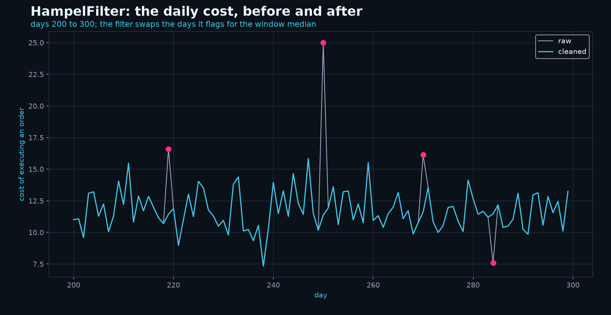

# HampelFilter

[← Streaming anomaly detection](index.md)

`HampelFilter` reads one value per call and returns the stream with outliers replaced by a clean value. When a reading is not an outlier it returns the reading unchanged; when it is an outlier it returns the median of the recent past. This is the same Hampel rule as `HampelScorer`, applied to a causal window, but the output is a cleaned series rather than a score. Other keys in the input are passed through unchanged.

It looks only at the `2 * radius` samples before the value being scored, like the other scorers; why the batch versions differ is explained on the page of [HampelScorer](hampel_scorer.md).


Inside the band a value comes out unchanged; outside it comes out as the median of the window. With n_sigmas = 3 an input of 6 or of -6 comes out at the median, about -0.06.

## A first example: a daily cost of executing an order

The daily cost of executing an order, 500 days around 12, with a spike of 25 at day 250. The filter cleans the stream before a model sees it.

```python
import numpy as np
from dense_armor.core.online.anomaly.filters import HampelFilter

rng = np.random.default_rng(0)
cost = 12.0 + 1.5 * rng.standard_normal(500)
cost[250] = 25.0
f = HampelFilter(radius=15)
clean = []
for v in cost:
    clean.append(f.transform_one({"x": float(v)})["x"])
    f.learn_one({"x": float(v)})
print(round(clean[250], 2), sum(a != b for a, b in zip(clean, cost)))
```

```
11.36 10
```

The spike of 25 comes out as 11.36, the median of the 30 days before it. In all, 10 of the 500 days were replaced: the spike and nine ordinary days in the tails of the noise.



The filter leaves the days it does not flag as they are and swaps the flagged days for the median of the window.

## The same on a robot

```python
from dense_armor.core.online.anomaly.filters import HampelFilter

f = HampelFilter(radius=5)
for v in [1.0, 1.2, 0.9, 1.1, 1.0, 0.8, 1.05]:
    f.learn_one({"v": v})
print(f.transform_one({"v": 50.0})["v"], f.transform_one({"v": 1.1})["v"])
```

```
1.0 1.1
```

A reading of 50 comes out as the median of the window; a reading of 1.1 comes out unchanged.

## How it works

`HampelFilter` also replaces an outlier with the window median.

`learn_one` adds a value to a short causal window; `transform_one` does not learn. `transform_one` returns the value itself when it is not an outlier, or the median of the `2 * radius` samples strictly before it when it is. The same rule as `HampelScorer`. A missing value is passed through unchanged. Other keys are passed through unchanged. The `HampelFilter` is an `AnomalyDetector`-style `Transformer`; see [HampelScorer](hampel_scorer.md) for the score and `n_sigmas`.

## The parameters

`HampelFilter` is a `Transformer`. `learn_one(x)`, `transform_one(x)`, `n_missing`. Signature:

`(self, radius: int = 10, n_sigmas: float = 3.0, feature: str | None = None, eps: float = 1e-09)`

| Parameter | Default | What it does |
|---|---|---|
| `radius` | 10 | with a `2 * radius` causal window |
| `n_sigmas` | 3.0 | outlier when score above `n_sigmas` |
| `feature` | `None` | key to filter; `None` takes the feature with the smallest key, order-independent |
| `eps` | 1e-9 | below this scale the window is flat |

## API reference

::: dense_armor.core.online.anomaly.filters.HampelFilter

## Details

- **Sources.** Hampel, F. R. (1974). The influence curve and its role in robust estimation. *JASA* 69(346), 383-393. Davies, L., Gather, U. (1993). The identification of multiple outliers. *JASA* 88(423), 782-792. Batch `robust_filters.hampel_filter`. Same replacement rule as `HampelScorer`.
- **Causal.** `2 * radius` strictly before; value not part of own window. `n_missing`.
