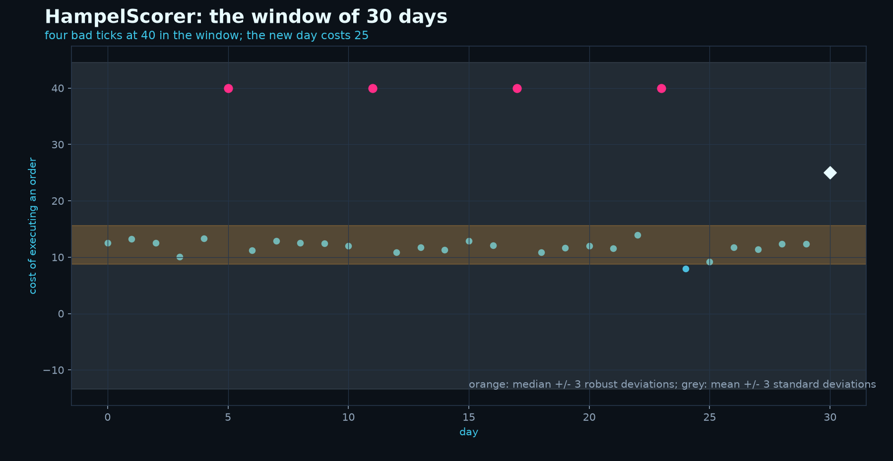

# HampelScorer

[← Streaming anomaly detection](index.md)

`HampelScorer` scores a new value by how far it is from the median of the recent window, measured in robust standard deviations: the robust spread is `1.4826 * MAD`. This is the classic Hampel rule, applied to a causal window of `2 * radius` samples strictly before the value. `is_outlier` is `True` when the score is above `n_sigmas`. It is an `AnomalyDetector`, and it never sees the future.

`dense_armor.core.online.anomaly.filters` gives the four classic outlier rules as streaming scorers: Hampel, Tukey fences, Chauvenet and sigma clipping.

Each scorer looks only at the `2 * radius` samples before the value being scored. The batch versions on the [robust filters](../robust_filters.md) page use a window centred on the value, which looks at future samples; a live robot loop cannot, and that is the only difference.


The score of the same spike goes down as the window fills with bad values: a spike of 8 standard deviations scores 9.3 in a clean window, 6.6 with 6 bad values out of 30, 2.7 with 12 and 1.5 with 14. The median and the MAD resist bad values, but not without limit.

## A first example: a daily cost of executing an order

A desk watches the daily cost of executing an order. In the last 30 days four ticks went wrong and were recorded as 40. Today the cost is 25: is it an outlier? The plain rule, the distance from the mean in standard deviations, is the one to beat.

```python
import numpy as np
from dense_armor.core.online.anomaly.filters import HampelScorer

rng = np.random.default_rng(1)
cost = 12.0 + 1.5 * rng.standard_normal(30)
cost[[5, 11, 17, 23]] = 40.0
h = HampelScorer(radius=15)
for v in cost:
    h.learn_one({"x": float(v)})
print(round(h.score_one({"x": 25.0}), 1), round(abs(25.0 - cost.mean()) / cost.std(), 1))
```

```
11.3 1.0
```

`HampelScorer` scores today at 11.3 robust deviations, far above the threshold of 3. The plain rule scores it 1.0 and misses it: the four bad ticks pull the mean up and stretch the standard deviation, so 25 looks ordinary. The median and the MAD of the window ignore the bad ticks.



Orange is the band of the median plus or minus 3 robust deviations (8.8 to 15.6); grey is the band of the mean plus or minus 3 standard deviations (-13.4 to 44.5). Today's cost, 25, is outside the orange band and inside the grey one.

## The same on a robot

```python
from dense_armor.core.online.anomaly.filters import HampelScorer

s = HampelScorer(radius=15, n_sigmas=3.0)
for v in [1.0, 1.2, 0.9, 1.1, 1.0, 0.8, 1.05]:
    s.learn_one({"v": v})
print(s.is_outlier({"v": 50.0}), s.is_outlier({"v": 1.1}))
```

```
True False
```

A reading of 50 is an outlier for the joint; a reading of 1.1 is not.

## How it works

The score is how far the new value is from the usual value, measured in robust standard deviations. The usual value is the median of the recent window; the robust standard deviation is `1.4826 * MAD`. `learn_one` adds a value; `score_one` does not change anything.

The score is

$$\text{score} = \frac{|x - \mathrm{med}(w)|}{1.4826 \cdot \mathrm{MAD}(w)},$$

where $x$ is the new value; $w$ is the recent window; $\mathrm{med}(w)$ is its median; $\mathrm{MAD}(w)$ is the median distance from that median. The window holds `2 * radius` samples strictly before the value being scored; the value itself is never part of its own window. `HampelScorer` uses `2 * radius`; `streamDD` uses `radius * ref_mult`. `is_outlier` returns `True` when `score_one(x)` is above `n_sigmas`. `score_one` returns `0.0` for an unusable value or while fewer than four values have been learned. If the window is flat and the value differs from the median, the score is `positive infinity`, otherwise `0.0`.

This is `robust_filters.hampel_filter` applied to a causal window instead of a window centred on the value. `HampelScorer` is the streaming member; batch Hampel is on the robust-filters page.

## Comparison of the four causal scorers

Precision and recall on 5,000 seeded samples with 50 spikes of size 5-15 (1% contamination), window 30 (`radius=15`), and cost per sample:

| Scorer | stationary noise (σ=0.5): precision / recall | sine (amplitude 5, period 500) + same noise: precision / recall | µs per sample |
|---|---|---|---|
| HampelScorer | 0.459 / 1.000 | 0.318 / 1.000 | 90 |
| TukeyScorer | 0.303 / 1.000 | 0.195 / 1.000 | 75 |
| ChauvenetScorer | 0.282 / 0.980 | 0.167 / 1.000 | 28 |
| SigmaClipScorer | 0.588 / 1.000 | 0.370 / 1.000 | 72 |

Every scorer catches the spikes; precision is the tuning knob. A trend inside the window and a short noisy window lower precision. Raise `n_sigmas` or combine scores. At 100 Hz the cost is under 1% of the loop budget. This table appears once, here; the other scorer pages link to it. See [TukeyScorer](tukey_scorer.md), [ChauvenetScorer](chauvenet_scorer.md), [SigmaClipScorer](sigma_clip_scorer.md).

## The parameters

`HampelScorer` is an `AnomalyDetector`. `learn_one(x)`, `score_one(x)`, `is_outlier(x)`, `threshold`, `n_missing`. Signature:

`(self, radius: int = 10, n_sigmas: float = 3.0, feature: str | None = None, eps: float = 1e-09)`

| Parameter | Default | What it does |
|---|---|---|
| `radius` | 10 | with a `2 * radius` causal window |
| `n_sigmas` | 3.0 | `is_outlier` when the score is above `n_sigmas`; `threshold` returns it |
| `feature` | `None` | key of the feature to watch; `None` takes the feature with the smallest key, order-independent |
| `eps` | 1e-9 | below this scale the window is flat |

## API reference

::: dense_armor.core.online.anomaly.filters.HampelScorer

## Details

- **Sources.** Hampel, F. R. (1974). The influence curve and its role in robust estimation. *JASA* 69(346), 383-393. Davies, L., Gather, U. (1993). The identification of multiple outliers. *JASA* 88(423), 782-792. Pearson et al. (2016), *Generalized Hampel filters*, for the `1.4826 * MAD` rule. Batch `robust_filters.hampel_filter`.
- **Causal window.** `2 * radius` samples strictly before; `is_outlier` ↔ batch would flag; batch Hampel uses a window centred on the value (sees future); streaming is causal.
- **Scale.** robust spread is `1.4826 * MAD`; flat window, `positive infinity` if dev > `eps` `0.0` otherwise. `n_missing` counts values that are not a number or `None`.
- **Shared interface.** the four scorers share `learn_one` / `score_one`, feature selection, `is_outlier`.
- **Window size.** A short window reacts faster but its median and MAD are noisier, so more ordinary samples are flagged (the first example of the [streamDD](streaming_deviation_detector.md) page with `radius=5` flags dozens of noise samples; with `radius=30, n_sigmas=4.0` one in 3,000).
