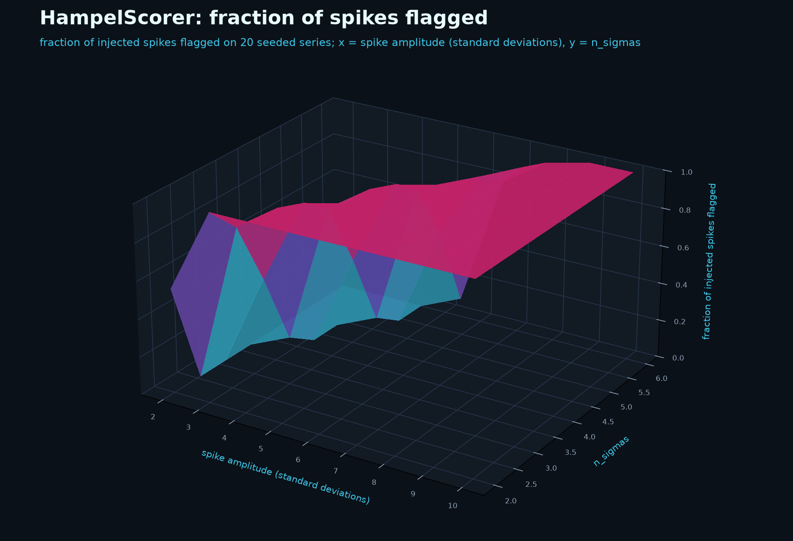

# HampelScorer

[← Streaming anomaly detection](index.md)

HampelScorer evaluates each new value by measuring its distance from the median of a recent window, expressed in robust standard deviations (1.4826 * MAD). This is the classic Hampel rule applied to a causal window composed of the 2 * radius samples strictly preceding the current data point. The is_outlier method returns True when the score exceeds the n_sigmas threshold. It is a pure AnomalyDetector and never looks into the future.

The dense_armor.core.online.anomaly.filters module provides the four classic statistical rules for outlier handling as streaming scorers: Hampel, Tukey fences, Chauvenet, and sigma clipping.

Each scorer analyzes exclusively the 2 * radius samples preceding the value to be evaluated. The batch counterparts presented on the [robust filters](../robust_filters.md) page instead use a window centered on the sample, also including future data; a real-time robotic control loop cannot afford this, and this is the only substantial difference.



The score assigned to the same spike progressively decreases as the window becomes contaminated with anomalous values: an 8-standard-deviation spike gets a score of 9.3 in a clean window, 6.6 with 6 outliers out of 30, 2.7 with 12, and 1.5 with 14. The median and MAD offer high resistance to outliers, while still having a physiological breakdown point.

## A first example: daily order execution cost

A trader monitors the daily execution cost of orders. Over the last 30 days, four system errors occurred, recorded with a value of 40. Today the cost is 25: is this an anomaly? The benchmark to beat is the classic rule based on the distance from the mean in standard deviations.

```python
import numpy as np
from dense_armor.core.online.anomaly.filters import HampelScorer

rng = np.random.default_rng(1)
cost = 12.0 + 1.5 * rng.standard_normal(30)
cost[[5, 11, 17, 23]] = 40.0
h = HampelScorer(radius=15)
for v in cost:
    h.learn_one({"x": float(v)})
print(round(h.score_one({"x": 25.0}), 1), round(abs(25.0 - cost.mean()) / cost.std(), 1))
```

```
11.3 1.0
```

HampelScorer assigns today's data point a score of 11.3 robust deviations, well above the threshold of 3. The traditional mean-based rule stops at 1.0 instead and fails to detect the anomaly: the four anomalous values pull the mean upward and stretch the standard deviation, making the value 25 appear completely normal. The median and MAD of the window, conversely, completely ignore the four spurious spikes.


The orange band marks the interval of the median ± 3 robust standard deviations (from 8.8 to 15.6); the gray band instead marks the mean ± 3 classic standard deviations (from -13.4 to 44.5). Today's cost, equal to 25, falls clearly outside the orange band but remains inside the gray one.

## The same applies to a robot

```python
from dense_armor.core.online.anomaly.filters import HampelScorer

s = HampelScorer(radius=15, n_sigmas=3.0)
for v in [1.0, 1.2, 0.9, 1.1, 1.0, 0.8, 1.05]:
    s.learn_one({"v": v})
print(s.is_outlier({"v": 50.0}), s.is_outlier({"v": 1.1}))
```

```
True False
```

A reading of 50 is identified as anomalous for the robotic joint (True), while a value of 1.1 falls within the norm (False).

## How it works

The score quantifies how much the new sample deviates from habitual behavior, expressed in units of robust standard deviation. The reference value is the median of the recent window, while the robust dispersion is given by 1.4826 * MAD. The learn_one method updates the window with the new data point; score_one computes the score without altering the internal state.

The formula for the score z is:

$$z = \frac{|x - \mathrm{med}(W)|}{1.4826 \cdot \mathrm{MAD}(W)}$$

Where:

- x is the new value to be evaluated;
- W is the window of recent samples;
- med(W) is the median of W;
- $\mathrm{MAD}(W) = \mathrm{median}(|W - \mathrm{med}(W)|)$ is the median absolute deviation.

The window contains exactly 2 * radius samples strictly preceding the current data point (the evaluated sample is never part of its own window). Unlike streamDD, which uses radius * ref_mult, HampelScorer adopts the 2 * radius convention.

The is_outlier method returns True when score_one(x) > n_sigmas. score_one returns 0.0 in the presence of invalid values (NaN, inf) or until at least four samples have been learned. If the window is completely flat (scale < eps) and the new value differs from the median, the returned score is +inf (float('inf')); otherwise, it is 0.0.

This algorithm corresponds to applying robust_filters.hampel_filter on a causal window rather than a centered one: HampelScorer is the streaming variant, while the batch version is documented on the robust filters page.

## Comparison among the four causal scorers

Precision and recall values measured on 5,000 simulated samples with 50 injected spikes of amplitude 5–15 (1% contamination), 30-sample window (radius=15), and computation time per sample:

| Scorer | Stationary noise (σ=0.5): precision / recall | Sine wave (amplitude 5, period 500) + noise: precision / recall | μs per sample |
|---|---|---|---|
| HampelScorer | 0.459 / 1.000 | 0.318 / 1.000 | 90 |
| TukeyScorer | 0.303 / 1.000 | 0.195 / 1.000 | 75 |
| ChauvenetScorer | 0.282 / 0.980 | 0.167 / 1.000 | 28 |
| SigmaClipScorer | 0.588 / 1.000 | 0.370 / 1.000 | 72 |

All scorers manage to intercept the spikes; precision represents the main tuning lever. The presence of a steep trend or a window that is too short and noisy reduces precision: in these cases, it is advisable to increase n_sigmas or combine multiple scorers. In a 100 Hz loop (budget of 10,000 µs per iteration), the computational cost is less than 1% of the available time. (This comparative table appears only on this page; the pages of the other scorers refer here: see TukeyScorer, ChauvenetScorer, SigmaClipScorer).

## The parameters

HampelScorer is an AnomalyDetector equipped with the learn_one(x), score_one(x), is_outlier(x) methods and the threshold and n_missing attributes.

Signature:

`HampelScorer(radius: int = 10, n_sigmas: float = 3.0, feature: str | None = None, eps: float = 1e-09)`

| Parameter | Default | Description |
|---|---|---|
| radius | 10 | Half-width unit; defines a causal window of 2 * radius samples. |
| n_sigmas | 3.0 | Activation threshold: is_outlier returns True when the score exceeds n_sigmas (also exposed by threshold). |
| feature | None | Key of the feature to monitor; if None, selects the lexicographically smallest key, regardless of order. |
| eps | 1e-9 | Scale threshold: below this value the window is considered flat. |

## API reference

::: dense_armor.core.online.anomaly.filters.HampelScorer

## Details

- Sources: Hampel, F. R. (1974), The influence curve and its role in robust estimation, JASA 69(346), 383–393; Davies, L., Gather, U. (1993), The identification of multiple outliers, JASA 88(423), 782–792; Pearson et al. (2016), Generalized Hampel filters, for the 1.4826 * MAD rule; batch version in robust_filters.hampel_filter.
- Causal window: uses exclusively the 2 * radius strictly preceding samples; is_outlier corresponds to the causal version of batch detection.
