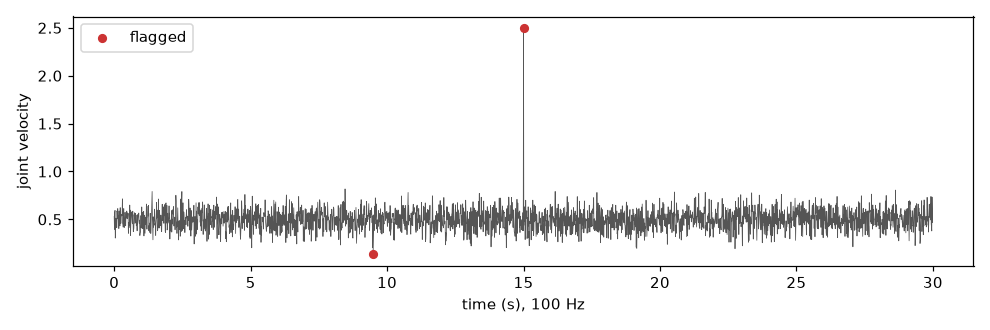
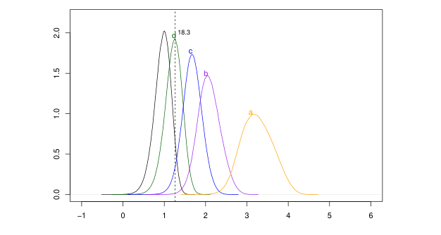

# Streaming anomaly detection

<object type="image/svg+xml" data="../../assets/maps/streaming.svg" style="width:100%"></object>

A streaming anomaly detector reads one sample at a time, compares it with the recent past, and answers at once with a score and a yes/no flag, without seeing what comes next.

A stock-index trading day stream: daily returns in percent around 0.05 with noise 0.8, and one crash day at sample 1000. The detector flags the crash on the same day.

```python
import numpy as np
from dense_armor.core.online.anomaly.streaming import streamDD

rng = np.random.default_rng(42)
r = 0.05 + 0.8 * rng.standard_normal(2000)
r[1000] = -9.0
det = streamDD(radius=30, ref_mult=3, n_sigmas=4.0)
flags = np.flatnonzero([det.update(float(x)) for x in r])
print(flags)
```

```
[   4  949 1000]
```

Sample 1000 is the crash; sample 4 is warm-up; sample 949 is one ordinary noise value out of 1,999, one false alarm. Executed with dense_armor 1.7.2. The robot cases are below.

These tools give every new reading a score that says how unusual it is compared with the last few readings, and a yes/no flag when it is too unusual. They answer at once, one reading at a time, without waiting for what comes next.

A robot joint sends its velocity 100 times a second. Most readings are ordinary noise; once in a
while one is absurd, because the arm bumped into something or a cable gave a false reading. The
controller must know *right now*, on that very sample, without waiting for the future. The tools
on this page give every new sample a score that says how unusual it is compared with the recent
past, and a yes/no flag when it is too unusual.



## 6. Two joints that must agree: online robust Mahalanobis

Some faults are visible only in the *combination* of channels: each joint alone looks normal,
but together they disagree. `OnlineRobustMahalanobis` learns how the channels usually move
together and scores how far a sample is from that pattern.

```python
import numpy as np
from dense_armor.core.online.anomaly.mahalanobis import OnlineRobustMahalanobis

rng = np.random.default_rng(3)
a = rng.normal(0, 1, 500)
b = a + 0.1 * rng.normal(0, 1, 500)
m = OnlineRobustMahalanobis(feature_keys=["a", "b"])
for x, y in zip(a, b):
    m.learn_one({"a": float(x), "b": float(y)})
print(round(m.score_one({"a": 1.0, "b": 1.0}), 1), round(m.score_one({"a": 1.0, "b": -1.0}), 1))
```

```
1.5 24.7
```

Two joints that always move together (`b` follows `a`). The sample `(1, 1)` moves them together:
score 1.5, normal. The sample `(1, −1)` moves them in opposite directions: each value alone is
ordinary (one standard deviation), but the pair is unusual, score 24.7.

The score is the Mahalanobis distance

$$D(x) = \sqrt{\sum_{j=1}^{d} \frac{\langle x - \bar m,\; P_j\rangle^2}{\delta_j}},$$

where $\bar m$ is the robust centre (the geometric median, the point with the smallest total
distance to all samples), $P_j$ are the main directions in which the channels vary together and
$\delta_j$ how much they vary along each one (eigenvectors and eigenvalues of the *median
covariation matrix*, a robust version of the covariance). Both are updated at every sample by a
small step towards the new data:

$$m_{n+1} = m_n + \gamma_{n+1}\,\frac{X_{n+1} - m_n}{\lVert X_{n+1} - m_n\rVert}, \qquad \gamma_n = c_\gamma\,(n + n_0)^{-\gamma},$$

and the same for the covariation matrix with the outer product $(X - m)(X - m)^\top$. Dividing
by the distance means one absurd sample moves the estimate by at most $\gamma$, whatever its
size: that is what makes it robust. Source: Guillot, Godichon-Baggioni, Robin and Sansonnet
(arXiv:2601.03957), the online scheme of section 3.2 (the recursion of the median is equation 8, in Appendix A.1; section numbers are those of arXiv v1).



*From Guillot et al. (arXiv:2601.03957), Figure 2: density of the (log10) Mahalanobis distance of
an outlier under four contamination scenarios (A–D); the dotted line is the inlier threshold. The
further a curve sits to the right of the line, the easier the outlier is to flag. Reproduced under
the paper's CC BY 4.0 licence.*

## API reference


::: dense_armor.core.online.anomaly.mahalanobis

## Details

- **Online robust Mahalanobis, differences from the paper.** This module is the minimal version
  of Guillot et al.: it scores with the eigenvalues $\delta_j$ of the median covariation matrix
  and does not run the Robbins–Monro step that reconstructs the true variances $\lambda_j$, so
  the scale of the score is larger than the classical chi-squared one (threshold 7.0 by
  default). It also centres the outer product on the averaged median $\bar m$ and averages with
  weight $1/n$ (the paper uses $m_n$ and $1/(n+2)$).

## The pages of the section

Only pages that already exist are linked; pages created in tappa C are added then.

| Page | Object |
|---|---|
| [Stream](index.md) | the section index (this page) |
| [Flag](streaming_deviation_detector.md) | `streamDD` |
| [Score](streaming_deviation_scorer.md) | `streamDS` |
| [Multi](multi_channel_streaming_deviation_detector.md) | `MultistreamDD` |
| class_seg_multi | `class_seg_multi` |
| [Hampel](hampel_scorer.md) | `HampelScorer` |
| [Tukey](tukey_scorer.md) | `TukeyScorer` |
| [Chauvenet](chauvenet_scorer.md) | `ChauvenetScorer` |
| [Sigma](sigma_clip_scorer.md) | `SigmaClipScorer` |
| hampel_filter | `HampelFilter` |
| [OnlineRobustMahalanobis](../mahalanobis.md) | `OnlineRobustMahalanobis`, the full page of the anomaly section |
