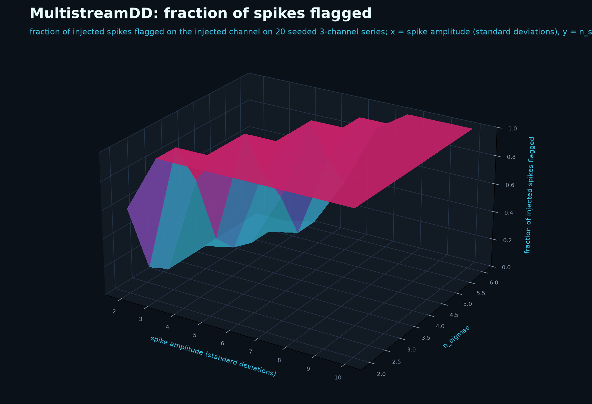

# MultistreamDD

[← Streaming anomaly detection](index.md)

You have several numbers arriving together, for example the cost of executing an order on several markets, or the velocity of every robot joint. `MultistreamDD` reads one vector per call and returns one flag per channel. Each channel is scored exactly as if a `streamDD` ran on that channel alone; channels never influence each other. A channel that is unusual in its own history is flagged, even if the others are normal.



On a seeded noise stream with one injected spike on one channel, this surface shows how often the spike is flagged on that channel, on a scale from 0 to 1. The horizontal axis is the spike amplitude in standard deviations; the other axis is `n_sigmas`, the flagging threshold. Higher means the spike is caught more often.

## A first example: three daily-cost streams

A desk watches the daily cost of executing an order on three markets at once. One day one market's cost spikes; only that channel is flagged.

```python
import numpy as np
from dense_armor.core.online.anomaly.streaming import MultistreamDD

rng = np.random.default_rng(0)
base = 12.0 + 1.5 * rng.standard_normal((500, 3))
base[250, 1] = 25.0
det = MultistreamDD(n_channels=3, radius=30, ref_mult=3, n_sigmas=4.0)
flags = np.array([det.update(row) for row in base])
print(flags[250], np.argwhere(flags[10:]).tolist())
```

```
[False  True False] [[240, 1]]
```

The stream is 500 days, three channels, daily cost around 12 with noise 1.5, and one spike at day 250 (value 25.0) on channel 1. Day 250 flags only channel 1. `np.argwhere(flags[10:])` holds `[sample - 10, channel]`, so `[240, 1]` is day 250 channel 1. `flags[10:]` skips the first ten printed days, not the per-channel warm-up.


On three seeded daily-cost streams, one spike day on one channel is flagged on that channel only.

## The same on a robot

A robot has several joints; `MultistreamDD` watches each one with its
own window. The measure for each channel is the same `z` as `streamDD`; see [streamDD](streaming_deviation_detector.md).

```python
import numpy as np
from dense_armor.core.online.anomaly.streaming import MultistreamDD

rng = np.random.default_rng(0)
qd = 0.1 * rng.standard_normal((500, 6))
qd[300, 2] = 3.0
det = MultistreamDD(n_channels=6, radius=30, ref_mult=3, n_sigmas=4.0)
flags = np.array([det.update(row) for row in qd])
print(flags[300], np.argwhere(flags[10:]).tolist())
```

```
[False False  True False False False] [[58, 5], [274, 4], [290, 2]]
```

Six joints, one fault on joint 2 at sample 300: row 300 flags only joint 2. `np.argwhere(flags[10:])` holds `[sample - 10, joint]`: `[290, 2]`
is the fault, and `[58, 5]`, `[274, 4]` are two noise values out of 2,940 checks. Each joint keeps
its own independent window; no need to write the loop over joints by hand.

## How it works

For each channel the class keeps an independent `streamDD`. On each call it reads the same `n_channels` values, scores each value against that channel's own recent window, and returns a boolean per channel. No channel affects another. The per-channel rule is the `z` score described on the `streamDD` page.

`update(x_vec)` returns a boolean array of length `n_channels`. `n_channels` is required. The input vector must have exactly `n_channels` values. Each channel has its own causal window of `radius * ref_mult` recent values and its own warm-up (`len < 4`, then `False`). The flags list `[sample - offset, channel]` is produced by `numpy.argwhere`, not by the class.

## The parameters

`MultistreamDD` is not an `Estimator` and not an `AnomalyDetector`: it is a plain class. `update(x_vec)` returns a boolean array. Signature:

`(self, n_channels: int, radius: int = 10, ref_mult: int = 3, n_sigmas: float = 3.0, eps: float = 1e-09)`

| Parameter | Default | What it does |
|---|---|---|
| `n_channels` | required | number of independent channels; `update` gets a vector of this length |
| `radius` | 10 | with `ref_mult`, each channel's causal window holds `radius * ref_mult` values |
| `ref_mult` | 3 | window length multiplier |
| `n_sigmas` | 3.0 | per-channel flag when `z > n_sigmas` (examples use 4.0) |
| `eps` | 1e-9 | degenerate-scale branch; below it the window is treated as flat |

## API reference

::: dense_armor.core.online.anomaly.streaming.MultistreamDD

## Details

- **Implementation.** `dense_armor/core/online/anomaly/streaming.py`. `update` converts `x_vec` to `as_default_array(...).ravel()`; `x_vec.size != self.n_channels` raises `ValueError("expected N channels, got ...")`. `_detectors` is a list of `streamDD(radius, ref_mult, n_sigmas, eps)`, one per channel. `n_sigmas`, `eps` passed through. (`MultiChannel...` itself never reads `n_missing`; per-channel missing handling is in `streamDD`.)
- **Per-channel independence.** a fast joint and an almost still one have different natural noise scales; a shared scale would desensitise the slow one or give false alarms on the active one. Same rule as `streamDD`, no new algorithm; ergonomics, not a new algorithm. `class_seg_multi` applies `classify_segments` per column separately; not this class.
- **Causality.** per channel `_window_causal`, only past values, no look-ahead.
- **Warm-up.** `flags[10:]` in the examples only skips printing; per-channel `len < 4`, then `False`.
- **Source.** `dense_armor/core/online/anomaly/streaming.py`. Output `[False False  True False False False] [[58, 5], [274, 4], [290, 2]]` ; `[False  True False] [[240, 1]]` . Provenance for `streamDD` (Arbiter, Dense-Evolution-Discovery) is on the page of that object.
