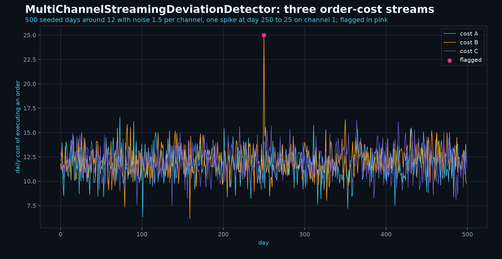

# MultistreamDD

[← Streaming anomaly detection](index.md)

When receiving multiple numerical streams simultaneously — such as the execution cost of an order across different markets or the velocity of each robot joint — MultistreamDD acquires a vector for each call and returns a boolean flag for each individual channel. Each channel is evaluated exactly as if streamDD were running in isolation on it: channels never influence each other. If a channel exhibits an anomaly compared to its own recent history, it is flagged regardless of whether the other channels remain within the norm.

The name MultistreamDD is short for Multi-channel Stream Deviation Detector: a dedicated instance of streamDD for each channel of a vector, such as the joints of a robotic arm or the portfolios of a trading desk.


On a noisy stream where a spike is injected on a single channel, this surface indicates the detection frequency on a scale from 0 to 1. The horizontal axis represents the spike amplitude in standard deviations, while the other axis indicates n_sigmas (the flagging threshold). A higher value corresponds to greater sensitivity.

## A first example: three daily cost streams

A trader simultaneously monitors the daily execution cost of orders across three distinct markets. On a specific day, the cost on one of the markets experiences a sudden surge: the detector flags exclusively that channel.

```python
import numpy as np
from dense_armor.core.online.anomaly.streaming import MultistreamDD

rng = np.random.default_rng(0)
base = 12.0 + 1.5 * rng.standard_normal((500, 3))
base[250, 1] = 25.0
det = MultistreamDD(n_channels=3, radius=30, ref_mult=3, n_sigmas=4.0)
flags = np.array([det.update(row) for row in base])
print(flags[250], np.argwhere(flags[10:]).tolist())
```

```
[False  True False] [[240, 1]]
```

The simulation covers 500 days across three channels, with a daily average cost of about 12, a noise equal to 1.5, and an isolated spike on day 250 (value 25.0) on channel 1. On day 250, only channel 1 is flagged (`[False, True, False]`). The instruction np.argwhere(flags[10:]) returns `[sample - 10, channel]` pairs, so `[[240, 1]]` identifies day 250 on channel 1. The flags[10:] slice serves solely to exclude the first ten days from printing, without altering the internal warm-up phase of each channel.



Across three parallel series, the anomaly is detected and marked exclusively on the affected channel.

## The same applies to a robot

A robot has multiple joints: MultistreamDD monitors each one with its own independent window, applying for each channel the same z metric described on the streamDD page.

```python
import numpy as np
from dense_armor.core.online.anomaly.streaming import MultistreamDD

rng = np.random.default_rng(0)
qd = 0.1 * rng.standard_normal((500, 6))
qd[300, 2] = 3.0
det = MultistreamDD(n_channels=6, radius=30, ref_mult=3, n_sigmas=4.0)
flags = np.array([det.update(row) for row in qd])
print(flags[300], np.argwhere(flags[10:]).tolist())
```

```
[False False  True False False False] [[58, 5], [274, 4], [290, 2]]
```

In this scenario with six joints and a fault on joint 2 at sample 300, row 300 flags exclusively joint 2. The output of np.argwhere(flags[10:]) returns indices in the format `[sample - 10, joint]`: `[290, 2]` corresponds to the real fault at sample 300, while `[58, 5]` and `[274, 4]` are two normal extreme noise fluctuations out of a total of 2,940 checks. Each joint maintains its own separate historical window, avoiding the need to manually manage a loop over individual channels.

## How it works

For each channel, the class instantiates and manages an independent streamDD object. At each call, it reads a vector of n_channels values, compares each element with the recent window of the respective channel, and returns an array of booleans. Channels never interact with each other, and each follows the z-score rule illustrated in the streamDD documentation.

The update(x_vec) method returns a boolean array of length n_channels (a mandatory parameter, which must match the exact dimension of the input vector). Each channel has its own causal window of radius * ref_mult recent samples and its own warm-up phase (len < 4, during which it always returns False). The `[sample - offset, channel]` coordinates shown in the examples are generated by numpy.argwhere and not directly by the class.

## The parameters

MultistreamDD does not inherit from Estimator nor from AnomalyDetector: it is a lightweight class in which update(x_vec) directly returns a boolean array.

Signature:

`MultistreamDD(n_channels: int, radius: int = 10, ref_mult: int = 3, n_sigmas: float = 3.0, eps: float = 1e-09)`

| Parameter | Default | Description |
|---|---|---|
| n_channels | required | Number of independent channels; update expects a vector of this length. |
| radius | 10 | Base unit of the window; together with ref_mult it defines the capacity per channel (radius * ref_mult). |
| ref_mult | 3 | Window length multiplier. |
| n_sigmas | 3.0 | Activation threshold per channel when z > n_sigmas (in the examples it is set to 4.0). |
| eps | 1e-9 | Threshold for degenerate scale; below this value the window is treated as flat. |

## API reference

::: dense_armor.core.online.anomaly.streaming.MultistreamDD

## Details

- Implementation: defined in dense_armor/core/online/anomaly/streaming.py. The update method converts x_vec via as_default_array(...).ravel(); if x_vec.size != self.n_channels, it raises ValueError("expected N channels, got ..."). The internal attribute _detectors holds a list of streamDD(radius, ref_mult, n_sigmas, eps) instances, one per channel, to which n_sigmas and eps are forwarded. (Note: the multi-channel class does not directly expose n_missing; missing value handling occurs locally inside each streamDD).
- Per-channel independence: a fast-moving joint and a nearly stationary one exhibit very different natural noise scales; using a shared scale would desensitize the slow joint or generate false alarms on the more active one. The class does not introduce a new algorithm, but offers an ergonomic interface based on the same rule as streamDD. (To apply classify_segments column-wise on an entire offline recording, see class_seg_multi instead).
- Causality: uses the _window_causal logic on each individual channel, relying exclusively on past samples without any look-ahead.
- Warm-up phase: in the examples, the flags[10:] slice only filters the printed output; at the algorithmic level, each channel requires at least 4 samples (len < 4) before being able to emit a True flag.
- Provenance: defined in dense_armor/core/online/anomaly/streaming.py. Reference output of the examples: [False False True False False False] [`[58, 5]`, `[274, 4]`, `[290, 2]`] and [False True False] `[[240, 1]]`. For the evolutionary history of streamDD (Arbiter, Dense-Evolution-Discovery), refer to its respective page.
