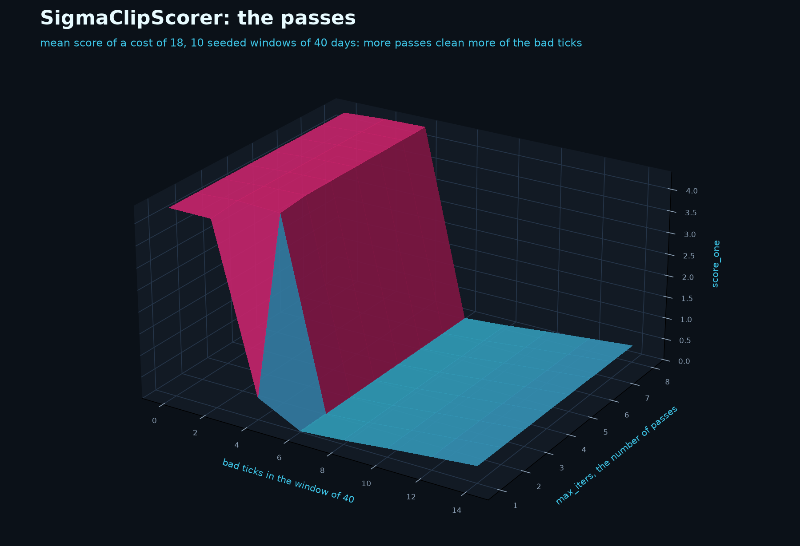
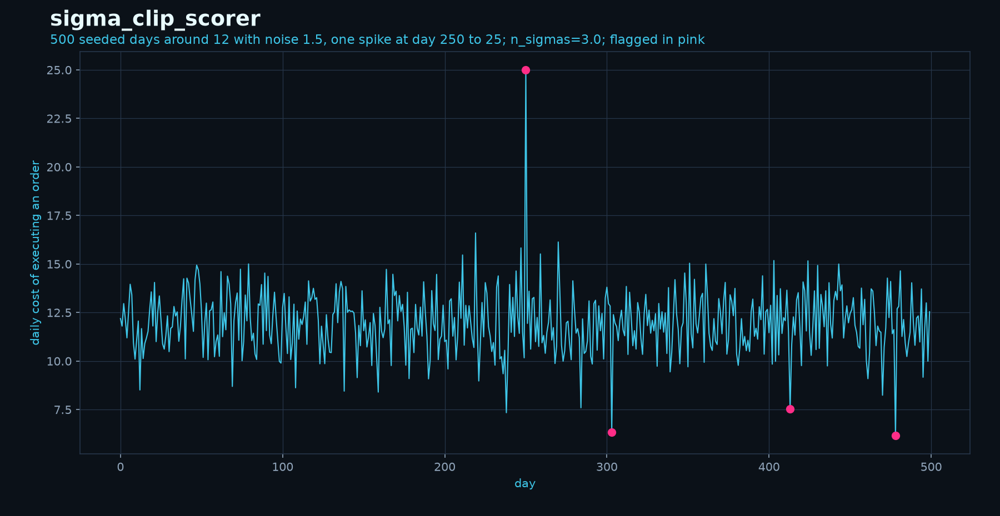

# SigmaClipScorer

[← Streaming anomaly detection](index.md)

`SigmaClipScorer` first removes points beyond `n_sigmas`, recomputes the centre and spread of what remains, repeats until stable or `max_iters`, and then scores the new value by how far it is from that cleaned centre in cleaned-standard-deviation units. The window is `2 * radius` samples strictly before the value. `is_outlier` is `True` when the score is above `n_sigmas`. It is an `AnomalyDetector`, causal.



On a seeded noise stream with one injected spike, this surface shows how often the spike is flagged. The horizontal axis is the spike amplitude in standard deviations; the other axis is `n_sigmas`. Higher means the spike is caught more often.

## A first example: a daily cost of executing an order

A desk watches the daily cost of executing an order. Each day it tells the scorer the new cost, then asks if the day is an outlier.

```python
import numpy as np
from dense_armor.core.online.anomaly.filters import SigmaClipScorer

rng = np.random.default_rng(0)
cost = 12.0 + 1.5 * rng.standard_normal(500)
cost[250] = 25.0
s = SigmaClipScorer(radius=15)
for v in cost[:250]:
    s.learn_one({"x": float(v)})
print(s.is_outlier({"x": float(cost[250])}), round(s.score_one({"x": float(cost[250])}), 2))
```

```
True 7.13
```



On the same seeded daily-cost stream, the spike day is flagged.

## The same on a robot

```python
import numpy as np
from dense_armor.core.online.anomaly.filters import SigmaClipScorer

rng = np.random.default_rng(0)
s = SigmaClipScorer(radius=10, n_sigmas=3.0)
for v in rng.normal(0, 1, 20):
    s.learn_one({"v": float(v)})
print(s.is_outlier({"v": 50.0}))
```

```
True
```

The robot case comes last. A reading of 50 is an outlier.

## How it works

The score is how far the new value is from a cleaned centre, measured in cleaned-standard-deviation units. First it removes obvious outliers from the recent window, then it measures. `learn_one` adds a value; `score_one` does not change anything.

It takes the `2 * radius` samples strictly before the value. The mean and standard deviation are recomputed after removing points beyond `n_sigmas`, repeated until stable or `max_iters`, leaving `mu_clean` and `sigma_clean`. The score is

$$\mathrm{score} = \frac{|x - \mu_{\mathrm{clean}}|}{\sigma_{\mathrm{clean}}},$$

where $x$ is the new value; $\mu_{\mathrm{clean}}$ is the mean of the cleaned window; $\sigma_{\mathrm{clean}}$ is its standard deviation. `n_sigmas` is both the clipping threshold and the outlier threshold. `is_outlier` is `score_one(x)` above `n_sigmas`. `score_one` returns `0.0` for an unusable value or while fewer than four values have been learned. On a window whose cleaned scale is degenerate, the score is `positive infinity` if the value deviates from `mu_clean`, `0.0` if it does not. `score_one` does not change anything.

`SigmaClipScorer` is `robust_filters.sigma_clip` applied to a causal window. See the comparison on [HampelScorer](hampel_scorer.md).

## The parameters

`SigmaClipScorer` is an `AnomalyDetector`. `learn_one(x)`, `score_one(x)`, `is_outlier(x)`, `n_missing`. Signature:

`(self, radius: int = 10, n_sigmas: float = 3.0, max_iters: int = 5, feature: str | None = None, eps: float = 1e-09)`

| Parameter | Default | What it does |
|---|---|---|
| `radius` | 10 | with a `2 * radius` causal window |
| `n_sigmas` | 3.0 | clipping threshold and outlier threshold |
| `max_iters` | 5 | maximum number of clipping iterations |
| `feature` | `None` | key of the feature to watch; `None` takes the feature with the smallest key, order-independent |
| `eps` | 1e-9 | below this scale the cleaned window is treated as flat |

## API reference

::: dense_armor.core.online.anomaly.filters.SigmaClipScorer

## Details

- **Sources.** Standard in astronomy; see Akritas, M. G., Bershady, M. A. (1996). Linear regression for astronomical data with measurement errors and intrinsic scatter. *ApJ* 470, 706. Batch `robust_filters.sigma_clip`.
- **Causal window.** `2 * radius` strictly before; not part of own window.
- **Comparison.** table on [HampelScorer](hampel_scorer.md).
