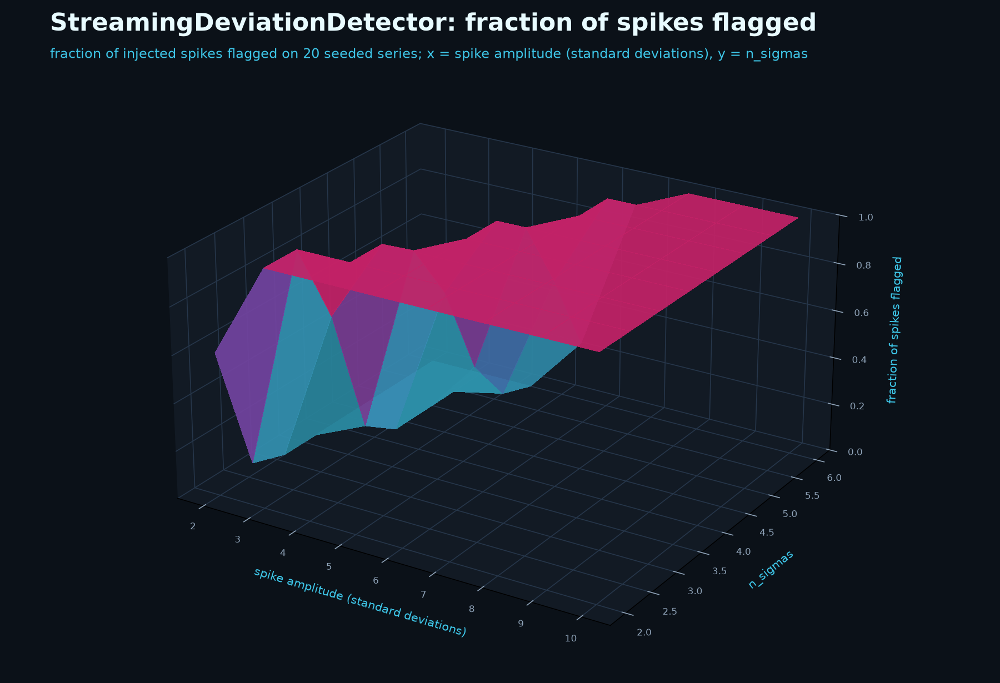
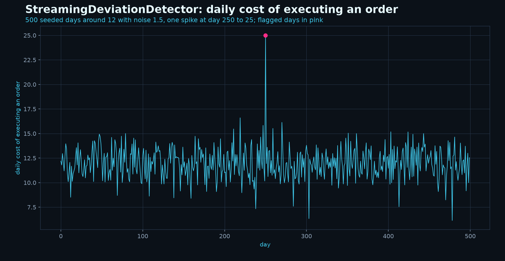

# Flag: a yes or no for each new value

[← Stream](index.md)

You have a stream of numbers, for example the daily cost of executing an order . You want to know, on the sample that arrives, whether it is too unusual compared with the recent past. `streamDD` reads one value per call, compares it with a robust median and spread of the window of strictly previous samples, and answers `True`, without seeing anything in the future. A robot joint uses the same call inside its control loop.



On a seeded noise stream with one injected spike, this surface shows how often the spike is flagged, on a scale from 0 to 1. The horizontal axis is the spike amplitude in standard deviations; the other axis is `n_sigmas`, the flagging threshold. Higher means the spike is caught more often.

## A first example: a daily cost of executing an order

A desk watches the daily cost of executing an order . Most days are ordinary; one day the cost spikes. The detector flags that day on the same day.

```python
import numpy as np
from dense_armor.core.online.anomaly.streaming import streamDD

rng = np.random.default_rng(0)
cost = 12.0 + 1.5 * rng.standard_normal(500)
cost[250] = 25.0
det = streamDD(radius=30, ref_mult=3, n_sigmas=4.0)
flags = np.flatnonzero([det.update(float(x)) for x in cost])
print(flags)
```

```
[250]
```

The stream is 500 days of daily execution cost around 12 with noise 1.5, and one spike at day 250 (value 25.0). The detector flags day 250, nothing else, executed with dense_armor 1.7.2.



On the same seeded daily-cost stream as the code above, one spike day is flagged. The line is the daily cost; the flagged day is marked.

## The same on a robot

`streamDD` takes one value per call and answers `True` when it deviates.

```python
import numpy as np
from dense_armor.core.online.anomaly.streaming import streamDD

rng = np.random.default_rng(42)
v = 0.5 + 0.1 * rng.standard_normal(3000)
v[1500] = 2.5
det = streamDD(radius=30, ref_mult=3, n_sigmas=4.0)
flags = np.array([det.update(x) for x in v])
print(np.flatnonzero(flags))
```

```
[   4  949 1500]
```

The stream is 30 seconds of a joint velocity around 0.5 with noise 0.1, and one collision at
sample 1500 (value 2.5). The detector flags sample 1500. The first four samples cannot flag; sample 4 can flag, and here it does. Sample 949 is one
ordinary noise value that happened to fall far out: one false alarm in 3,000 samples with these
settings. Each call to `update` looks only at the past, so the answer is available on the same
sample, inside the control loop.


## How it works

The detector compares the new value with the median of a window of past samples, in units of
the window's own spread.

```python
import numpy as np

w = np.array([10, 11, 9, 10, 12, 10, 11, 9, 10])
x = 30.0
med = np.median(w)
mad = np.median(np.abs(w - med))
s = 1.4826 * mad
print(med, mad, round(s, 4), round(abs(x - med) / s, 2))
```

```
10.0 1.0 1.4826 13.49
```

The score is

$$z = \frac{|x - \mathrm{med}(w)|}{S}, \qquad S = 1.4826 \cdot \mathrm{MAD}(w), \qquad \mathrm{MAD}(w) = \mathrm{med}\big(|w - \mathrm{med}(w)|\big),$$

where:

- $w$ is the window of past samples before the new one; it has `radius * ref_mult` values;
- $\mathrm{med}(w)$ is its median, the "usual" value; unlike the mean, one absurd sample cannot
  drag it away;
- $\mathrm{MAD}(w)$ is the median distance of the samples from that median, a robust width;
- $1.4826$ turns the MAD into the standard deviation when the noise is normal (it is
  $1/\Phi^{-1}(3/4)$; numerically verified here: `1 / NormalDist().inv_cdf(0.75) = 1.4826`), so $z$ reads as "how many standard deviations away";
- the sample is flagged when $z$ is larger than `n_sigmas`.

In the example the past window is around 10 with MAD 1, so $S = 1.4826$ and the new value 30 is
13.49 standard deviations away. This robust score is the Hampel identifier
(Pearson et al., 2016, "Generalized Hampel filters", *EURASIP J. Adv. Signal Process.*).

The window length is exactly `radius * ref_mult`.

## The parameters

`streamDD` is NOT an `Estimator`/`AnomalyDetector`: it is a plain class, no `learn_one`/`score_one`; `update(x)` returns a boolean. Signature:

`(self, radius: int = 10, ref_mult: int = 3, n_sigmas: float = 3.0, eps: float = 1e-09)`

| Parameter | Default | What it does |
|---|---|---|
| `radius` | 10 | with `ref_mult`, the window holds `radius * ref_mult` values |
| `ref_mult` | 3 | see `radius` |
| `n_sigmas` | 3.0 | flag when `z > n_sigmas` (page examples use 4.0) |
| `eps` | 1e-9 | `scale < eps` degenerate-scale branch; `deviation > eps`; non-finite never enters buffer |

`update(x)` returns a boolean. `last_deviation` (`deviation`, or `deviation / scale`, or 0.0) readable after each call.

## API reference

::: dense_armor.core.online.anomaly.streaming.streamDD

## Details

- **Implementation.** `dense_armor/core/online/anomaly/streaming.py`. `update` returns `False` for a non-finite value; while fewer than four values have been seen it appends and returns `False`. Then `deviation = abs(x - med)`. If `scale < eps`, return `deviation`; otherwise return `deviation / scale`. `last_deviation` is informative. `1.4826 * MAD`.
- **Causality.** `_window_causal` uses only points before `i`, never `i` itself, never after; this class uses `deque(maxlen=_span)`. No look-ahead.
- **Warm-up.** While fewer than four samples have been seen, no sample can flag; sample 4 can flag.
- **Provenance.** `streamDD` is the causal per-sample half of the
  [Arbiter](../../protect/arbiter.md)'s per-point deviation check; the spike-versus-regime label
  needs to see the end of a run and stays batch-only. It was promoted from
  Dense-Evolution-Discovery after validation on two real physical domains (SO-101 robot arm,
  UCI HAR inertial data). Source docstring `streaming.py` (Dense-Evolution-Discovery Experiments 48-49; `classify_segments`; `_window_causal`; `_robust_center_scale`; O(span) not two-heap O(log span); ~18.6 kHz measured in Dense-Evolution-Discovery).
- **Paper.** Pearson et al. 2016, "Generalized Hampel filters". `1.4826 = 1/\Phi^{-1}(3/4)` numerically verified.
- **Sources.** `dense_armor/core/online/anomaly/streaming.py`; `dense_armor/core/online/protect/arbiter.py`. 
