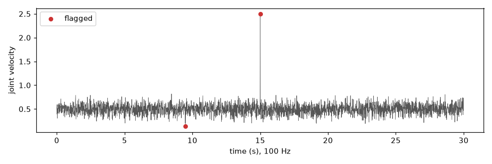

# streamDD

[← Streaming anomaly detection](index.md)

Imagine having a continuous stream of data, such as the daily execution cost of orders. You want to know, at the very instant a new sample arrives, if that value is too anomalous compared to the recent past. streamDD reads one value per call, compares it with the robust median and the dispersion of a window composed of the strictly preceding samples, and returns True in case of an anomaly, without ever looking into the future. Similarly, a robot joint can use the exact same call inside its real-time control loop.

The name streamDD is short for Stream Deviation Detector: a detector that receives one value at a time from a stream and flags if it deviates significantly from recent history.


In a stream with background noise into which a spike is injected, this surface indicates the frequency with which the anomaly is flagged on a scale from 0 to 1. The horizontal axis represents the spike amplitude in standard deviations, while the other axis indicates n_sigmas (the flagging threshold). A higher value indicates greater detection sensitivity.

## A first example: daily order execution cost

A trading desk monitors the daily execution cost of orders. On most days the values fall within the norm, but on a specific day the cost experiences a sudden surge. The detector identifies and flags the anomaly on the very same day.

```python
import numpy as np
from dense_armor.core.online.anomaly.streaming import streamDD

rng = np.random.default_rng(0)
cost = 12.0 + 1.5 * rng.standard_normal(500)
cost[250] = 25.0
det = streamDD(radius=30, ref_mult=3, n_sigmas=4.0)
flags = np.flatnonzero([det.update(float(x)) for x in cost])
print(flags)
```

```
[250]
```

The stream simulates 500 days with an average cost of about 12, a background noise equal to 1.5, and an isolated spike on day 250 (value 25.0). The detector flags exclusively day 250 (run with dense_armor 1.7.2).


The line shows the cost trend over time and highlights the identified spike.

## The same applies to a robot

streamDD acquires a single value per call and returns True as soon as it detects an anomalous deviation.

```python
import numpy as np
from dense_armor.core.online.anomaly.streaming import streamDD

rng = np.random.default_rng(42)
v = 0.5 + 0.1 * rng.standard_normal(3000)
v[1500] = 2.5
det = streamDD(radius=30, ref_mult=3, n_sigmas=4.0)
flags = np.array([det.update(x) for x in v])
print(np.flatnonzero(flags))
```

```
[   4  949 1500]
```

The simulation covers 30 seconds (at 100 Hz) of a robotic joint's velocity around 0.5, with noise 0.1 and a collision at sample 1500 (value 2.5). The detector correctly flags sample 1500. The first four samples (indices 0–3) cannot be evaluated due to lack of history; sample 4 is the first evaluable one and, in this case, is flagged. Sample 949, on the other hand, is a particularly extreme normal noise fluctuation: a single false alarm out of 3,000 samples with this configuration. Each call to update examines exclusively the past, making the result available on the sample itself, directly inside the control loop.



## How it works

The detector compares each new value x with the median of a window of preceding samples, measuring the deviation in units proportional to the dispersion of the window itself.

```python
import numpy as np

w = np.array([10, 11, 9, 10, 12, 10, 11, 9, 10])
x = 30.0
med = np.median(w)
mad = np.median(np.abs(w - med))
s = 1.4826 * mad
print(med, mad, round(s, 4), round(abs(x - med) / s, 2))
```

```
10.0 1.0 1.4826 13.49
```

The anomaly score z is calculated as:

$$z = \frac{|x - \mathrm{med}|}{s}$$

Where:

- w is the window of samples strictly preceding the new value (it contains radius * ref_mult elements).
- med is the median of w, i.e., the "normal" reference value (unlike the mean, it is not skewed by single anomalous values).
- MAD is the median absolute deviation ($\mathrm{median}(|w - \mathrm{med}|)$), a robust measure of dispersion.
- s = 1.4826 × MAD converts the MAD into an estimate of the standard deviation under the assumption of Gaussian noise (the exact factor is 1 / Φ⁻¹(0.75) ≈ 1.4826). In this way, z directly indicates "how many standard deviations away" the sample is located.
- The sample is flagged as anomalous when z > n_sigmas.

In the example, the preceding window has median 10 and MAD = 1, so s = 1.4826 and the new value 30.0 is located 13.49 standard deviations away. This robust criterion corresponds to the Hampel identifier (Pearson et al., 2016, "Generalized Hampel filters", EURASIP J. Adv. Signal Process.).

The maximum window length is exactly radius * ref_mult.

## The parameters

streamDD does not inherit from Estimator or AnomalyDetector: it is a lightweight class lacking the learn_one and score_one methods, in which update(x) directly returns a boolean.

Signature:

`streamDD(radius: int = 10, ref_mult: int = 3, n_sigmas: float = 3.0, eps: float = 1e-09)`

| Parameter | Default | Description |
|---|---|---|
| radius | 10 | Base unit of the window; together with ref_mult it determines the capacity (radius * ref_mult). |
| ref_mult | 3 | Window length multiplier (see radius). |
| n_sigmas | 3.0 | Activation threshold: flags when z > n_sigmas (in the examples above it is set to 4.0). |
| eps | 1e-9 | Threshold to handle degenerate scales (scale < eps); non-finite values are ignored. |

After each call to update(x), in addition to the returned boolean value, it is possible to inspect the last_deviation attribute (which contains deviation / scale, or deviation in case of a degenerate scale, or 0.0).

## API reference

::: dense_armor.core.online.anomaly.streaming.streamDD

## Details

- Implementation: defined in dense_armor/core/online/anomaly/streaming.py. The update method returns False if the value is not finite; as long as the buffer contains fewer than four samples, it appends the data point and returns False. Subsequently, it calculates deviation = abs(x - med) and scale = 1.4826 * MAD. If scale < eps, it directly compares deviation > eps (and saves deviation in last_deviation); otherwise, it calculates z = deviation / scale (saved in last_deviation) and compares it with n_sigmas.
- Causality: replicates the behavior of _window_causal, using only points preceding index i (never i itself nor subsequent points) via a deque(maxlen=_span) structure. No look-ahead.
- Warm-up phase: until at least four samples have been acquired, no flag is emitted; the fifth sample (index 4) is the first one on which the detector can trigger.
- Provenance: streamDD represents the causal half (sample by sample) of Arbiter's deviation check (whereas the spike-versus-regime classification requires the end of the sequence and remains batch-only). It was promoted from Dense-Evolution-Discovery after being validated on two real physical domains: the SO-101 robotic arm and UCI HAR inertial data. (Source references: streaming.py, Dense-Evolution-Discovery experiments 48–49; classify_segments; _window_causal; _robust_center_scale; O(span) complexity instead of dual-heap $O(\log \mathrm{span})$; measured throughput of approximately 18.6 kHz).
