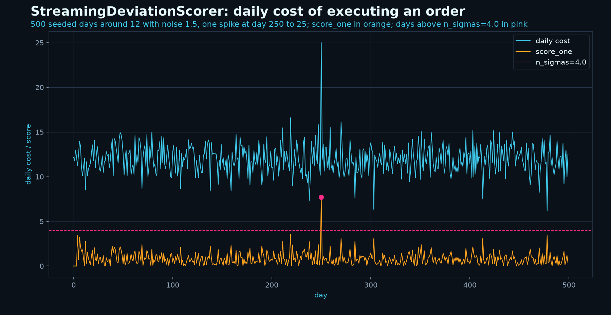

# Score: how strange a value is, as a number

[← Stream](index.md)

You want a number, not just a yes/no flag. On a stream you first ask for a score, then tell the estimator what really happened. `streamDS` returns how unusual a reading is compared with the window of readings it has already learned, in robust standard-deviation units. A score above your chosen `n_sigmas` means the sample would be flagged.


On a seeded noise stream with one injected spike, this surface shows the score on the spike. The horizontal axis is the spike amplitude in standard deviations; the other axis is `radius`, the size of the recent window. Higher means the spike is scored more strongly.

## A first example: a daily cost of executing an order

A desk watches the daily cost of executing an order. Each day it scores the new cost before learning it. On the day the cost spikes, the score is large; on an ordinary day it is small.

```python
import numpy as np
from dense_armor.core.online.anomaly.deviation import streamDS

rng = np.random.default_rng(0)
cost = 12.0 + 1.5 * rng.standard_normal(500)
cost[250] = 25.0
sc = streamDS(radius=30, ref_mult=3)
scores = []
for x in cost:
    scores.append(sc.score_one({"x": float(x)}))
    sc.learn_one({"x": float(x)})
print(round(scores[250], 1), round(scores[499], 2))
```

```
7.7 0.36
```

The stream is 500 days of daily execution cost around 12 with noise 1.5, and one spike at day 250 (value 25.0). The score at day 250 is 7.7 robust standard deviations; the score on day 499 is 0.36. A score above your chosen `n_sigmas`, for example `scores[250] > 4.0`, means the day would be flagged. `score_one` is called before `learn_one`, so the reading is scored against what came before it.



On the same seeded daily-cost stream as the code above, one spike day is above the threshold. The line is the daily cost; the orange line is the score; the dashed line is `n_sigmas=4.0`, a threshold the caller applies.

## The same on a robot

A robot joint uses the same `learn_one` / `score_one` interface. The feature key in this example is `v`.

```python
from dense_armor.core.online.anomaly.deviation import streamDS

sc = streamDS(radius=5, ref_mult=2)
for v in [1.0, 1.2, 0.9, 1.1, 1.0, 0.8, 1.05]:
    sc.learn_one({"v": v})
print(round(sc.score_one({"v": 50.0}), 1), round(sc.score_one({"v": 1.1}), 2))
```

```
330.5 0.67
```

A reading of 50 scores 330.5 robust standard deviations; a reading of 1.1 scores 0.67, ordinary. `score_one` never changes the estimator; `learn_one` adds the value to the window. A score above `n_sigmas` is exactly a flag of `streamDD`.

## How it works

The score says how far the new value is from the centre of the recent values, measured in robust standard deviations. Think of it as a "how strange is this?" number. First `learn_one` adds a value to a short list of recent values. Then `score_one` measures the new value against that list without adding it. If fewer than four values have been learned, the score is `0.0`. If the recent values are almost identical, the spread would be tiny; in that flat case the score is the plain distance, not the distance divided by a tiny spread.

`learn_one` adds one value to the window; `score_one` does not change anything. The window holds `radius * ref_mult` recent values. The robust centre is the median; the robust spread is `1.4826 * MAD`. `streamDS` reuses a `streamDD` inside and exposes only the score.

The score is

$$z = \frac{|x - \mathrm{med}(w)|}{S}, \qquad S = 1.4826 \cdot \mathrm{MAD}(w),$$

or $|x - \mathrm{med}(w)|$ when the window is flat. Here $x$ is the new value; $w$ is the window of values already learned; $\mathrm{med}(w)$ is its median, the usual value; $\mathrm{MAD}(w)$ is the median distance from that median; $S$ is the robust standard deviation; $1.4826$ makes `S` match the usual standard deviation when the noise is normal. This is the same `z` as on the `streamDD` page. `score_one` returns `0.0`, not `None`. A value that is not a number, or `None`, is not learned and `n_missing` is increased.

**Difference from `streamDD`.** `streamDD` answers `update(x)` returns a boolean, `True` when `z > n_sigmas`, and takes `n_sigmas` in its constructor. `streamDS` answers `score_one(x)` returns a float; you compare the score with your own `n_sigmas`. `n_sigmas` is not a constructor parameter of `streamDS`. `streamDD` is not an `AnomalyDetector`. See [streamDD](streaming_deviation_detector.md).

## The parameters

`streamDS` is an `AnomalyDetector`. `learn_one(x)` and `score_one(x)`. Signature:

`(self, radius: int = 10, ref_mult: int = 3, feature: str | None = None, eps: float = 1e-09)`

| Parameter | Default | What it does |
|---|---|---|
| `radius` | 10 | with `ref_mult`, the causal window holds `radius * ref_mult` values |
| `ref_mult` | 3 | window length multiplier |
| `feature` | `None` | key of the feature to watch; `None` takes the feature with the smallest key, order-independent |
| `eps` | 1e-9 | below this scale the window is treated as flat; the distance is returned directly |

`n_missing` counts values that are not a number or `None`. `score_one(x)` returns a float. `learn_one(x)`.

## API reference

::: dense_armor.core.online.anomaly.deviation.streamDS

## Details

- **Implementation.** `dense_armor/core/online/anomaly/deviation.py`. `_value` uses `_feature_value`. `score_one` reads the detector's window, returns `0.0` if the value is unusable or `len < 4`, computes `dev`, `dev if scale < eps else dev / scale`. `learn_one` calls `update`, increments `n_missing_` on `None`, returns `None`. `n_missing` property. 
- **Causality.** `score_one` uses only already-learned values; `learn_one` adds after scoring; `score_one` has no effect on state.
- **Distinction.** `streamDD` (`streaming.py`) vs `streamDS` (`deviation.py`, `AnomalyDetector`, compatible with `river`). `n_sigmas` belongs to `streamDD`, not `streamDS`. Flag `z > n_sigmas` is applied by the caller, or reproduced with `streamDD(..., n_sigmas=...)`; scorer does not read an inner flag.
- **Source.** `dense_armor/core/online/anomaly/deviation.py`; `dense_armor/core/online/anomaly/streaming.py`; `dense_armor/core/online/protect/arbiter.py`. `n_sigmas` absent from `__init__`.
