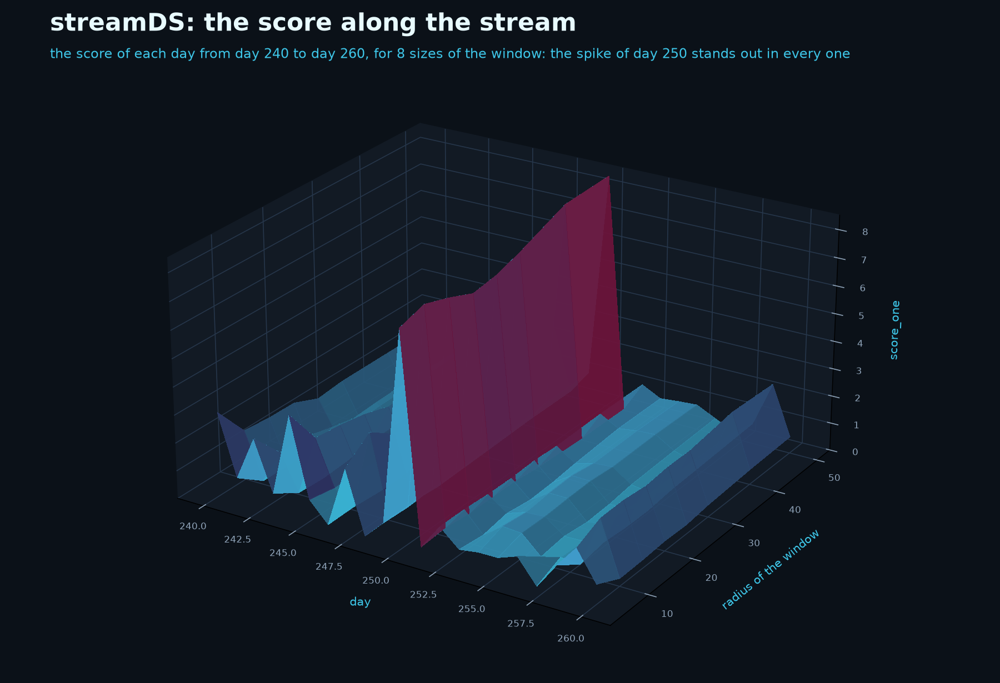

# streamDS

[← Streaming anomaly detection](index.md)

streamDS returns a numerical score instead of a simple boolean, exposing the classic learn_one / score_one interface typical of online learning systems.

The name streamDS is short for Stream Deviation Scorer: it provides the deviation of a value compared to the recent past in the form of a continuous number, instead of the binary answer (yes/no) offered by streamDD.



The surface shows the trend of the daily score around a spike as the window width varies. The horizontal axis represents the day, the other axis indicates radius (the window size), and the height corresponds to the calculated score.

## A first example: daily order execution cost

A system monitors the daily execution cost of orders. Over time, three anomalous days occur: on day 120 the cost drops to 3.0, on day 250 it rises to 25.0, and on day 400 it reaches 19.0. Each day the new data point is first evaluated and then acquired into the model, storing the resulting scores.

```python
import numpy as np
from dense_armor.core.online.anomaly.deviation import streamDS

rng = np.random.default_rng(0)
cost = 12.0 + 1.5 * rng.standard_normal(500)
cost[[120, 250, 400]] = [3.0, 25.0, 19.0]
sc = streamDS(radius=30, ref_mult=3)
scores = []
for x in cost:
    scores.append(sc.score_one({"x": float(x)}))
    sc.learn_one({"x": float(x)})
s = np.array(scores)
top = np.argsort(s)[::-1][:4]
print(top, np.round(s[top], 1), [int((s > n).sum()) for n in (3, 4, 5)])
```

```
[250 120 400 478] [7.7 5.3 4.6 3.6] [10, 3, 2]
```

Each day thus obtains its own anomaly index. The three critical days conquer the top three positions in the ranking: day 250 with a score of 7.7, day 120 with 5.3, and day 400 with 4.6. In fourth place is day 478, a normal noisy day with 3.6. Applying a threshold equal to 3 results in ten anomalous days; with threshold 4 they become three, and with threshold 5 only two — all with a single pass over the stream. Whereas a boolean detector forces setting the threshold before starting the stream, a continuous score allows choosing it afterwards, or sorting events and examining the most extreme cases.


The orange line traces the daily score trend: three days exceed the dashed threshold at 4, and the four absolute peaks are marked in pink.

## The same applies to a robot

```python
from dense_armor.core.online.anomaly.deviation import streamDS

sc = streamDS(radius=5, ref_mult=2)
for v in [1.0, 1.2, 0.9, 1.1, 1.0, 0.8, 1.05]:
    sc.learn_one({"v": v})
print(round(sc.score_one({"v": 50.0}), 1), round(sc.score_one({"v": 1.1}), 2))
```

```
330.5 0.67
```

A reading equal to 50 corresponds to 330.5 standard deviations, while a value of 1.1 stops at 0.67, perfectly within the norm. The score_one method never alters the internal state of the estimator, whereas learn_one actually inserts the data point into the window. Obtaining a score higher than n_sigmas is exactly equivalent to receiving a positive flag from streamDD.

## How it works

The score uses the exact same metric as streamDD: the distance of the new value from the window median, expressed in robust standard deviations (the full formula is available on the streamDD page). What changes in streamDS is the operational flow:

- learn_one(x) adds an observation to the historical window.
- score_one(x) queries the window and calculates the score without modifying its content, allowing the same value to be evaluated multiple times if necessary.

The standard usage loop involves first evaluating the new sample with score_one and only subsequently integrating it with learn_one, ensuring that each data point is judged exclusively against the past.

The window holds at most radius * ref_mult values. Until at least four samples are learned, the returned score is 0.0. Non-numeric values (NaN or infinities) are not learned and increment the n_missing counter. The estimator accepts a dictionary of features as input, such as {"x": 12.3}; leaving feature=None, it automatically selects the feature with the lexicographically smallest key.

## The parameters

streamDS is an AnomalyDetector equipped with the learn_one(x) and score_one(x) methods.

Signature:

`streamDS(radius: int = 10, ref_mult: int = 3, feature: str | None = None, eps: float = 1e-09)`

| Parameter | Default | Description |
|---|---|---|
| radius | 10 | Base unit of the window; together with ref_mult it defines the capacity (radius * ref_mult). |
| ref_mult | 3 | Window length multiplier. |
| feature | None | Key of the feature to monitor; if None, selects the smallest key. |
| eps | 1e-9 | Scale threshold: below this value the window is considered flat and the absolute distance is returned. |

streamDS does not include the n_sigmas parameter: applying a threshold (z > n_sigmas) is left to the user (alternatively, streamDD can be used, which directly integrates n_sigmas in the constructor).

## API reference

::: dense_armor.core.online.anomaly.deviation.streamDS

## Details

- Relation to streamDD: streamDS shares the exact same causal window and robust metric as streamDD, merely returning the raw numerical score instead of applying a boolean threshold.
- Theoretical references: the calculation criterion is based on the Hampel identifier, as described on the streamDD page.
