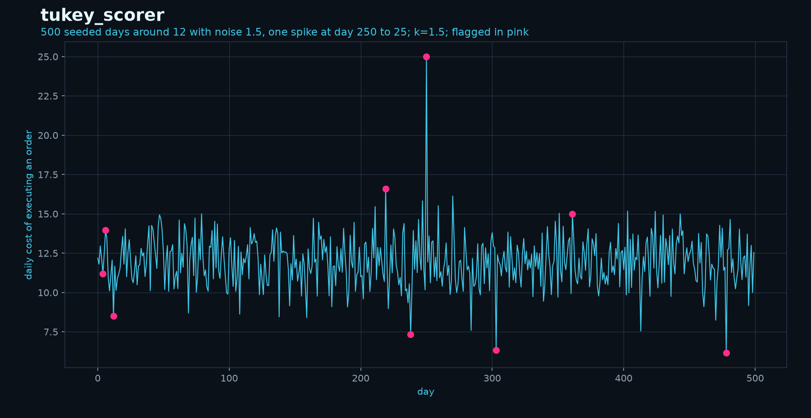

# Tukey: distance beyond the quartile fences

[← Stream](index.md)

`TukeyScorer` scores a new value by how far it lies beyond Tukey's fences, in interquartile-range units. The fences are `[Q1 - k * IQR, Q3 + k * IQR]`, built from the quartiles of a causal window of `2 * radius` samples strictly before the value; `k` is `1.5` for ordinary outliers, `3.0` for extreme ones. The score is `0.0` inside the fences; `is_outlier` is `True` when the score is above `0.0`. It is an `AnomalyDetector`, causal, no future.


On a seeded noise stream with one injected spike, this surface shows how often the spike is flagged. The horizontal axis is the spike amplitude in standard deviations; the other axis is `k`, the fence multiplier. Higher means the spike is caught more often.

## A first example: a daily cost of executing an order

A desk watches the daily cost of executing an order. Each day it tells the scorer the new cost, then asks if the day is an outlier.

```python
import numpy as np
from dense_armor.core.online.anomaly.filters import TukeyScorer

rng = np.random.default_rng(0)
cost = 12.0 + 1.5 * rng.standard_normal(500)
cost[250] = 25.0
s = TukeyScorer(radius=15)
for v in cost[:250]:
    s.learn_one({"x": float(v)})
print(s.is_outlier({"x": float(cost[250])}), round(s.score_one({"x": float(cost[250])}), 2))
```

```
True 2.6
```



On the same seeded daily-cost stream, the spike day is flagged; ordinary days can also be flagged.

## The same on a robot

```python
import numpy as np
from dense_armor.core.online.anomaly.filters import TukeyScorer

rng = np.random.default_rng(0)
s = TukeyScorer(radius=5)
for v in rng.normal(0, 1, 20):
    s.learn_one({"v": float(v)})
print(s.is_outlier({"v": 50.0}))
```

```
True
```

The robot case comes last. A reading of 50 is beyond the fences.

## How it works

The score says how far the new value is beyond the inner range, measured in interquartile-range units. First it finds the 25th and 75th percentiles of the recent window. `learn_one` adds a value; `score_one` does not change anything.

Tukey's fences are

$$\mathrm{low} = Q_1 - k \cdot \mathrm{IQR}, \qquad \mathrm{high} = Q_3 + k \cdot \mathrm{IQR}, \qquad \mathrm{IQR} = Q_3 - Q_1,$$

where $Q_1$ is the first quartile and $Q_3$ the third. A value inside `[low, high]` scores `0.0`. A value below `low` scores `(low - x) / IQR`. A value above `high` scores `(x - high) / IQR`. `k` is `1.5` for ordinary outliers, `3.0` for extreme outliers. The window holds `2 * radius` samples strictly before the value; it is never part of its own window. `score_one` returns `0.0` for an unusable value or while fewer than four values have been learned. On a flat window (`IQR == 0`) the score is `positive infinity` if the value differs from the fence, else `0.0`. `is_outlier` is `score_one(x)` above `0.0`.

`TukeyScorer` is `robust_filters.tukey_fences` applied to a causal window. See the comparison on [HampelScorer](hampel_scorer.md).

## The parameters

`TukeyScorer` is an `AnomalyDetector`. `learn_one(x)`, `score_one(x)`, `is_outlier(x)`, `n_missing`. Signature:

`(self, radius: int = 10, k: float = 1.5, feature: str | None = None, eps: float = 1e-09)`

| Parameter | Default | What it does |
|---|---|---|
| `radius` | 10 | with a `2 * radius` causal window |
| `k` | 1.5 | fence multiplier; `1.5` ordinary, `3.0` extreme |
| `feature` | `None` | key of the feature to watch; `None` takes the feature with the smallest key, order-independent |
| `eps` | 1e-9 | below this IQR the window is treated as flat |

There is no `n_sigmas`; `is_outlier` is `score_one(x)` above `0.0`.

## API reference

::: dense_armor.core.online.anomaly.filters.TukeyScorer

## Details

- **Sources.** Tukey, J. W. (1977). *Exploratory Data Analysis*. Addison-Wesley. Batch `robust_filters.tukey_fences`.
- **Causal window.** `2 * radius` strictly before; `is_outlier` exactly when the batch would flag, since "beyond the fences" is `score > 0`. Batch Tukey uses a centred window.
- **Scale.** quartiles + IQR; `n_missing`.
- **Comparison.** table on [HampelScorer](hampel_scorer.md).
