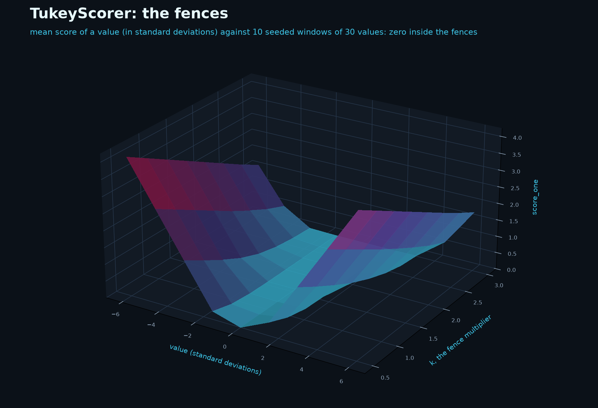

# TukeyScorer

[← Streaming anomaly detection](index.md)

`TukeyScorer` scores a new value by how far it lies beyond Tukey's fences, in interquartile-range units. The fences are `[Q1 - k * IQR, Q3 + k * IQR]`, built from the quartiles of a causal window of `2 * radius` samples strictly before the value; `k` is `1.5` for ordinary outliers, `3.0` for extreme ones. The score is `0.0` inside the fences; `is_outlier` is `True` when the score is above `0.0`. It is an `AnomalyDetector`, causal, no future.

It looks only at the `2 * radius` samples before the value being scored, like the other scorers; why the batch versions differ is explained on the page of [HampelScorer](hampel_scorer.md).



The score is zero inside the fences and grows outside them. With k = 1.5 a value of 3 standard deviations scores 0.71 and a value of 5 scores 2.37; with k = 3 the fences are wider and a value of 5 scores 1.0.

## A first example: the size of an order

A desk watches the size of its orders, in shares. The sizes are skewed to the right: many small orders and a few large ones. The new order is 200 shares.

```python
import numpy as np
from dense_armor.core.online.anomaly.filters import TukeyScorer

size = np.random.default_rng(2).lognormal(mean=4.0, sigma=0.6, size=60)
t = TukeyScorer(radius=30, k=1.5)
for v in size:
    t.learn_one({"x": float(v)})
q1, q3 = np.percentile(size, [25, 75])
print(round(q3 + 1.5 * (q3 - q1), 1), round(size.mean() + 3 * size.std(), 1), round(t.score_one({"x": 200.0}), 2))
```

```
167.5 193.4 0.63
```

The upper fence is at 167.5 shares, so the order of 200 is above it and scores 0.63, in units of the interquartile range. The rule of the mean plus 3 standard deviations puts its line at 193.4: the large orders of a skewed stream stretch the standard deviation, and the line moves away from the bulk of the orders. The quartiles do not move.


The orange line is the upper Tukey fence; the grey one is the mean plus 3 standard deviations. In a skewed stream the grey line sits further to the right.

## The same on a robot

```python
from dense_armor.core.online.anomaly.filters import TukeyScorer

t = TukeyScorer(radius=5, k=1.5)
for v in [10, 11, 9, 10, 12, 10, 11, 9, 10]:
    t.learn_one({"v": float(v)})
print(t.is_outlier({"v": 13.0}), t.is_outlier({"v": 12.0}))
```

```
True False
```

For this window the normal range is [8.5, 12.5]: 13 is outside it, 12 is inside.

## How it works

The normal range is $[Q_1 - 1.5\,\mathrm{IQR},\; Q_3 + 1.5\,\mathrm{IQR}]$ with $Q_1, Q_3$ the quartiles of the window and $\mathrm{IQR} = Q_3 - Q_1$ (window `[10, 11, 9, 10, 12, 10, 11, 9, 10]`: range $[8.5, 12.5]$).

The score says how far the new value is beyond the inner range, measured in interquartile-range units. First it finds the 25th and 75th percentiles of the recent window. `learn_one` adds a value; `score_one` does not change anything.

Tukey's fences are

$$\mathrm{low} = Q_1 - k \cdot \mathrm{IQR}, \qquad \mathrm{high} = Q_3 + k \cdot \mathrm{IQR}, \qquad \mathrm{IQR} = Q_3 - Q_1,$$

where $Q_1$ is the first quartile and $Q_3$ the third. A value inside `[low, high]` scores `0.0`. A value below `low` scores `(low - x) / IQR`. A value above `high` scores `(x - high) / IQR`. `k` is `1.5` for ordinary outliers, `3.0` for extreme outliers. The window holds `2 * radius` samples strictly before the value; it is never part of its own window. `score_one` returns `0.0` for an unusable value or while fewer than four values have been learned. On a flat window (`IQR == 0`) the score is `positive infinity` if the value differs from the fence, else `0.0`. `is_outlier` is `score_one(x)` above `0.0`.

`TukeyScorer` is `robust_filters.tukey_fences` applied to a causal window. See the comparison on [HampelScorer](hampel_scorer.md).

## The parameters

`TukeyScorer` is an `AnomalyDetector`. `learn_one(x)`, `score_one(x)`, `is_outlier(x)`, `n_missing`. Signature:

`(self, radius: int = 10, k: float = 1.5, feature: str | None = None, eps: float = 1e-09)`

| Parameter | Default | What it does |
|---|---|---|
| `radius` | 10 | with a `2 * radius` causal window |
| `k` | 1.5 | fence multiplier; `1.5` ordinary, `3.0` extreme |
| `feature` | `None` | key of the feature to watch; `None` takes the feature with the smallest key, order-independent |
| `eps` | 1e-9 | below this IQR the window is treated as flat |

There is no `n_sigmas`; `is_outlier` is `score_one(x)` above `0.0`.

## API reference

::: dense_armor.core.online.anomaly.filters.TukeyScorer

## Details

- **Sources.** Tukey, J. W. (1977). *Exploratory Data Analysis*. Addison-Wesley. Batch `robust_filters.tukey_fences`.
- **Causal window.** `2 * radius` strictly before; `is_outlier` exactly when the batch would flag, since "beyond the fences" is `score > 0`. Batch Tukey uses a centred window.
- **Scale.** quartiles + IQR; `n_missing`.
- **Comparison.** table on [HampelScorer](hampel_scorer.md).
