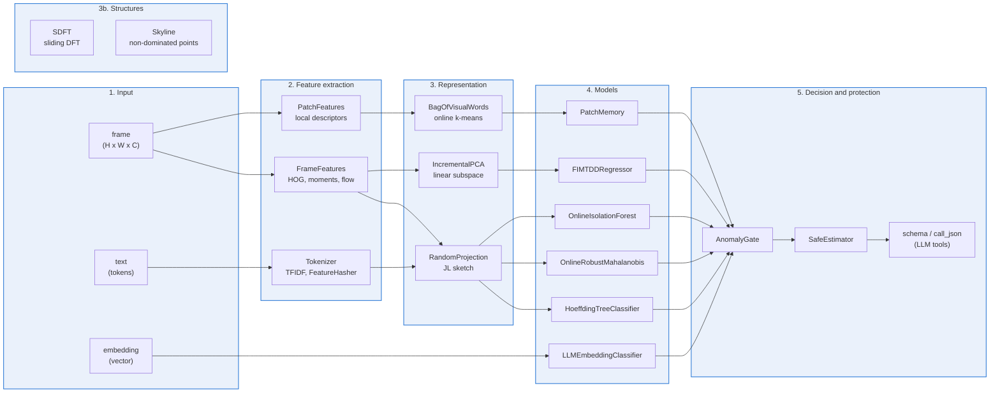

# API — AI

A picture map of the library seen from the AI side, from a raw input such as an image or a piece of text to the final decision. The input can be a frame, a text or an embedding; the output is a class, a score, a pressure value or a safe action. The five levels between the two are drawn below as a graph, each zone of the interactive map is clickable, and each class of the library is listed under the level it belongs to.

## Interactive map

Click a zone of the map. A side panel shows what that zone does and which APIs implement it. The panel does not cover the image.

## The pipeline as a graph

Every node is a class or a concept used on this page; every arrow is a flow of data from a level to the next.

The five levels, from the raw input to the decision:

- **Input**: a frame from a camera, a piece of text, or an embedding from a language model. Nothing is learned at this level; the input is passed on as it arrives, with its timestamp.
- **Feature extraction**: the numbers taken from the input. From an image, `FrameFeatures` gives the oriented gradients, the intensity moments, the optical flow; `PatchFeatures` gives one descriptor per patch. From text, `Tokenizer`, `TFIDF` and `FeatureHasher` give one vector per document.
- **Representation**: the input compressed into fewer numbers. A projection keeps the distances between samples, a PCA keeps the directions of largest variance, a visual vocabulary keeps the distribution of local descriptors. The sliding DFT and the sliding-window skyline are two more structures over a window: `SDFT` gives the spectrum of the last N samples, `Skyline` gives the points that no other point of the window dominates.
- **Models**: the online learners. A tree classifier, a FIMT-DD regression tree, a robust Mahalanobis detector, an isolation forest, a patch memory, an embedding classifier. Each one learns one sample at a time and exposes `predict_one`, `score_one` or `predict_proba_one` according to its role.
- **Decision and protection**: the gate that reads a score and decides, and the shield that protects the model while it learns. The schema and the JSON call expose the same classes to an LLM as tools.

## APIs by level

### Input

- [`frame`](../api/general.md)
- [`text`](../api/general.md)
- [`embedding`](../api/general.md)

### Feature extraction

- [`FrameFeatures`](../api/general.md)
- [`PatchFeatures`](../api/general.md)
- [`Tokenizer`](../api/general.md)
- [`TFIDF`](../api/general.md)
- [`FeatureHasher`](../api/general.md)

### Representation

- [`RandomProjection`](../api/general.md)
- [`IncrementalPCA`](../api/general.md)
- [`BagOfVisualWords`](../api/general.md)

### Structures

- [`SDFT`](../api/general.md)
- [`Skyline`](../api/general.md)

### Models

- [`HoeffdingTreeClassifier`](../api/general.md)
- [`FIMTDDRegressor`](../api/general.md)
- [`OnlineRobustMahalanobis`](../anomaly/mahalanobis.md)
- [`OnlineIsolationForest`](../anomaly/oiforest.md)
- [`PatchMemory`](../api/general.md)
- [`LLMEmbeddingClassifier`](../api/general.md)

### Decision and protection

- [`AnomalyGate`](../api/general.md)
- [`SafeEstimator`](../api/robot_roles.md)
- [`schema`](../api/general.md)
- [`call_json`](../api/general.md)

## The pipeline as a 3D surface

The same five levels, drawn as a surface you can rotate. Drag with the mouse to rotate, use the arrow keys for the same, use + and − to zoom. Auto-rotation is on until you interact.

<iframe src="../../assets/api/ai_3d.html" style="width:100%;height:640px;border:0" loading="lazy"></iframe>

The solid below is a reconstruction of the concept image that opens this page, generated from the 1024x1024 source. Every pixel of the source has been lifted to a height and the surface has been closed into a volume. The result can be rotated and inspected from any angle, including the back, which does not exist in the flat image above. The colour of the surface carries no information; what matters is the silhouette, where the surface is convex and where it is concave. The content of the page is the five levels, the graph and the classes listed above, not the surface.

## Details

**How the surface was made.** The geometry was reconstructed from a single image by an image-to-3D model. The mesh has roughly 107,500 vertices and 215,800 triangles. The reconstruction is monochrome: the source image was not projected onto the surface, so the model is shown as a single material rather than a textured one. The coloured map at the top of the page keeps the colours and the API hotspots; the 3D model keeps the shape and the volume.

**The concept image.** The prompt that generated the concept image was built by a pipeline of algorithms written by the author. The rendering step called an image-generation API from inside the author's own application. The stored file declares the asset as `TrainedAlgorithmicMedia` in its IPTC metadata; it carries no C2PA manifest and no SynthID watermark in this version, most likely because the image passed through an intermediate processing step (resize, re-encode) inside the application before being saved here. The attribution stays at the level of what the file can prove, not at the level of what the author remembers.
