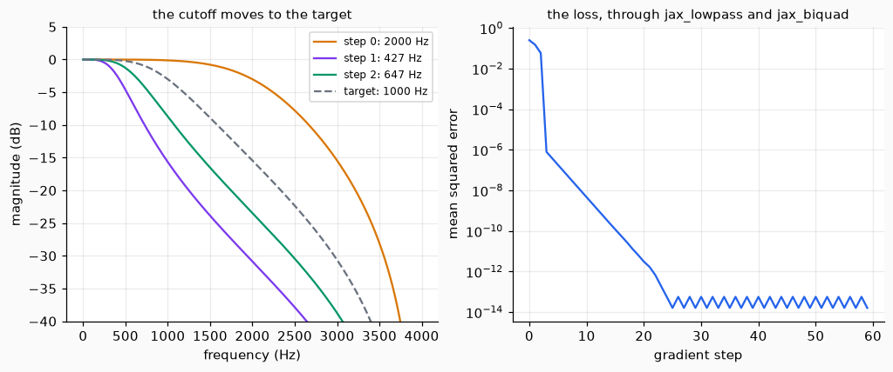

# Filters you can train

A filter has numbers in it: a cutoff, a quality factor, the coefficients of a recursion. To fit those numbers to a recording, a program has to know how the error changes when each number changes, that is, the gradient. This page covers filters written in JAX, so that the gradient is available: the low-pass biquad as a function of its cutoff, a biquad whose coefficients are trained like the weights of a network, and an all-pole filter whose coefficients change at every sample.

## 1. The coefficients as a function of the cutoff

`jax_lowpass(f0, sr, q)` gives the same `(b, a)` as `lowpass`, but as JAX arrays, so `jax.grad` and `jax.jacobian` can follow `f0`, `sr` and `q`.

```python
import jax
from dense_armor.core.audio import jax_lowpass

b, a = jax_lowpass(1000.0, 8000.0, 0.707)
db_df0 = jax.jacobian(lambda f0: jax_lowpass(f0, 8000.0, 0.707)[0])(1000.0)
print(b.shape, round(float(b[0]), 5), round(float(db_df0[0]) * 1000, 3))
```

```text
(3,) 0.09763 0.16
```

The coefficient `b[0]` is 0.09763. The derivative of `b[0]` with respect to `f0` is about 0.00016 per hertz, so the last number, that derivative times 1000, is 0.16: the change of `b[0]` for a cutoff 1 kHz higher, if it went on as it does at 1000 Hz.

## 2. A biquad that is a layer

`JaxBiquad(b, a)` filters a signal along the time axis. Its two coefficient vectors are `Param` objects, like the weights of `Conv1D`: `forward(x)` filters, `backward(g)` returns the gradient of the input and adds the gradient of the coefficients to `b.grad` and `a.grad`. So it goes into a `Sequential` after a `Conv1D`, and the same training loop updates both.

```python
import numpy as np
from dense_armor.core.audio import Biquad, JaxBiquad, lowpass

x = np.sin(2 * np.pi * 440 * np.arange(8000) / 8000)
b, a = lowpass(1000.0, 8000.0, 0.707)
y = np.asarray(JaxBiquad(b, a).forward(x))
print(len(y), bool(np.max(np.abs(y - Biquad(b, a).update_many(x))) < 1e-5))
```

```text
8000 True
```

The output has the 8000 samples of the input and is the output of `Biquad` to within 1e-5, the rounding of a 32-bit float.

## 3. An all-pole filter with a coefficient for every sample

`jax_allpole_time_varying(a, x)` is the filter `y(n) = x(n) - sum_i a_i(n) y(n - i)`, where `a` has one row of coefficients for each sample. The recursion is not unrolled to find the gradient: the code of the paper runs the same filter backwards in time, which is what `jax.custom_vjp` does here.

```python
import jax
import jax.numpy as jnp
from dense_armor.core.audio import jax_allpole_time_varying

x = jnp.array([1.0, 0.0, 0.0, 0.0])
a = jnp.array([[-0.5], [-0.5], [-0.25], [-0.25]])
y = jax_allpole_time_varying(a, x)
ga = jax.grad(lambda a: jnp.sum(jax_allpole_time_varying(a, x)))(a)
print([round(float(v), 4) for v in y], [round(float(v) + 0.0, 4) for v in ga[:, 0]])
```

```text
[1.0, 0.5, 0.125, 0.0312] [0.0, -1.3125, -0.625, -0.125]
```

The impulse gives 1, 0.5, then 0.125 and 0.0312, because the coefficient changes from -0.5 to -0.25 at the third sample. The second list is how the sum of the output changes with each coefficient: the first is 0, because the filter has not got a past output yet at the first sample.

## 4. Training a cutoff

The two functions together: the cutoff of a low-pass is found by gradient descent so that its output matches the output of a low-pass at 1000 Hz. The step is taken on the logarithm of the cutoff, so a step is a ratio and not a number of hertz.

```python
import jax
import jax.numpy as jnp
import numpy as np
from dense_armor.core.audio import jax_biquad, jax_lowpass

x = jnp.asarray(np.random.default_rng(0).standard_normal(2000), dtype=jnp.float32)
target = jax_biquad(*jax_lowpass(1000.0, 8000.0), x)


def loss(log_f0):
    y = jax_biquad(*jax_lowpass(jnp.exp(log_f0), 8000.0), x)
    return jnp.mean((y - target) ** 2)


step = jax.jit(jax.value_and_grad(loss))
u = jnp.log(2000.0)
for _ in range(60):
    value, grad = step(u)
    u = u - 2.0 * grad
print(f"{float(loss(jnp.log(2000.0))):.4f} {float(value):.1e} {float(jnp.exp(u)):.1f}")
```

```text
0.2528 1.6e-14 1000.0
```

The error starts at 0.2528 from a cutoff of 2000 Hz, goes down to 1.6e-14 in 60 steps, and the cutoff is 1000.0 Hz.



*Left, the response at the start (2000 Hz), after one step (427 Hz) and after two (647 Hz), against the target (dashed). The first step is too long and passes the target, and the next one comes back; from the third step on the cutoff is within 2 Hz of 1000 (1001.4, 999.1, 1000.7 Hz). Right, the error: from 0.25 to 3.1e-12 in 20 steps, then it stays at the rounding of a 32-bit float.*

## Details

### Sources and checks

| function | source | checked against | measured |
| --- | --- | --- | --- |
| `jax_lowpass` | Comunita, Steinmetz and Reiss, NablAFx (2025), Sec. 2.2.1 (low-pass formulas, cascade of sections, Eq. 2); the Audio EQ Cookbook | `lowpass` for 5 sets of `(f0, sr, q)`; central finite differences of step 1e-5 | float64: at most 2.2e-16; float32: at most 1.7e-7; the derivative wrt `f0` differs from the finite difference by 1.6e-11 (at 1000 Hz) |
| `jax_biquad`, `JaxBiquad` | the same recursion as `Biquad` (Eq. 4 of the cookbook); Yu and others (2024), Eq. (11)-(12), for the split into zeros and poles | `Biquad.update_many` on 1000 samples of noise; central finite differences of step 1e-6 | float64: at most 4.4e-16; float32: 2.4e-7; gradient wrt `b`: 1.4e-10 relative, wrt `a`: 1.3e-9 relative |
| `jax_allpole_time_varying` | Yu, Mitcheltree, Carson, Bilbao, Reiss and Fazekas, DAFx-24 (2024), Sec. 3: filter Eq. (1), gradient of `x` Eq. (7), gradient of `a` Eq. (8) | `AllPole.update_many` with a constant and with a varying `a`; gradient through the plain `lax.scan`; finite differences | float64: at most 4.4e-16 against `AllPole`; the gradient of the paper against the one of the scan: 8.9e-16; float32 against `AllPole`: 2.0e-7 |

The two papers are in the papers folder and the sections and equations above were read in the PDF.

### Where to find things in the papers

- The biquad of NablAFx is in Sec. 2.2.1, not in a Sec. 2 of its own. Its Eq. (2) is the product of the second-order sections; the difference equation of the biquad has no number. The paper writes `-a2 y[n-1]` in that equation where the second output sample before is meant (`y[n-2]`); the code follows the cookbook.
- NablAFx trains with frequency sampling (the frame is filtered by multiplying the spectrum) and not with the recursion. `JaxBiquad` runs the recursion sample by sample, so what is trained is what runs at inference, which is the point of Yu and others.
- In Yu and others, the time-varying filter is Eq. (1) of Sec. 3; Sec. 3.2 is the gradient of `x` (Eq. 5-7) and Sec. 3.3 the gradient of `a` (Eq. 8).

### Choices of this code

- The pattern of `core/deep/neural` is object-oriented, not functional: layers have `forward(x, training=True)`, `backward(g)` and `params()`, with `Param` holding a value and a gradient. `JaxBiquad` is written in it; `jax_lowpass`, `jax_biquad` and `jax_allpole_time_varying` are pure functions that `jax.grad` can use. The layers of the library write `backward` by hand (`Conv1D` does); inside `JaxBiquad.backward` the gradient comes from `jax.vjp` of `jax_biquad`, which the tests compare with finite differences.
- The time axis is axis 0 for a 1D signal and axis `-2` otherwise, the layout of `Conv1D`: `(L,)`, `(L, channels)` or `(batch, L, channels)`. Each channel and each item of the batch is filtered alone.
- `jax_biquad` and the scan of the all-pole filter are compiled with `jax.jit`; without it, every call traced the scan again, and the tests took six times longer.
- The all-pole backward is the paper's one, written for `jax.custom_vjp`: `a_hat_i(n) = a_i(n + i)`, with 0 beyond the end, and the same filter on the reversed signal; the gradient of `a` is `-dL/dx(n) y(n - i)`.
- The golden file `sine_440_jaxlowpass.npy` is computed in float64.

### Numerical precision

JAX computes in 32 bits unless told otherwise, and the library does the same. The comparisons to 1e-10 above were made in 64 bits, switched on with `jax.config.update("jax_enable_x64", True)` for the duration of the test and put back afterwards, as `gradcheck` does; the context managers for this have a different name in different releases of JAX (the CI runs 0.6.2, where `jax.enable_x64` does not exist), so the config call is used. The tests that check 32 bits switch it off the same way, because other test modules of the library switch it on for the whole session. In 32 bits the difference from the NumPy filters is of the order of 2e-7, as measured above, and the tests bound it with 1e-6 (coefficients) and 1e-5 (signal); the bounds were not widened to make a test pass.

### Limits

- `JaxBiquad` has constant coefficients: it is trained, but it does not change inside a signal. A biquad whose coefficients change at every sample is not implemented. The all-pole function has time-varying coefficients and the zeros are not part of it: Yu and others put a time-varying FIR in front (Eq. 11-12), which is not provided here.
- The stability is not enforced. `Biquad` refuses a pole outside the unit circle; `JaxBiquad` cannot, because the coefficients move while training. For the all-pole function, with poles inside the circle at every sample (five trajectories built from reflection coefficients), the output of the test stayed finite and under 1e3 and so did the gradient; that is a test of five cases, and a filter whose coefficients change fast can be unstable even when each set is stable.
- The recursion is a scan, one step per sample: the gradient of the all-pole filter over 8000 samples took 76 ms on one CPU. The speed of the paper (a Numba operator against PyTorch) was not reproduced, and this code was not compared with the unrolled gradient for speed, only for value.
- A cascade of second-order sections is a `Sequential` of `JaxBiquad`; the test uses one section after a `Conv1D`, not a cascade.
- The step size of the example (2.0 on the logarithm of the cutoff) was chosen by trying three. With 4.0 the first step throws the cutoff to 91 Hz, where the error is almost flat, and 29 steps later it is at 717 Hz and not settled; with 8.0 the cutoff is at 4.2 Hz after one step and at 2.6 Hz after 29, and training does not recover. The error of a cutoff far below the signal band has almost no gradient, so a plain step is not safe there.
