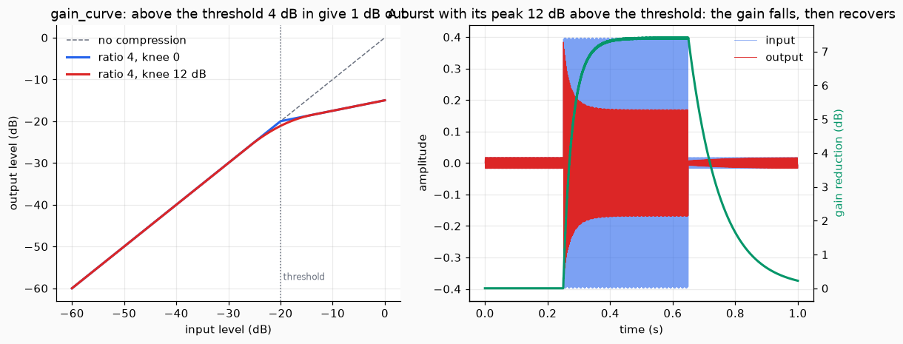
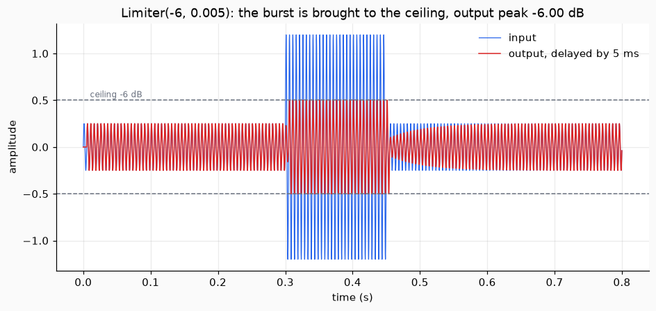
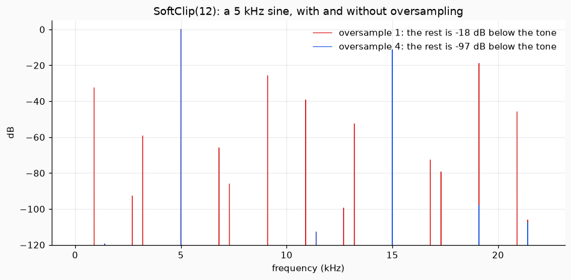
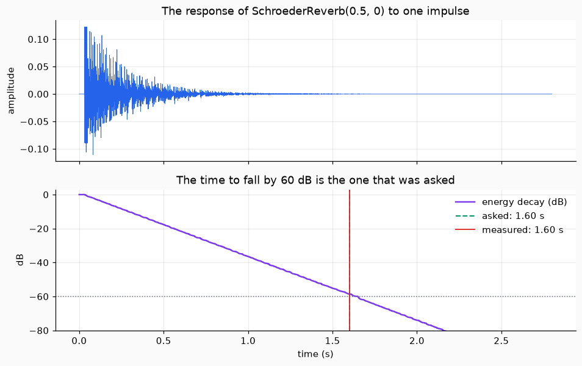
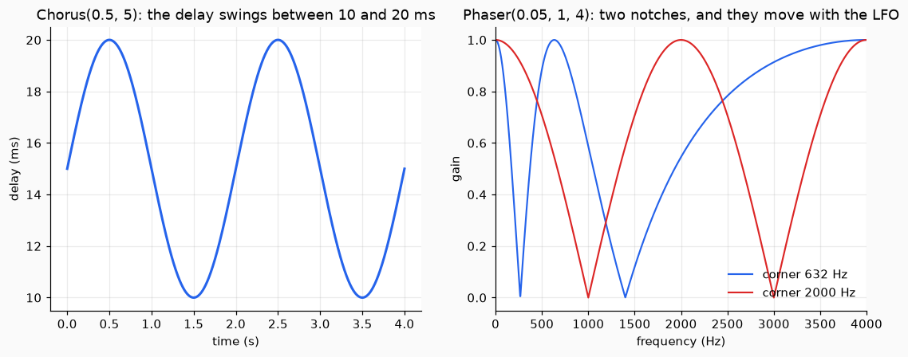

# Effects

This page covers six effects that change a sound: two that control how loud it is (a compressor and a limiter), one that distorts it on purpose (a soft clipper), one that adds a room (a reverberator), and two that move it (a chorus and a phaser). Each effect is an object that keeps its own state: give it samples with `update_many(block)` and it returns the processed samples, in as many pieces as you like.

## 1. The compressor

A compressor makes loud parts quieter and leaves quiet parts alone. You choose a threshold in dB. Below it nothing happens. Above it, every `ratio` dB of input become 1 dB of output: with a ratio of 4, a sound 12 dB above the threshold comes out 3 dB above it. The difference is the gain reduction: 12 - 3 = 9 dB.

`gain_curve(level, threshold_db, ratio, knee_db)` is that rule on levels in dB. A knee rounds the corner so that the compression starts gently, a little before the threshold.

```python
import numpy as np
from dense_armor.core.audio import Compressor, gain_curve

print(gain_curve([-30.0, -20.0, -10.0, 0.0], -20.0, 4.0).tolist())
c = Compressor(-20.0, 4.0, 0.0, 0.0, 0.0, 0.0, 8000.0)
c.update_many(np.full(20, 10 ** (-8 / 20)))
print(round(c.gain_reduction_db, 2))
```

```text
[-30.0, -20.0, -17.5, -15.0]
9.0
```

The first line is the curve: -30 dB stays -30 dB, and 20 dB above the threshold comes out only 5 dB above it. The second says that a steady level 12 dB above the threshold gets exactly 9 dB of gain reduction.

`Compressor` does not apply the gain at once. It moves towards the wanted gain reduction with a time `attack_s` when the sound gets louder and `release_s` when it gets quieter, so that the gain does not jump. After a step, the gain reduction has covered 63% of the way after one time constant.

```python
import numpy as np
from dense_armor.core.audio import Compressor

t = np.arange(8000) / 8000
x = 10 ** (-8 / 20) * np.sin(2 * np.pi * 440 * t)
c = Compressor(-20.0, 4.0, 0.02, 0.1, 0.0, 0.0, 8000.0)
y = c.update_many(x)
print(round(c.gain_reduction_db, 1), round(float(np.abs(y[4000:]).max()), 3))
```

```text
7.4 0.17
```

The sine has a peak 12 dB above the threshold, but the compressor looks at every sample, and the samples of a sine pass through small values: on average the gain reduction is 7.4 dB, not the 9 dB of a steady level. The peak of the output is 0.17, from the 0.398 of the input.



*Left, the curve: the blue one turns at the threshold, the red one with a 12 dB knee turns earlier and more gently. Right, a burst of 440 Hz: the gain reduction (green) rises when it starts and falls back when it ends.*

## 2. The limiter

A limiter is a compressor with an infinite ratio and one promise: **no sample comes out above the ceiling.** To keep the promise it has to turn the gain down before the loud sample arrives, so it looks ahead. `Limiter(ceiling_db, lookahead_s, release_s, sr)` delays the sound by the lookahead and uses that time to lower the gain gradually, so that the gain is already low when the loud sample comes out.

```python
import numpy as np
from dense_armor.core.audio import Limiter

t = np.arange(8000) / 8000
x = np.where(t > 0.5, 1.2, 0.2) * np.sin(2 * np.pi * 200 * t)
lim = Limiter(-6.0, 0.005, 0.05, 8000.0)
y = lim.update_many(x)
print(lim.latency, round(float(20 * np.log10(np.abs(y).max())), 2))
```

```text
40 -6.0
```

The delay is 40 samples (5 ms at 8000 samples per second), and the loudest output sample is at -6.0 dB, the ceiling.



*The input (blue) has a burst of 1.2. The output (red) is the same sound, 5 ms later, and never goes beyond the dashed lines.*

## 3. The soft clipper

Clipping a signal makes new frequencies, harmonics. A soft clipper does it smoothly, with `tanh`, and gives the warm sound of a saturated amplifier. `SoftClip(drive_db, oversample)` raises the gain by `drive_db` and then clips.

There is a trap. The new harmonics can be above the highest frequency the samples can hold, half the sample rate, and a harmonic above it does not disappear: it comes back down as a different, unrelated frequency. This is aliasing, and it sounds harsh. The cure is to clip at a higher rate: `SoftClip` raises the rate by `oversample` times, clips, and filters the sound back down before returning to the original rate.

```python
import numpy as np
from dense_armor.core.audio import SoftClip

x = np.sin(2 * np.pi * 5000 * np.arange(44100) / 44100)
for os in (1, 4):
    p = np.abs(np.fft.rfft(SoftClip(12.0, os, 44100.0).update_many(x)[4410:13230])) ** 2
    rest = np.delete(p, np.arange(0, len(p), 1000))
    print(os, round(10 * np.log10(rest.sum() / p[1000]), 1))
```

```text
1 -17.9
4 -97.3
```

A 5 kHz sine is a hard test: its fifth harmonic, at 25 kHz, comes back to 19.1 kHz. The code measures what is left after taking away the harmonics of the tone. With no oversampling the unwanted frequencies are 17.9 dB below the tone, loud enough to hear. With 4 times oversampling they are 97.3 dB below it.



*Red, no oversampling: lines at 19.1 kHz, 9.1 kHz and others that are not harmonics of 5 kHz. Blue, 4 times: only the harmonics of 5 kHz are left (the tone and its third harmonic, 15 kHz), and traces about 100 dB down.*

The two filters delay the sound by 64 samples (`latency`). The output can be a little above 1 in modulus: the filter rings on a signal that was cut at 1.

## 4. The reverberator

A room adds a long tail of echoes. A reverberator makes one from two simple pieces. A **comb filter** is a delay in a loop: a sound goes in, comes out after the delay, goes round the loop again quieter, and so on, a train of echoes that fade. An **all-pass filter** does the same but keeps the volume of every frequency, so it makes the echoes denser without colouring the sound. `SchroederReverb` puts four combs in parallel and two all-passes in series.

You ask for a room size between 0 and 1, which sets the reverberation time: the time the tail takes to fall by 60 dB, from 0.2 s to 3 s. `reverberation_time(h, sr)` measures it from the response to an impulse.

```python
import numpy as np
from dense_armor.core.audio import SchroederReverb, reverberation_time

r = SchroederReverb(0.5, 0.0, 1.0, 0.0, 8000.0)
h = r.update_many(np.r_[1.0, np.zeros(16000)])
print(round(r.t60_s, 2), round(reverberation_time(h, 8000.0), 2))
```

```text
1.6 1.6
```

The room asked for 1.6 s, and the tail measured 1.6 s. The `damping` parameter, 0 here, makes the high frequencies die faster than the low ones, as in a room with soft walls.



*Top, the response: a few separate echoes at the start, then a dense tail. Bottom, the energy of the tail in dB: it is a straight line, and it crosses -60 dB (dotted) where the asked time (green) and the measured time (red) both are.*

## 5. The chorus

A chorus makes one voice sound like several. It mixes the sound with a copy of itself that is delayed by a few milliseconds, and the delay slowly swings up and down, so that the two are never quite in tune. `Chorus(rate_hz, depth_ms, mix, sr)` has the speed of the swing, its size in milliseconds, and how much of the copy to mix in.

```python
import numpy as np
from dense_armor.core.audio import Chorus

sr = 8000.0
x = np.sin(2 * np.pi * 440 * np.arange(24000) / sr)
y = Chorus(0.5, 5.0, 0.5, sr).update_many(x)
w = 800
print(round(min(np.corrcoef(x[i : i + w], y[i : i + w])[0, 1] for i in range(w, 24000 - w, w)), 2))
```

```text
0.24
```

The number is the correlation between the input and the output in windows of 100 ms: 1 would mean that they are the same, and the lowest is 0.24. The output is not the input: the moving delay changes the phase of the tone.

## 6. The phaser

A phaser sweeps a set of notches up and down the spectrum. It sends the sound through a few all-pass filters, which change only the phase, and adds the result to the original sound. Where the phase has turned by half a turn, the two cancel: a notch. `Phaser(rate_hz, depth, stages)` has the speed of the sweep, how much of the range it covers, and the number of all-pass stages.

```python
import numpy as np
from dense_armor.core.audio import Phaser

h = Phaser(0.0, 0.0, 4, 8000.0, 0.5).update_many(np.r_[1.0, np.zeros(8191)])
m = np.abs(np.fft.rfft(h))
i = np.nonzero((m[1:-1] < m[:-2]) & (m[1:-1] < m[2:]) & (m[1:-1] < 0.02))[0] + 1
print(np.round(i * 8000 / 8192, 1))
```

```text
[ 266.6 1399.4]
```

With the sweep stopped, four stages give two notches, at 266.6 Hz and 1399.4 Hz. **A phaser with N stages has N / 2 notches, not N.** The notches are at the frequencies where the total turn of the phase is half a turn, one and a half, two and a half, and so on. Each stage turns the phase by half a turn at most, from 0 Hz to the top, so N stages turn it by N half turns at most, and only N / 2 of the notches fit below the top frequency.



*Left, the delay of a chorus: it swings between 10 and 20 ms. Right, the gain of a phaser with four stages at two moments of the sweep: the two notches move together towards the high frequencies.*

## Details

### Sources and checks

| function | source | checked against | largest difference measured |
| --- | --- | --- | --- |
| `gain_curve`, `Compressor` | Giannoulis, Massberg and Reiss (2012), J. Audio Eng. Soc. 60(6), 399-408 | a hand computation at 10 points; the continuity of the curve and of its slope; `scipy.signal.lfilter` for the smoothing | the smoothing: 1.8e-15 |
| `Limiter` | the same, and Zolzer (ed.) (2011), DAFX, 2nd ed., Wiley, ISBN 978-0-470-66599-2 | random signals with bursts: no sample above the ceiling | the largest output is 1 + 1.9e-14 times the linear ceiling (rounding) |
| `SoftClip` | Zolzer (ed.) (2011) | a reference made at 16 times the rate, and `scipy.signal.resample_poly` | THD 0.00036 points from the reference |
| `CombFilter`, `AllpassFilter` | Schroeder (1962), J. Audio Eng. Soc. 10(3), 219-223, Eq. 3 and 12 | `scipy.signal.lfilter`, `scipy.signal.freqz` | 0, 8.9e-16, 4.4e-16; the gain of the all-pass is 1 within 4.3e-15 |
| `SchroederReverb` | Schroeder (1962), Fig. 5 and Eq. 15 | the reverberation time measured on the impulse response | +0.3%, 0.0%, +0.7% for three room sizes |
| `reverberation_time` | Schroeder (1965), J. Acoust. Soc. Am. 37(3), 409-412, DOI 10.1121/1.1909343 | an exponential with a known time | 2e-16 (relative) |
| `Chorus` | Zolzer (ed.) (2011) | a loop written out by hand; the rate of the LFO measured on the output | 2.3e-14; 2.0 and 1.3 Hz measured for 2.0 and 1.3 asked |
| `Phaser` | Zolzer (ed.) (2011) | the notches from the phase of the all-pass; `scipy.signal.freqz` | the notches within 0.5 Hz; the response 9e-16 |

The comparisons with `scipy` are in the tests with `pytest.importorskip`, because it is not a dependency of the library. The tests that always run use hand computations, and `test/audio/test_golden.py` compares a compressor and a reverberator with committed arrays.

The PDF of Schroeder (1962) was opened and its text read: the structure of the combs and all-passes, the equations 3, 12 and 15, the range of the delays (about 30 to 45 ms), the delays of the all-passes (about 5 and 1.7 ms) and their gain of 0.7. The other sources (Giannoulis, Massberg and Reiss; Zolzer; Schroeder 1965) are cited and not read: their formulas were derived and checked by hand or against a library, and no equation number is quoted from them.

### Choices of this code

- **Compressor.** The knee is the parabola whose slope joins the two straight parts. The level is the absolute value of each sample, with no averaging.
- **Limiter.** The attack is not exponential: the gain is the smallest of the wanted gains over the lookahead, followed by a mean over the same window. This is what makes the ceiling a guarantee. The release is exponential.
- **Soft clipper.** The filters are windowed-sinc low-passes of `64 * oversample + 1` taps with a Blackman window, about 97 dB of stopband. There is no gain correction after the `tanh`.
- **Reverberator.** The paper gives a range for the delays of the combs, not values: they are 31.1, 35.9, 40.3 and 44.7 ms, inside the range and not simply related. The reverberation time is `0.2 + 2.8 room_size` seconds. `damping` is a low-pass in the loop of each comb that the paper does not have: at 0 the reverberator is the one of the paper.
- **Chorus.** The LFO is a sine, the delay is read with linear interpolation, and the centre delay is `delay_ms` (15 ms).
- **Phaser.** The corner frequency sweeps from 200 to 2000 Hz on a logarithmic scale, with a sine LFO. The notches are at `(sr / pi) atan(t tan((2k + 1) pi / (2 N)))`, with `t = tan(pi f_c / sr)`.

### Limits

- The cost of one call. `Compressor`, `Limiter`, `SchroederReverb`, `Phaser` and the filters take a few microseconds per sample (p99 between 0.5 and 34 microseconds on the machine of the measurement); `update` of `Chorus` takes 34 microseconds and of `SoftClip` 253 microseconds, because they work on blocks. Use `update_many`: a block of 512 costs about 0.08 microseconds per sample for the chorus and 0.54 for the soft clipper.
- All the effects have a Python loop over the samples, except the chorus and the soft clipper, which use NumPy on blocks.
- The limiter delays the sound by the lookahead, and the soft clipper by 64 samples.
- The ceiling of the limiter holds up to floating-point rounding: 1.9e-14 of the ceiling was seen on signals of 6000 samples. Its mean over the lookahead is a running sum, and the rounding error of a running sum grows slowly with the length of the signal; it was not measured on long signals.
- The checks were made on synthetic signals (tones, noise, impulses). No real recording was used, and no listening test.
