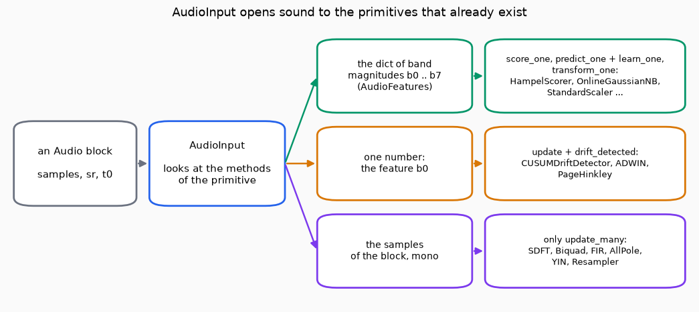

# How do I work with sound in Dense-Armor?

Sound is a long list of numbers, one for each tiny slice of time. This section gives you a value for it (`Audio`), the primitives that read it, make it, filter it and measure it, and **one adapter, `AudioInput`, that opens sound to every estimator, detector, scaler and filter that Dense-Armor already has**. Nothing that already exists is copied or rewritten for sound: the adapter looks at what a primitive can do and gives it a block of sound in the form it takes.

The code is in `dense_armor/core/audio/`. The sound itself is handled with NumPy; the estimators it connects to need JAX; a live input needs the optional extra `audio`.

## 1. The one idea: give sound to any primitive

A drift detector wants one number per block. An anomaly scorer wants a dict of numbers. A filter wants the samples. `AudioInput(primitive)` reads the methods of the primitive and gives it what it asks for:

| the primitive has | it gets |
| --- | --- |
| `update` and `drift_detected` (drift detectors) | one number per block |
| `score_one` (anomaly scorers) | the dict of band magnitudes, then learns it |
| `predict_one` and `learn_one` (classifiers, regressors) | the dict, then the label `y` |
| `transform_one` (scalers) | the dict, learned and transformed |
| only `update_many` (filters, `SDFT`, `YIN`, `AllPole`, `Resampler`) | the samples of the block |

The dict is the one of `AudioFeatures`: the mean magnitude of the spectrum in `n_bands` groups of frequencies, with the fixed keys `b0 .. b7`.



*The adapter looks at the methods of the primitive (right) and gives the block in the form it takes.*

```python
import numpy as np
from dense_armor.core.audio import Audio, AudioInput
from dense_armor.core.online.anomaly.filters import HampelScorer
from dense_armor.core.signals.stats.sdft import SDFT

a = AudioInput(SDFT(8))
a.feed(Audio(np.arange(8.0), 8))
print(a.mode, np.allclose(a.primitive.spectrum(), np.fft.fft(np.arange(8.0))))
h = AudioInput(HampelScorer())
print(h.run([Audio(np.sin(np.arange(64) * k), 64) for k in range(1, 9)])[-1] >= 0.0, h.mode)
```

```text
samples True
True score
```

`SDFT` is the sliding DFT that Dense-Armor already had; it received the samples. `HampelScorer` is an anomaly scorer that already existed; it received the dict. [Events and streams](events.md) shows the adapter on a file and on a live input.

## 2. What is in the section

| page | what you can do | main names |
| --- | --- | --- |
| [Sound, files and frequency](sound.md) | hold a sound, read and write WAV, look at it by frequency and go back | `Audio`, `read_wav`, `write_wav`, windows, `stft`, `istft`, `StreamingSTFT` |
| [Filters](filters.md) | filter a sound by biquads, taps or poles | `Biquad`, `lowpass` and six more, `FIR`, `convolve`, `DelayLine`, `AllPole`, `reflection_to_lpc` |
| [Making sound](synthesis.md) | make a sound from nothing, without aliasing | `Oscillator`, `plucked_string`, `white_noise`, `pink_noise`, `ADSR`, `triangle_blamp`, `hard_clip_blamp` |
| [Pitch](pitch.md) | find the pitch of a block, and name a frequency | `YIN`, `yin_f0`, `freq_to_cents`, `freq_to_note` |
| [Resampling](resampling.md) | change the sample rate, or glide the pitch, without a click | `Resampler`, `resample`, `pitch_ratio_transition`, `rational_ratio` |
| [Separating sources](analysis.md) | split a sound into parts | `nmf`, `separate` |
| [Events and streams](events.md) | read a file or a live input and find the moment something happens | `AudioFileStream`, `AudioLiveStream`, `AudioFeatures`, `AudioInput`, `run_estimators`, `detect_events` |
| [Sources and checks](sources.md) | see which paper each primitive comes from, what was checked, and what is missing | |

## 3. How to read the pages

Each page goes from the simplest step to the hardest, and each code block can be run as it is. The outputs shown were produced by running the code. Where a primitive follows a paper, the page names the paper and the equation, and [Sources and checks](sources.md) says whether the equation was read in the paper and compared with the code.
