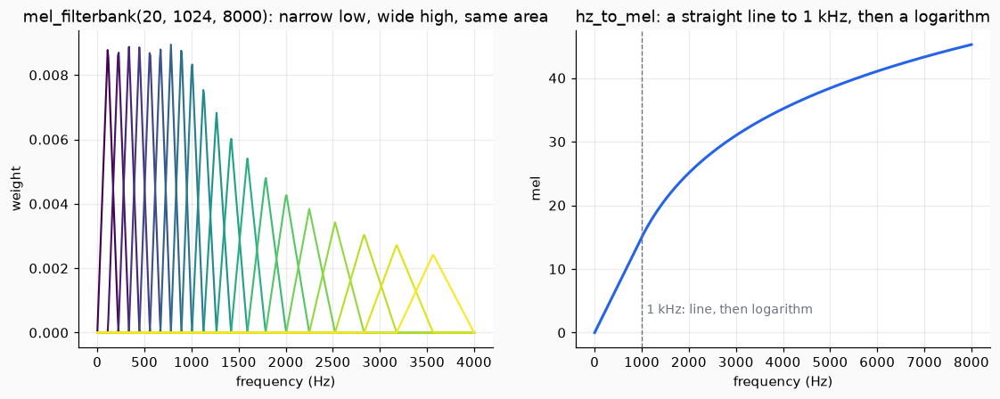
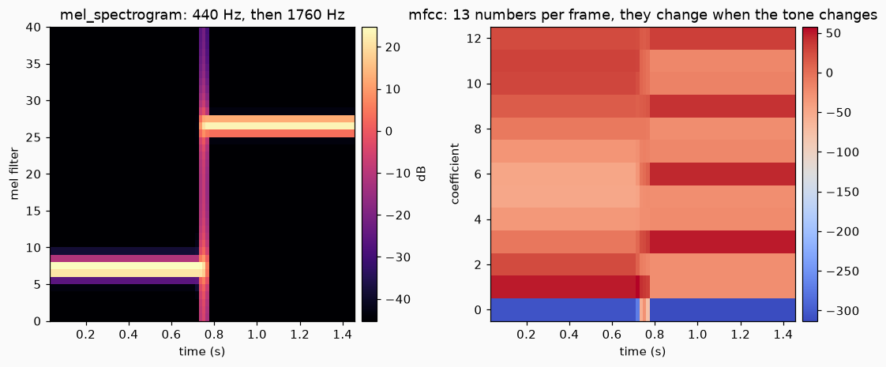
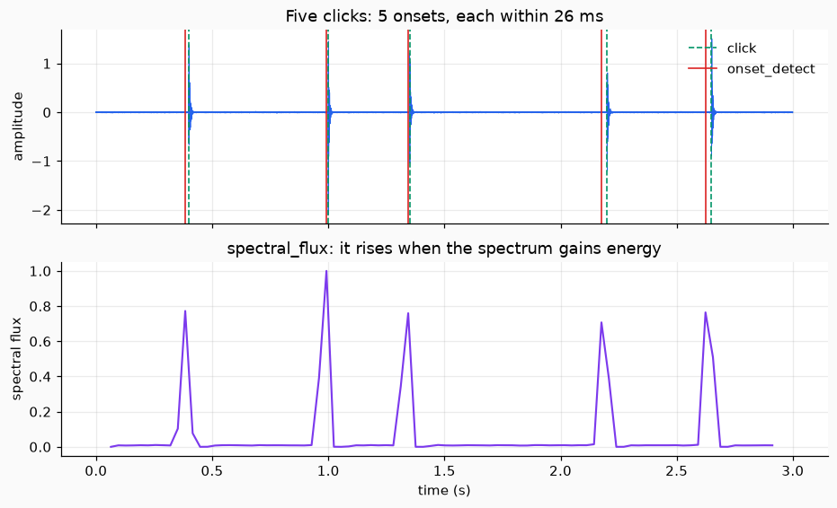
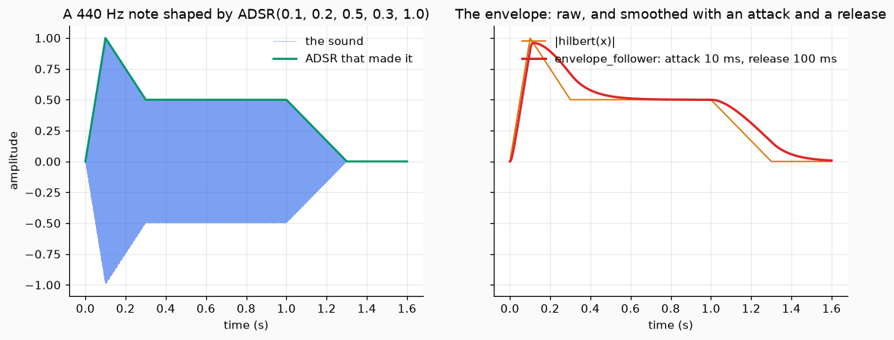

# Perceptual analysis

This page describes a sound the way a listener would: which frequencies it holds and how they are spread, when something starts, and how loud it is over time. Every function takes the samples of a sound as a NumPy array and gives an array back. Nothing keeps a state between calls.

## 1. The mel scale

The ear hears the step from 100 Hz to 200 Hz as large and the step from 5000 Hz to 5100 Hz as tiny. The mel scale stretches the low frequencies and squeezes the high ones to follow this. `hz_to_mel(f)` is a straight line up to 1 kHz and a logarithm above it. `mel_to_hz(m)` goes back.

`mel_filterbank(n_mels, n_fft, sr)` makes `n_mels` triangles on the frequency bins of an FFT of length `n_fft`. The triangles are narrow where the scale is stretched and wide where it is squeezed, and each one has the same area.

```python
from dense_armor.core.audio import hz_to_mel, mel_filterbank

print(round(hz_to_mel(1000.0), 1), round(hz_to_mel(4000.0), 1))
fb = mel_filterbank(20, 1024, 8000.0)
area = fb.sum(axis=1) * 8000.0 / 1024
print(fb.shape, round(float(area.min()), 3), round(float(area.max()), 3))
```

```text
15.0 35.2
(20, 513) 1.0 1.001
```

The first line says that 1000 Hz is 15 mel and 4000 Hz is 35.2 mel: the next 3000 Hz add only 20 mel. The second says that there are 20 filters over the 513 bins and that every filter has an area of 1, within a thousandth.



*Left, the filters: the low ones are narrow and tall, the high ones wide and low, so that the area is the same. Right, the scale: the dashed line is at 1 kHz, where the line turns into a logarithm.*

## 2. The mel spectrogram

`mel_spectrogram(x, sr)` cuts the sound into overlapping frames, takes the power of the spectrum of each frame (the square of its magnitude) and adds it up inside each mel triangle. The result has one row per frame and one column per filter: the energy of each frame in each band of the ear.

```python
import numpy as np
from dense_armor.core.audio import mel_filterbank, mel_spectrogram

x = np.sin(2 * np.pi * 440 * np.arange(8000) / 8000)
mel = mel_spectrogram(x, 8000.0, n_mels=40, n_fft=512, hop=128)
fb = mel_filterbank(40, 512, 8000.0)
k = int(mel.mean(axis=0).argmax())
print(mel.shape, k, round(float(fb[k].argmax() * 8000 / 512)))
```

```text
(59, 40) 7 453
```

One second of a 440 Hz tone gives 59 frames of 40 numbers. The band with the most energy is the number 7, whose triangle has its peak at 453 Hz: the one that holds 440 Hz.

## 3. MFCC

The mel spectrogram has one number for each band, and neighbouring bands are almost the same number. `mfcc(x, sr)` keeps the shape of the spectrum and drops that repetition. It takes the logarithm of the mel spectrogram (in decibels) and then a cosine transform along the bands, which turns the 40 band energies into a few numbers: the first ones describe the broad shape, the later ones the finer detail. By default there are 13.

```python
import numpy as np
from dense_armor.core.audio import mfcc

t = np.arange(12000) / 8000
x = np.sin(2 * np.pi * np.where(t < 0.75, 440, 1760) * t)
c = mfcc(x, 8000.0, n_mfcc=13, n_mels=40, n_fft=512, hop=128)
print(c.shape)
print(np.round(c[10, :4], 1), np.round(c[-10, :4], 1))
```

```text
(90, 13)
[-307.2   50.1   25.    -6.9] [-313.1  -25.1  -26.2   49.9]
```

There are 90 frames of 13 coefficients. The first four coefficients of a frame in the 440 Hz part and of a frame in the 1760 Hz part are different: this is the signal that a classifier or an anomaly scorer reads. They go to any estimator through [`AudioInput`](index.md).



*Left, the mel spectrogram: the energy is in filter 7 and then in filter 26. Right, the 13 coefficients, which change when the tone changes.*

## 4. Spectral features

Four numbers per frame say in one value how the spectrum looks.

| function | what it says |
| --- | --- |
| `spectral_centroid` | the centre of mass of the spectrum, in Hz: how bright the sound is |
| `spectral_rolloff` | the frequency under which 85% of the magnitude lies, in Hz |
| `spectral_flatness` | from 0 (a pure tone) to 1 (white noise) |
| `spectral_flux` | how much the spectrum gained since the previous frame |

```python
import numpy as np
from dense_armor.core.audio import spectral_centroid, spectral_flatness, spectral_rolloff

t = np.arange(8000) / 8000
tone = np.sin(2 * np.pi * 1000 * t)
noise = np.random.default_rng(0).standard_normal(8000)
for x in (tone, noise):
    c = spectral_centroid(x, 8000.0, 1024, 256).mean()
    r = spectral_rolloff(x, 8000.0, 0.85, 1024, 256).mean()
    print(round(c), round(r), round(spectral_flatness(x, 1024, 256).mean(), 3))
```

```text
1000 1008 0.0
2000 3402 0.561
```

The tone has its centroid and its rolloff at 1000 Hz and a flatness of 0. The noise has its centroid at 2000 Hz, half of the highest frequency (4000 Hz), a rolloff near 3400 Hz, which is 85% of 4000 Hz, and a flatness of 0.56.

The flux is a number for each frame that is large when something new arrives. A tone that starts at 0.5 s shows it:

```python
import numpy as np
from dense_armor.core.audio import spectral_flux

t = np.arange(8000) / 8000
x = np.where(t > 0.5, np.sin(2 * np.pi * 1000 * t), 0.0)
f = spectral_flux(x, 512, 256)
print((int(f.argmax()) * 256 + 256) / 8000, round(float(f[:12].max()), 1), round(float(f.max()), 1))
```

```text
0.512 0.0 374.3
```

Before the tone the flux is 0, and the largest value, 374.3, is at the frame centred at 0.512 s.

## 5. Onsets

`onset_detect(x, sr)` gives the times, in seconds, at which something starts. It takes the flux, compares each frame with the typical flux around it, and keeps the frames that stand out, at least one frame length apart. A steady sound, with no change, gives an empty array.

```python
import numpy as np
from dense_armor.core.audio import onset_detect

x = 0.005 * np.random.default_rng(5).standard_normal(24000)
for t0 in (0.4, 1.0, 1.35):
    i = int(t0 * 8000)
    x[i : i + 160] += np.exp(-np.arange(160) / 32)
print(np.round(onset_detect(x, 8000.0, 1024, 256), 3))
```

```text
[0.384 0.992 1.344]
```

Three clicks at 0.4, 1.0 and 1.35 s give three times, each 6 to 16 ms before the click. The time of a frame is its centre, and the frame notices the click a little before its middle.



*Top, the five clicks (green, dashed) and the onsets (red). Bottom, the spectral flux, which has one peak for each click.*

## 6. The envelope

The envelope is the outline of the loudness of a sound. `hilbert(x)` gives the analytic signal, a complex signal whose modulus is the outline of `x`. `envelope_follower(x, sr, attack_s, release_s)` takes that modulus and smooths it: it rises with the time `attack_s` when the sound gets louder and falls with the time `release_s` when it gets quieter. After a step, the output has covered 63% of the way after one time constant.

```python
import numpy as np
from dense_armor.core.audio import ADSR, envelope_follower

e = ADSR(0.1, 0.2, 0.5, 0.3, 1.0, 8000)
t = np.arange(12800) / 8000
x = np.array([e.value(v) for v in t]) * np.sin(2 * np.pi * 440 * t)
y = envelope_follower(x, 8000.0, 0.01, 0.1)
print(round(float(y[800]), 2), round(float(y[8000]), 2), round(float(y[-1]), 3))
```

```text
0.9 0.5 0.008
```

The note is a 440 Hz tone shaped by an [`ADSR`](synthesis.md). The follower is at 0.9 at 0.1 s, where the note peaks at 1.0 and the follower still lags, at 0.5 at 1.0 s, the sustain level, and at 0.008 at the end, after the release.



*Left, the note and the ADSR that made it. Right, the raw envelope (orange) and the smoothed one (red), which rises and falls more slowly.*

## Details

### Sources and checks

| function | source | checked against | largest difference measured |
| --- | --- | --- | --- |
| `hz_to_mel`, `mel_to_hz` | Slaney (1998), Auditory Toolbox v2, Interval Research Corporation TR #1998-010, p. 29 | `librosa.hz_to_mel`, `librosa.mel_to_hz` | 0 |
| `mel_filterbank` | the same | `librosa.filters.mel`, three sets of parameters | 3.3e-9 |
| `mel_spectrogram` | Allen and Rabiner (1977) for the STFT; Purwins et al. (2019), p. 3 | `librosa.feature.melspectrogram(center=False)` | 2.4e-8 of the largest value |
| `mfcc` | Davis and Mermelstein (1980), DOI 10.1109/TASSP.1980.1163420 | `librosa.feature.mfcc(center=False)` | 1.5e-7 |
| the DCT inside `mfcc` | the orthonormal DCT-II | `scipy.fft.dct(type=2, norm="ortho")` | 2e-15 |
| `spectral_centroid`, `spectral_rolloff`, `spectral_flatness` | Peeters (2004), IRCAM report | `librosa.feature.spectral_*(center=False)` | 7e-13, 0, 9e-16 |
| `spectral_flux` | Bello et al. (2005), DOI 10.1109/TSA.2005.851998 | a hand computation (no library has it) | equal within the test tolerance, 1e-12 relative |
| `onset_detect` | Bello et al. (2005) | 87 synthetic clicks with known times; `librosa.onset.onset_detect` | F1 1.000; agreement with `librosa` F1 0.945 |
| `hilbert` | Oppenheim and Schafer, Discrete-Time Signal Processing | `scipy.signal.hilbert`, lengths 8 to 1001 | 2e-15 |
| `envelope_follower` | the usual attack and release detector, see Giannoulis, Massberg and Reiss (2012), J. Audio Eng. Soc. 60(6), 399-408 | a burst: 63% after `attack_s`, 37% after `release_s` | within 10% |

The comparisons with `librosa` and `scipy` are in the tests with `pytest.importorskip`, because neither is a dependency of the library. `librosa` computes in `float32`, which is the size of the differences in the filterbank. The tests that always run check the properties above, and `test/audio/test_golden.py` compares the output on a committed wav with committed arrays.

Only two sources were opened for this page, and only the pages named: the Slaney report (page 29) and the Purwins paper (page 3). The Slaney report gives, on page 29, the filterbank of the MFCC: 13 linear filters followed by 27 logarithmic ones "separated by a factor of 1.0711703", and that number is the base of the log step of the scale (`6.4 ** (1/27)`; there is a test). The break at 1 kHz, the linear step of `200/3` Hz per mel and the area normalisation of the triangles are not written as formulas in the report text, so they are checked against `librosa` only. Purwins et al. say that the mel filter bank is made of triangular filters and that the log-mel spectrum is a common feature; they give no formula for it. Peeters (2004) could not be downloaded, and Davis and Mermelstein (1980), Bello et al. (2005) and Oppenheim and Schafer are not in the folder of the papers: they are cited, not read.

### Choices of this code

- The filterbank is the Slaney one (triangles of equal area), not the HTK one.
- `mfcc` takes the logarithm in decibels with the floor of `librosa` (80 dB below the largest value), not the `log10` of the original paper, so that the result can be compared with `librosa.feature.mfcc`.
- The STFT has no padding, so frame `m` is `x[m hop : m hop + n_fft]`. `librosa` pads the signal by default: the comparisons use `center=False`.
- `onset_detect` uses a threshold made of the median of the flux around a frame plus a margin, the largest frame within a distance, and a smallest flux relative to the loudness. The values of these parameters are defaults of this code, not of a paper.

### Limits

- The time of an onset is the centre of a frame, and the frame notices the click a little before its middle: the times are early by about `n_fft / 8`, with a spread of about one hop. With the defaults (`n_fft=2048`, `hop=512`) at 22.05 kHz the clicks were found with an error of at most 20 ms. At 8 kHz the same defaults make a frame of 256 ms and a hop of 64 ms, and the error can reach 60 ms: use `n_fft=1024, hop=256` there.
- Two onsets closer than a frame (`n_fft / sr`) are reported as one.
- The golden file of the onsets is the output on a steady sine, which is an empty array: it only guards against false onsets. The times are guarded by the tests on click tracks.
- `envelope_follower` has a loop in Python, one pass over the samples: it is fine for a few seconds of sound, not for hours.
- The checks were made on synthetic signals (tones, noise, clicks). No real recording was used.
