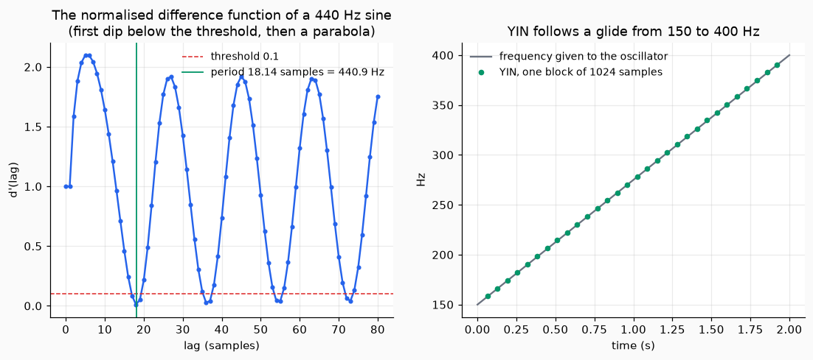

# Pitch

This page finds the pitch of a block of sound, and then names a frequency: how many cents from a reference, and which note.

## 1. The pitch of a block

`YIN(sr, f0_min, threshold)` finds the fundamental frequency of a block (Strahl and Mueller 2025, Sec. II-A, Eq. 1 and 2, which restate YIN). For each lag `tau` it measures how much the block differs from itself shifted by `tau` samples, divides that by its own running mean so that small lags do not win, and takes the smallest lag with a local minimum below the threshold. A parabola through the three lags around the minimum gives the period between two samples.

The block should hold at least two periods of the lowest pitch you look for. The answer is `nan` when no lag is below the threshold: the block has no clear pitch. The threshold has no default, because the paper gives no value.

```python
import numpy as np
from dense_armor.core.audio import YIN, Audio, AudioInput

n = np.arange(1024)
blk = Audio(np.sin(2 * np.pi * 440 * n / 8000), 8000)
print(round(float(AudioInput(YIN(8000, 100.0, 0.1)).feed(blk)), 1))
```

```text
440.9
```

The estimate is 3.6 cents above 440 Hz: the parabola through the three lags is not exactly the shape of the function. For tones from 110 to 1000 Hz the error was at most 12 cents. `yin_f0(x, sr, f0_min, threshold)` is the same on an array, and `cmndf(x, tau_max)` returns the normalised difference function itself, so you can look at it.

`YIN` stops at step 2 of the method. Step 3, a second pass that narrows the search with the neighbouring frames, is one sentence in the paper, and the original paper of YIN is not in the folder.



*Left, `cmndf` of the 440 Hz block of the example: it dips to nearly zero at multiples of the period, the first dip below the threshold (red) is chosen, and the parabola moves it to 18.14 samples (green). Right, YIN on a sound that glides from 150 to 400 Hz, one answer for each block of 1024 samples.*

## 2. Name a frequency

`freq_to_cents(f, fref)` is `1200 log2(f / fref)`: 1200 cents are an octave and 100 cents a semitone. `freq_to_note(f, fref, names)` gives the note as `(j, o, delta)`: the semitone `j` in `0..11` above the note at `fref`, the octave `o` and the leftover `delta` in cents, within half a semitone (Falkenberg 2026, Algorithm 1). The reference frequency has no default: 440 Hz is the usual concert pitch, but you say it.

```python
from dense_armor.core.audio import cents_to_freq, freq_to_cents, freq_to_note, note_to_freq

names = tuple("A A# B C C# D D# E F F# G G#".split())
print(freq_to_cents(880.0, 440.0))
j, o, d, name = freq_to_note(261.63, 440.0, names)
print(j, o, round(d, 2), name)
print(round(note_to_freq(3, -1, 0.0, 440.0), 2), round(float(cents_to_freq(50.0, 440.0)), 2))
```

```text
1200.0
3 -1 0.03 C
261.63 452.89
```

Middle C is `j = 3` above the A of the octave below (`o = -1`), within 0.03 cents. The algorithm leaves two choices to you: the twelve names, and how a tie between two notes is rounded; here a tie rounds half to even.
