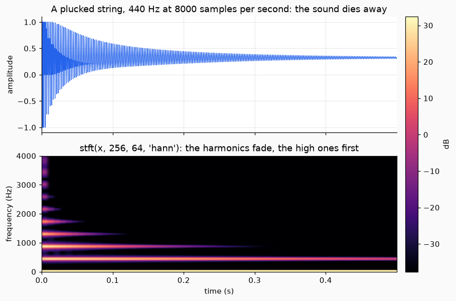
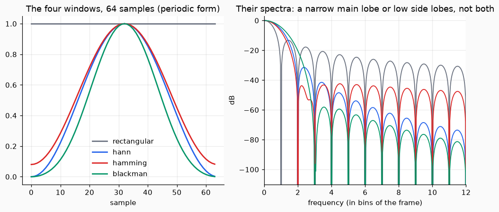

# Sound, files and frequency

This page holds a sound in a value, saves and reads it as a WAV file, and looks at it by frequency.

## 1. A sound is an `Audio`

`Audio(x, sr, t0)` holds the samples `x` (one channel, shape `(n,)`, or several, shape `(n, channels)`), the sample rate `sr` in Hz and the time `t0` of the first sample in seconds. It checks that `sr` is positive and that `x` has one or two dimensions.

```python
import numpy as np
from dense_armor.core.audio import Audio

a = Audio(np.zeros(8000), 8000)
print(a.n, a.channels, a.duration)
print(Audio(np.zeros((8000, 2)), 8000).to_mono().channels)
```

```text
8000 1 1.0
1
```

`to_mono()` returns the mean of the channels.

## 2. Make a sound and save it

A plucked string is the simplest sound that needs no input file: a burst of random values that dies away. `plucked_string(440.0, 8000, 0.5)` makes half a second of it at 440 Hz with 8000 samples per second.

```python
from dense_armor.core.audio import plucked_string, read_wav, write_wav

a = plucked_string(440.0, 8000, 0.5)
write_wav("pluck.wav", a)
b = read_wav("pluck.wav")
print(b.sr, b.n, round(b.duration, 2))
```

```text
8000 4000 0.5
```

`write_wav` writes 16-bit PCM by default (`pcm24`, `pcm32` and `float32` are also available). `read_wav` returns an `Audio` with the samples as floats in `[-1, 1)`. A file it cannot decode raises `ValueError` and the message names the format found.



*Above, the waveform of the plucked string: it dies away, but not to zero. The random burst does not average to zero, and Karplus and Strong note that the tone decays to a constant value, which is the bright line at 0 Hz below. Below, the harmonics of 440 Hz fade, the high ones first; the spectrogram is explained in the next step.*

## 3. Look at it by frequency, and go back

The short-time Fourier transform cuts the sound into overlapping frames, multiplies each by a window and takes its spectrum. The windows are `rectangular`, `hann`, `hamming` and `blackman`, each in a periodic and a symmetric form (Harris 1978). With a Hann window and a hop of half the frame, adding the inverse of the frames gives the sound back exactly in the middle of the signal (overlap-add, Allen and Rabiner 1977).



*Left, the shape of each window. Right, how much each lets leak into the other frequencies: the rectangular window has the narrowest main lobe and the highest side lobes, the Blackman window the lowest side lobes and the widest lobe.*

```python
import numpy as np
from dense_armor.core.audio import istft, read_wav, stft

b = read_wav("pluck.wav")
S = stft(b.x, 256, 128, "hann")
y = istft(S, 128, "hann", 256)
print(S.shape, bool(np.max(np.abs(y[128:-128] - b.x[128:len(y) - 128])) < 1e-9))
```

```text
(30, 129) True
```

There are 30 frames of 129 frequencies each. The first and last frames do not have all the overlaps, so they are not rebuilt exactly; `istft` says so in its docstring.

`cola_ok(window, hop)` tells you whether a window and a hop can be inverted this way. `istft` raises `ValueError` if they cannot.

## 4. One sample at a time

`StreamingSTFT(n_fft, hop, window)` gives the same spectra from a stream: push samples, and a spectrum is ready after the first `n_fft` samples and then every `hop` samples. Dense-Armor also has `SDFT`, the sliding DFT of the last `N` samples with a rectangular window, in `dense_armor.core.signals.stats`; `StreamingSTFT` adds the hop and the other windows.

```python
import numpy as np
from dense_armor.core.audio import StreamingSTFT, stft

x = np.random.default_rng(2).standard_normal(1000)
got = StreamingSTFT(64, 16, "hann").update_many(x)
print(len(got), np.allclose(np.array(got), stft(x, 64, 16, "hann")))
```

```text
59 True
```
