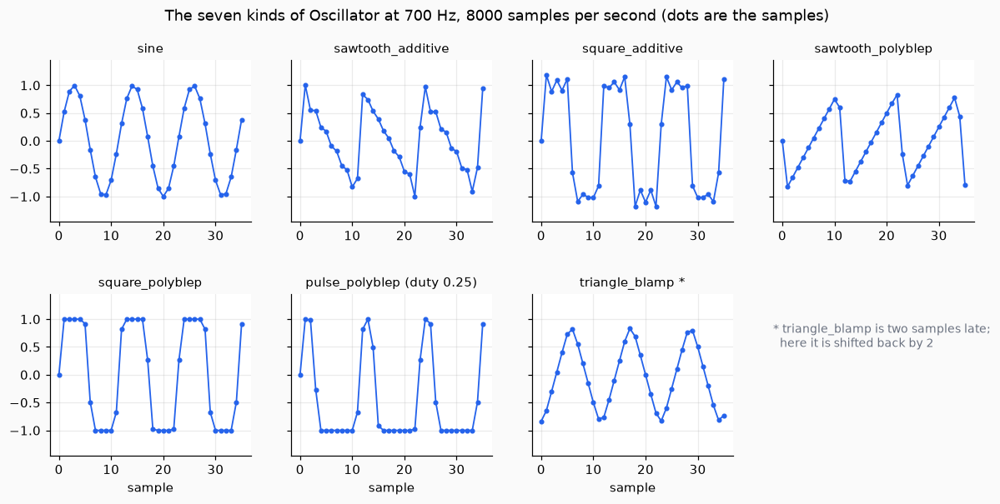
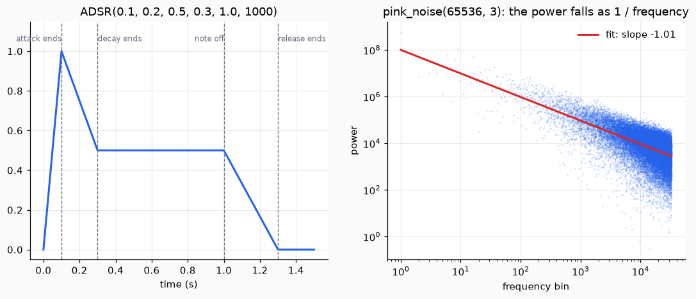
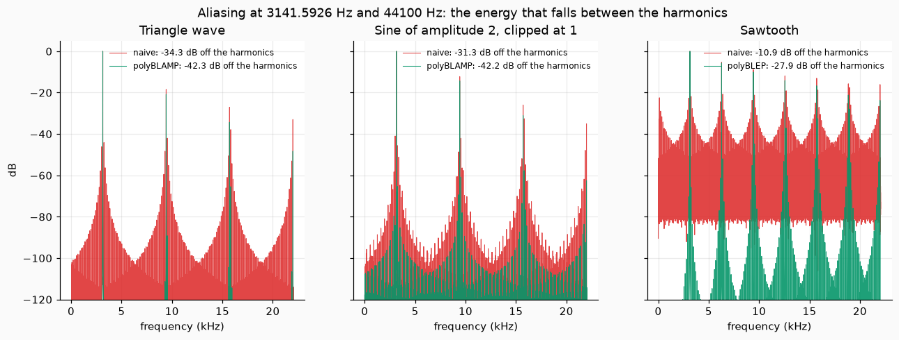

# Making sound

This page makes sound from nothing: a plucked string, oscillators, noise and a loudness envelope, and then rounds the corners that make a wave alias.

## 1. A plucked string

The Karplus-Strong algorithm (Karplus and Strong 1983) loads a delay line of `p` samples with random values and then replaces each output by the mean of two older ones. The tone dies away like a plucked string, and its period is `p + 1/2` samples. `plucked_string(freq, sr, duration)` chooses `p = round(sr / freq - 1/2)` and returns an `Audio`; `KarplusStrong(p)` is the same algorithm one sample at a time.

```python
from dense_armor.core.audio import plucked_string

a = plucked_string(440.0, 8000, 0.5)
print(a.sr, a.n)
```

```text
8000 4000
```

`p` must be an integer, so the pitch is the nearest one the delay line allows. The first value before the burst, `y[-1]`, is taken as 0, which the paper does not specify.

## 2. Choose an oscillator

An oscillator makes a repeating wave, one sample at a time, at the frequency you give it at each step, so the pitch can glide without a click. `Oscillator(kind, sr)` has seven kinds:

| kind | wave | how it is made |
| --- | --- | --- |
| `sine` | sine | `sin(2 pi phi)` |
| `sawtooth_additive`, `square_additive` | sawtooth, square | sum of the harmonics below half the sample rate (Hayes and others 2023, Eq. 10 and 11) |
| `sawtooth_polyblep` | sawtooth | the naive wave with its jump smoothed (Du and others 2026, Eq. 1) |
| `square_polyblep`, `pulse_polyblep` | square, pulse with `duty` | the naive wave with both edges smoothed (Valimaki and Pekonen 2012, Eq. 12 and 13) |
| `triangle_blamp` | triangle | the naive wave with its corners rounded (Esqueda and others 2016), two samples late |

```python
import numpy as np
from dense_armor.core.audio import Oscillator

f = np.full(8, 1000.0)
for k in ("sine", "square_polyblep", "triangle_blamp"):
    print(k, Oscillator(k, 8000).update_many(f).round(2).tolist())
print(Oscillator("pulse_polyblep", 8000, 0.25).update_many(f).round(2).tolist())
```

```text
sine [0.0, 0.71, 1.0, 0.71, 0.0, -0.71, -1.0, -0.71]
square_polyblep [0.0, 1.0, 1.0, 1.0, 0.0, -1.0, -1.0, -1.0]
triangle_blamp [0.0, 0.0, -0.77, -0.49, 0.0, 0.49, 0.77, 0.49]
[0.0, 1.0, 0.0, -1.0, -1.0, -1.0, -1.0, -1.0]
```

The additive kinds have no aliasing but cost more at low frequencies (one sine per harmonic); the polyBLEP and polyBLAMP kinds cost the same at any frequency and keep a little aliasing. `triangle_blamp` needs two samples of look-ahead around each corner, so its output is the sample two calls earlier (the first two are 0), and its frequency must stay below a quarter of the sample rate. The pulse is `+1` for the first `duty` of each period and `-1` after it, so the last line is a pulse of a quarter period at 1000 Hz and 8000 samples per second.

The phase of sample `n` is the sum of the frequencies before `n`, so the first sample is at phase 0. Eq. (10) and (11) of Hayes sum up to and including `n`, which is the same wave one sample earlier.



*Three cycles of each kind. The additive square shows the ripple of its finite sum of harmonics; the polyBLEP kinds have the jump smoothed over two samples; the pulse is `+1` for a quarter of each cycle.*

## 3. Noise and loudness

`white_noise(n, seed)` has mean 0 and variance 1. `pink_noise(n, seed, beta)` has a power spectrum that falls as `1 / frequency^beta` (Timmer and Koenig 1995): it draws two Gaussian numbers for each Fourier frequency, scales them by `(1/w)^(beta/2)` and takes the inverse transform. `ADSR` gives the loudness envelope of a note (Hayes and others 2023, Eq. 15).

```python
import numpy as np
from dense_armor.core.audio import ADSR, pink_noise

e = ADSR(0.1, 0.2, 0.5, 0.3, 1.0, 1000)
print([round(e.value(t), 2) for t in (0.0, 0.05, 0.1, 0.2, 0.3, 1.0, 1.15, 1.3)])
x = pink_noise(1 << 16, 3)
X = np.abs(np.fft.rfft(x)) ** 2
print(round(float(np.polyfit(np.log(np.arange(1, len(X))), np.log(X[1:]), 1)[0]), 2))
```

```text
[0.0, 0.5, 1.0, 0.75, 0.5, 0.5, 0.25, 0.0]
-1.01
```

The envelope rises to 1 in 0.1 s, falls to the sustain level 0.5, holds it until the note ends at 1 s and returns to 0 in 0.3 s. The slope of the noise spectrum on a log-log plot is -1.01. The pink noise sets the component at zero frequency to 0 and scales to unit variance, which the paper does not fix.



*Left, the envelope with its four moments. Right, the power of each frequency of the pink noise (dots) and the fitted line of slope -1.01: ten times the frequency, a tenth of the power.*

## 4. Round the corners

A triangle wave and a clipped sine both have sharp corners, and a sharp corner puts energy at frequencies the sound should not have (aliasing). `triangle_blamp` and `hard_clip_blamp` round each corner with the four-point polyBLAMP of Esqueda, Valimaki and Bilbao (2016): a small polynomial, computed from the exact position of the corner between two samples, is added to the four samples around it. The number below is the share of the energy that lies away from the harmonics, in dB, at 3141.5926 Hz and 44100 Hz:

```python
import numpy as np
from dense_armor.core.audio import hard_clip, hard_clip_blamp, triangle_blamp

sr, f0 = 44100, 3141.5926


def db(x):
    X = np.abs(np.fft.rfft(x * np.hanning(len(x)))) ** 2
    m = np.zeros(len(X), bool)
    for h in range(1, int(sr / 2 / f0) + 1):
        c = int(round(h * f0))
        m[max(0, c - 3):c + 4] = True
    return round(float(10 * np.log10(X[~m].sum() / X.sum())), 1)


p = (np.arange(sr) * f0 / sr) % 1
print(db(1 - 4 * np.abs(p - 0.5)), db(triangle_blamp(f0, sr, sr)))
s = 2 * np.sin(2 * np.pi * f0 * np.arange(sr) / sr)
print(db(hard_clip(s, 1.0)), db(hard_clip_blamp(s, 1.0)))
```

```text
-34.3 -42.3
-31.3 -42.2
```

The first line is the triangle (plain, then corrected), the second the clipped sine. The corrected corners are slightly rounded: the peaks of the triangle are 0.133 lower. `hard_clip_blamp` leaves a jump from above `level` to below `-level` between two samples uncorrected: no four-point polyBLAMP removes it.



*The spectrum of each wave: the tall lines are the harmonics, and everything between them is aliasing. Red is the naive wave, green the corrected one; the numbers are the share of the energy that lies off the harmonics. The corrected waves have a lower floor between the harmonics (the sawtooth, by 17 dB).*
