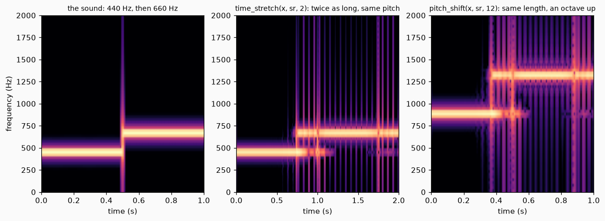

# Time and pitch

A recording has a length and a pitch, and they are tied together: play it slower and it gets lower. This page covers four functions that undo that tie: make a sound longer or shorter without changing its pitch, change its pitch without changing its length, do the first for a voice with a method made for voices, and add copies of a sound at other pitches. Each takes the samples of a sound as a NumPy array and returns an array.

## 1. Make it longer or shorter

`time_stretch(x, sr, rate)` returns a sound `rate` times as long that has the same pitch. A rate of 2 makes it twice as long, and a rate of 0.5 half as long.

It is a phase vocoder. It cuts the sound into short overlapping frames and finds the frequencies in each one. To make the sound longer, it plays the frames more slowly, but it makes each frequency go on turning at its own speed from one frame to the next, so the pitch does not move.

```python
import numpy as np
from dense_armor.core.audio import time_stretch

x = np.sin(2 * np.pi * 437.3 * np.arange(8000) / 8000)
y = time_stretch(x, 8000.0, 2.0)
f = np.fft.rfftfreq(len(y), 1 / 8000)
print(len(x), len(y), round(float(f[np.argmax(np.abs(np.fft.rfft(y)))]), 1))
```

```text
8000 16000 437.5
```

One second becomes two, and the frequency stays at 437.5 Hz (the closest the spectrum of the output, with 0.5 Hz between its points, can say to 437.3).



*Left, a tone that goes from 440 to 660 Hz. Middle, the same sound made twice as long: the frequencies are the same, the time is doubled. Right, the same sound an octave higher, with the original length.*

## 2. Change the pitch

`pitch_shift(x, sr, n_semitones)` keeps the length and moves the pitch: 12 semitones are an octave. It stretches the sound by the ratio of the two pitches and then reads it faster (or slower) so that it comes back to the original length.

```python
import numpy as np
from dense_armor.core.audio import pitch_shift

x = np.sin(2 * np.pi * 440 * np.arange(8000) / 8000)
for n in (12, -12, 7):
    y = pitch_shift(x, 8000.0, n)
    print(n, len(y), round(float(np.fft.rfftfreq(len(y), 1 / 8000)[np.argmax(np.abs(np.fft.rfft(y)))]), 1))
```

```text
12 8000 880.0
-12 8000 220.0
7 8000 659.0
```

An octave up doubles 440 Hz to 880 Hz, an octave down halves it to 220 Hz, and seven semitones (a fifth) give 659 Hz, the 659.26 Hz of the note E.

## 3. Stretch a voice

A phase vocoder smears a voice a little: the sharp pulses of the vocal folds are blurred. PSOLA works on the periods themselves. `psola_time_stretch(x, sr, f0, rate)` finds the peak of every period, takes a short piece around it, and builds a longer (or shorter) sound by repeating or skipping whole periods and adding them with overlap. The pitch does not change, because the periods are the same length. It needs the fundamental frequency `f0`, a number or one value for each sample.

```python
import numpy as np
from dense_armor.core.audio import psola_time_stretch

t = np.arange(4000) / 8000
x = sum(np.sin(2 * np.pi * 200 * k * t) / k for k in range(1, 7))
y = psola_time_stretch(x, 8000.0, 200.0, 2.0)[1000:-1000]
print(len(psola_time_stretch(x, 8000.0, 200.0, 2.0)), round(float(np.corrcoef(y[:-40], y[40:])[0, 1]), 3))
```

```text
8000 1.0
```

The sound is 8000 samples long, twice the input, and the number is the correlation of the output with itself one period later (40 samples at 200 Hz): 1.0, so it is exactly periodic.

## 4. Add copies at other pitches

`Harmonizer(intervals_semitones, sr)` adds the sound to copies of itself moved by the intervals you give, each with the same weight. An interval of 0 is the original.

```python
import numpy as np
from dense_armor.core.audio import Harmonizer

x = np.sin(2 * np.pi * 440 * np.arange(8000) / 8000)
z = Harmonizer((-12, 0, 12), 8000.0).process(x)[1000:-1000]
s = np.abs(np.fft.rfft(z * np.hanning(len(z)), 16 * len(z)))
fr = np.fft.rfftfreq(16 * len(z), 1 / 8000)
i = [k for k in range(1, len(s) - 1) if s[k] > s[k - 1] and s[k] > s[k + 1] and s[k] > 0.2 * s.max()]
print([round(float(fr[k]), 1) for k in i])
```

```text
[220.0, 440.0, 880.0]
```

A 440 Hz tone with the intervals -12, 0 and +12 gives three tones: one octave below, the tone, and one octave above.

## Details

### Sources and checks

| function | source | checked against | measured |
| --- | --- | --- | --- |
| `time_stretch` | Flanagan and Golden (1966), Bell System Technical Journal 45(9), 1493-1509, DOI 10.1002/j.1538-7305.1966.tb01706.x; Laroche and Dolson (1999), DOI 10.1109/ASPAA.1999.810857 | the length; `yin_f0` and the peak of the spectrum; a rate of 1; `librosa.effects.time_stretch` | length exact; peak within 2 cents; rate 1 gives back noise to 1e-9 from sample 64; spectrum of the interior within 0.024 of librosa |
| `pitch_shift` | Laroche and Dolson (1999) | the peak of the spectrum; `librosa.effects.pitch_shift` | 880.000, 220.000, 659.255 Hz, the same as librosa |
| `psola_time_stretch` | Moulines and Laroche (1995), Speech Communication 16(2), 175-205, DOI 10.1016/0167-6393(94)00054-E | the length, the peak of the spectrum, `yin_f0`, the periodicity | peak at 200.000 Hz; `yin_f0` within 7.6 cents; rate 1 correlation 1.0 |
| `Harmonizer` | Laroche and Dolson (1999) | the peaks of the spectrum | 220.0, 440.0, 880.0 Hz |

The references were checked on Crossref and are cited, not read: none of the four papers is in the folder of the papers, so the formulas were derived and checked by the measurements above and not against an equation of the paper.

### What the phase vocoder does (derived here)

For each bin, the phase turned in one hop is `w_k = 2 pi hop k / n_fft`. The phase of an output frame is accumulated with `phase += w_k + wrap(dphi - w_k)`, where `dphi` is the difference of phase of two analysis frames and `wrap` takes it to the interval from -pi to pi. This is the phase that the true frequency of the partial turns in one hop, so a sine that is not at the centre of a bin goes on at its own frequency. The output frames are `hop` apart like the input ones, whatever the rate.

### Choices of this code

- `time_stretch` takes a rate that is the ratio of the lengths (2 is twice as long); `librosa.effects.time_stretch` takes the inverse.
- Nothing is added at the start of the signal, and `n_fft` zeros at the end. The phase is accumulated and never locked again, so an error in one frame stays in all the later ones. A first version padded the start by reflection: the kink at the join gave wrong phase steps, the amplitude of the output fell to 0.37 of the input at a rate of 0.5, and the results at rates 1 and 2 were right by luck.
- `pitch_shift` reads the stretched sound with the existing `Resampler`, which interpolates linearly and has no anti-alias filter, so a shift up folds back the partials above `sr / (2 r)`; the last sample of the output is 0.
- PSOLA puts its marks at the highest sample of each period, not the largest in modulus. With the largest in modulus, marks jumped between positive and negative peaks and the correlation with the input at a rate of 1 was 0.76.
- `Harmonizer` divides the sum by the number of voices.

### Limits

- The first 30 samples of `time_stretch` are attenuated (the window sum is almost 0 there), and the last `n_fft` samples of the output are the stretched ending of the sound.
- `librosa.effects.time_stretch` and `time_stretch` do not agree to 1e-3: the normalised spectra differ by 0.0043, 0.0067 and 0.024 at rates 0.5, 1.37 and 2, because the interior of the output of `librosa` has a lower RMS than its input (0.616 against 0.687 for a steady tone at rate 2), and this one keeps it.
- A phase vocoder smears transients, and PSOLA needs a sound with one clear pitch. Neither was tested on real speech.
- `yin_f0` reads a 1000 Hz sine 11.7 cents high, in the input as in the output: the tests compare the output with what it reads on the input.
- The checks were made on synthetic signals (tones and a sum of partials). The first listening test, a real recording, was not made.
