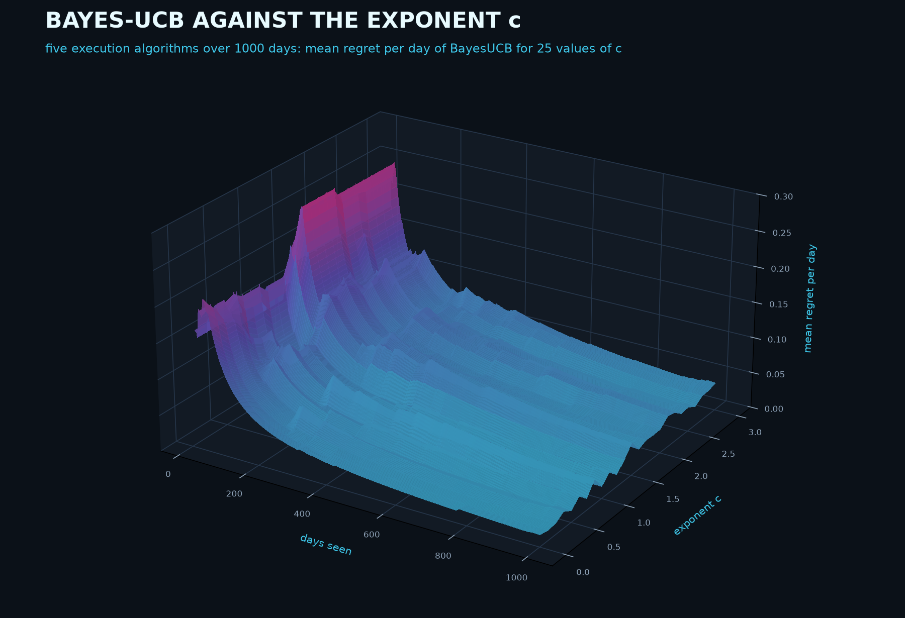
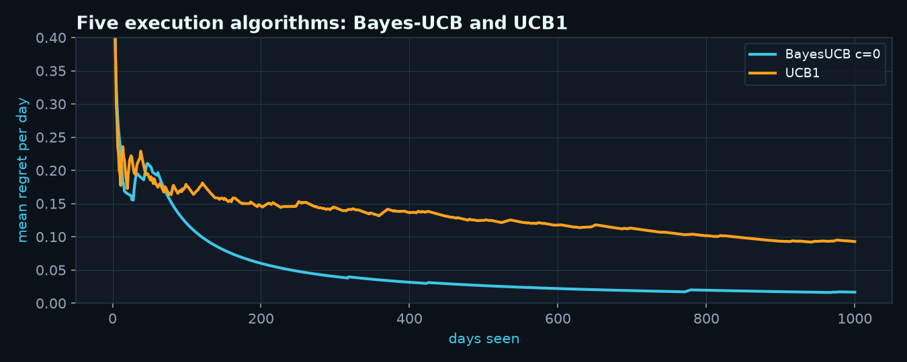

# Bayes-UCB: play the arm with the highest quantile

[← Bandits](index.md)

A desk keeps a belief about how often each execution algorithm fills well. Instead of drawing from it, Bayes-UCB takes a high quantile of each belief and plays the algorithm whose quantile is the highest: the less sure it is about an algorithm, the higher the quantile reaches. A robot choosing a gain does the same, in the last section.



## 1. A first example: five execution algorithms, one desk

Three execution algorithms fill an order well with probability 0.2, 0.5 and 0.8. The horizon of 500 days sets the level of the quantile.

```python
import numpy as np
from dense_armor.core.online.bandit import BayesUCB

rng = np.random.default_rng(0)
rate = {"twap": 0.2, "vwap": 0.5, "pov": 0.8}
desk = BayesUCB(arms=["twap", "vwap", "pov"], family="bernoulli", horizon=500, seed=0)
for _ in range(500):
    arm = desk.pull()
    desk.update(arm, float(rng.binomial(1, rate[arm])))
print(desk.pull())
```

```
pov
```

The quantile level is `1 - 1 / (t (log n)^c)`, with `t` the number of plays so far and `n` the horizon. With `c = 0` it is `1 - 1/t`: the more the policy has played, the higher the quantile.



On five execution algorithms with rates 0.2, 0.35, 0.5, 0.65 and 0.8, Bayes-UCB with `c = 0` reads a mean regret per day of 0.207, 0.06 and 0.017 after 50, 200 and 1000 days, and UCB1 reads 0.189, 0.146 and 0.093.

The picture follows the same 1000 days for 25 values of the exponent `c` between 0 and 3, with a horizon of 1000. Each point of the surface is the mean regret per day so far. For `c = 0` it reads 0.207, 0.06 and 0.017 after 50, 200 and 1000 days, for `c = 1` it reads 0.105, 0.055 and 0.017, and for `c = 3` it reads 0.174, 0.082 and 0.039: a large exponent lowers the quantile and explores less.

| class or function | what it does |
|---|---|
| `BayesUCB` | plays the arm with the highest quantile of its posterior |

## 2. What it does

At each step the policy computes, for each arm `j`, the `1 - 1 / (t (log n)^c)` quantile of the posterior distribution of the mean reward, where `t` is the number of plays so far and `n` the horizon. The arm with the highest quantile is played. For Bernoulli rewards the posterior is `Beta(1 + S_j, 1 + F_j)`; a reward counts as a success when it is `>= 0.5`, so a continuous reward in [0, 1] is binarised (the paper assumes rewards in {0, 1}). For Gaussian rewards with known variance the posterior is `N(mu_j, sigma^2 / n_j)`; with `estimate_var=True` the posterior is a Student-t with `n_j - 1` degrees of freedom, as in Section 2 of the paper.

**Source:** Kaufmann, E., Cappe, O., Garivier, A. (2012). On Bayesian upper confidence bounds for bandit problems. In AISTATS 15. Algorithm 1, page 3: the quantile schedule `q_j(t) = Q(1 - 1/(t (log n)^c), lambda_j^{t-1})`. The Bernoulli posterior is on page 3, the Gaussian and Student-t posteriors on page 4.

## 3. The parameters

| Parameter | Meaning | Default |
|---|---|---|
| `arms` | the sequence of arms, any hashables | none |
| `family` | `"bernoulli"` or `"gaussian"` | `"bernoulli"` |
| `horizon` | the horizon `n` of the quantile level; `None` sets it to `n_seen_ + 1` | `None` |
| `c` | exponent in the quantile level | 0.0 |
| `sigma` | known standard deviation of Gaussian rewards | 1.0 |
| `estimate_var` | use the Student-t posterior with unknown variance; ignored for Bernoulli | `False` |
| `seed` | seed of the random generator | 0 |

`BayesUCB` raises `ValueError` if `family` is unknown or `sigma <= 0` for the Gaussian family. The methods that every policy shares (`pull`, `update`, `n_seen_`, `state_dict`, `clone`...) are on the [shared methods page](policy.md).

## 4. The same policy on a controller gain

A controller has three candidate gains and a good run is a reward of 1. The gain 8.0 works with probability 0.8.

```python
import numpy as np
from dense_armor.core.online.bandit import BayesUCB

rng = np.random.default_rng(0)
rate = {0.5: 0.2, 8.0: 0.8, 30.0: 0.5}
tuner = BayesUCB(arms=[0.5, 8.0, 30.0], family="bernoulli", horizon=500, seed=0)
for _ in range(500):
    kp = tuner.pull()
    tuner.update(kp, float(rng.binomial(1, rate[kp])))
print(tuner.pull())
```

```
8.0
```

After 500 tries the policy picks the gain 8.0.

## API reference

::: dense_armor.core.online.bandit.bayes_ucb.BayesUCB

---

## Details

### Choices

- **The figures** are drawn with the library by `docs/assets/bandit/make_bandit_style_figures.py`. Five execution algorithms with success rates 0.2, 0.35, 0.5, 0.65 and 0.8 (or the stated gap), 1000 days, the regret of a day is the rate of the best algorithm minus the rate of the one that was pulled, and the surface is the mean over the days so far.
