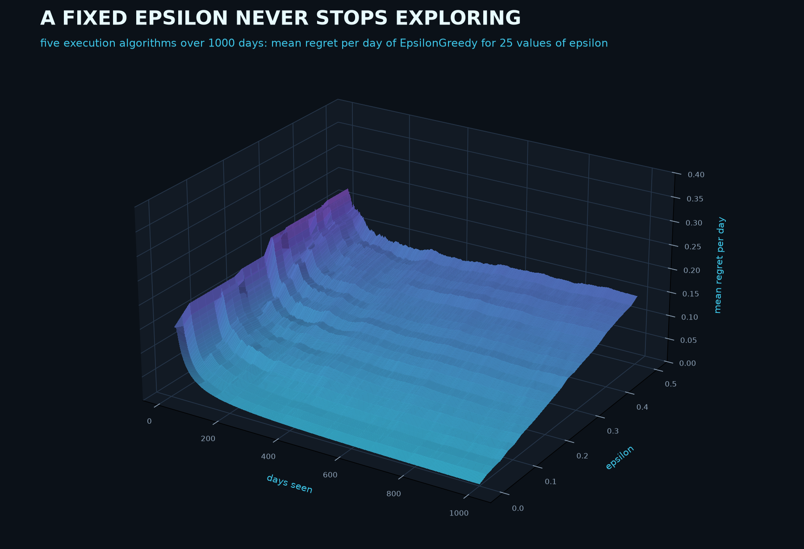
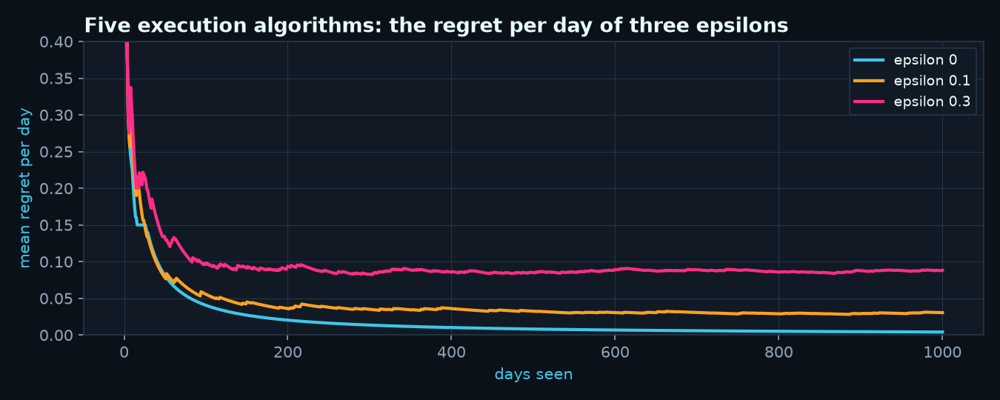

# Epsilon-greedy: explore with a fixed probability

[← Bandits](index.md)

A desk has three execution algorithms and no idea which one fills orders best. Every day it uses the best one so far, except on a fraction epsilon of the days, when it tries another at random. A robot that tunes a controller gain picks its options the same way, in the last section.



## 1. A first example: five execution algorithms, one desk

Three execution algorithms fill an order well with probability 0.2, 0.5 and 0.8, and the reward is 1 when the fill is good. After 500 days the policy has learned which one to use.

```python
import numpy as np
from dense_armor.core.online.bandit import EpsilonGreedy

rng = np.random.default_rng(0)
rate = {"twap": 0.2, "vwap": 0.5, "pov": 0.8}
desk = EpsilonGreedy(arms=["twap", "vwap", "pov"], epsilon=0.1, seed=0)
for _ in range(500):
    arm = desk.pull()
    desk.update(arm, float(rng.binomial(1, rate[arm])))
print(desk.pull())
```

```
pov
```

With probability `1 - epsilon` play the arm with the highest running mean; otherwise play a uniformly random arm. Every arm is played once first, so an arm has at least one sample before the comparison. A constant `epsilon` never stops exploring: the regret grows linearly with the number of plays (Auer et al. 2002, page 5).



On five execution algorithms with rates 0.2, 0.35, 0.5, 0.65 and 0.8, the mean regret per day of epsilon 0 reads 0.081, 0.02 and 0.004 after 50, 200 and 1000 days, epsilon 0.1 reads 0.078, 0.036 and 0.03, and epsilon 0.3 reads 0.132, 0.094 and 0.088.

The picture follows the same 1000 days for 25 values of epsilon between 0 and 0.5, scored as the mean regret per day so far: the rate of the best algorithm minus the rate of the one that was pulled. On this easy stream the lowest regret is at epsilon 0, because every arm is played once first, and it rises with epsilon: at epsilon 0.5 it reads 0.186, 0.137 and 0.147 after 50, 200 and 1000 days. A fixed exploration costs a regret that does not go to zero.

| class or function | what it does |
|---|---|
| `EpsilonGreedy` | plays the best arm so far, and a random arm with probability epsilon |

## 2. What it does

With probability `1 - epsilon` the policy plays the arm with the highest running mean reward; otherwise it plays an arm chosen uniformly at random. Each arm is played once before the first choice, so that every arm has a sample even with `epsilon = 0`. A constant `epsilon` gives a linear regret; the logarithmic bound requires `epsilon_n = c K / (d^2 n)`, where `d` is a lower bound on the gap to the best arm. This class keeps `epsilon` constant, which is the baseline the paper compares against.

**Source:** Auer, P., Cesa-Bianchi, N., Fischer, P. (2002). Finite-time analysis of the multiarmed bandit problem. Machine Learning 47(2-3), 235-256. Section 3, "epsilon-greedy rule", page 5; Figure 3 and Theorem 3, pages 5-6; the choice `epsilon_n = cK / (d^2 n)` on page 10.

## 3. The parameters

| Parameter | Meaning | Default |
|---|---|---|
| `arms` | the sequence of arms, any hashables | none |
| `epsilon` | exploration probability, in `[0, 1]` | 0.1 |
| `seed` | seed of the random generator | 0 |

`EpsilonGreedy` raises `ValueError` if `epsilon` is outside `[0, 1]`. The methods that every policy shares (`pull`, `update`, `n_seen_`, `state_dict`, `clone`...) are on the [shared methods page](policy.md).

## 4. The same policy on a controller gain

A controller has three candidate gains and a good run is a reward of 1. The gain 8.0 works with probability 0.8.

```python
import numpy as np
from dense_armor.core.online.bandit import EpsilonGreedy

rng = np.random.default_rng(0)
rate = {0.5: 0.2, 8.0: 0.8, 30.0: 0.5}
tuner = EpsilonGreedy(arms=[0.5, 8.0, 30.0], epsilon=0.1, seed=0)
for _ in range(500):
    kp = tuner.pull()
    tuner.update(kp, float(rng.binomial(1, rate[kp])))
print(tuner.pull())
```

```
8.0
```

After 500 tries the policy picks the gain 8.0.

## API reference

::: dense_armor.core.online.bandit.ucb.EpsilonGreedy

---

## Details

### Choices

- **The figures** are drawn with the library by `docs/assets/bandit/make_bandit_style_figures.py`. Five execution algorithms with success rates 0.2, 0.35, 0.5, 0.65 and 0.8 (or the stated gap), 1000 days, the regret of a day is the rate of the best algorithm minus the rate of the one that was pulled, and the surface is the mean over the days so far.
