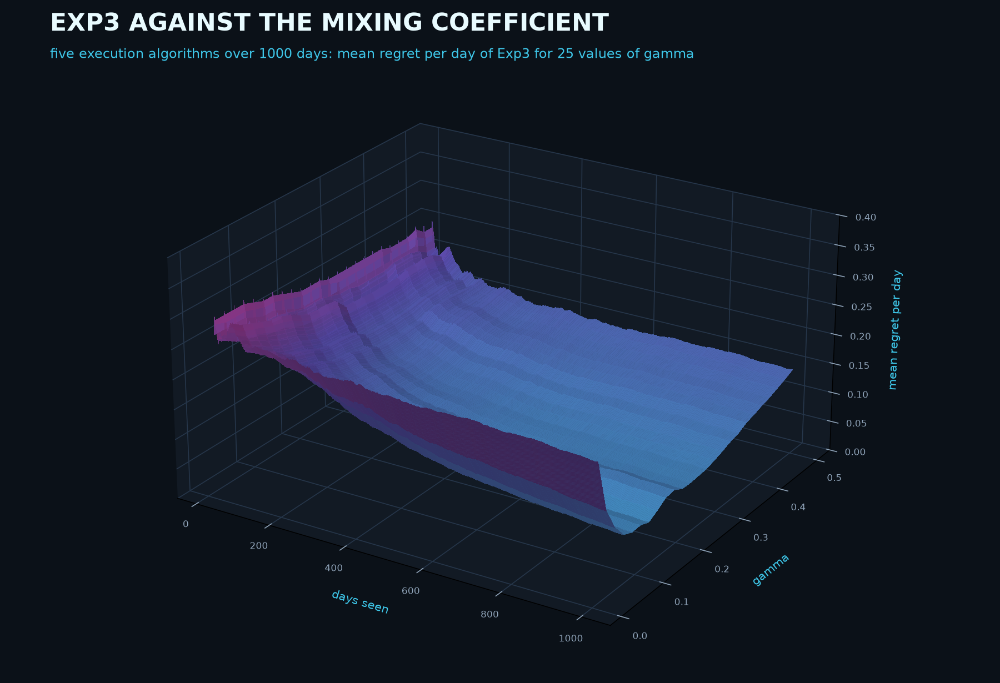
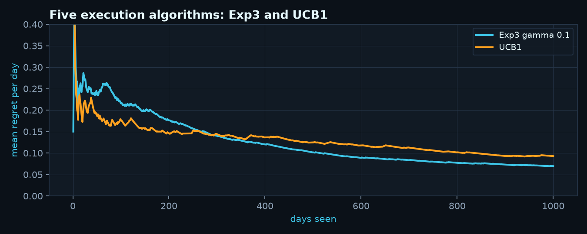

# Exp3: when the rewards are not drawn from a fixed rule

[← Bandits](index.md)

The other policies assume that each execution algorithm has a fixed rate of good fills. Exp3 does not: it assumes nothing about how the rewards are produced, even that someone picks them against you, and it keeps a weight for each algorithm that grows when the algorithm pays. A robot choosing a gain does the same, in the last section.



## 1. A first example: five execution algorithms, one desk

Three execution algorithms fill an order well with probability 0.2, 0.5 and 0.8. The mixing coefficient gamma is 0.1.

```python
import numpy as np
from dense_armor.core.online.bandit import Exp3

rng = np.random.default_rng(0)
rate = {"twap": 0.2, "vwap": 0.5, "pov": 0.8}
desk = Exp3(arms=["twap", "vwap", "pov"], gamma=0.1, seed=0)
for _ in range(500):
    arm = desk.pull()
    desk.update(arm, float(rng.binomial(1, rate[arm])))
print(desk.pull())
```

```
pov
```

Each arm has a weight that is multiplied after each reward by `exp(gamma * reward_estimate / K)`; the probability of playing an arm mixes the share of its weight with the uniform `gamma / K`.



On five execution algorithms with rates 0.2, 0.35, 0.5, 0.65 and 0.8, Exp3 with gamma 0.1 reads a mean regret per day of 0.24, 0.176 and 0.07 after 50, 200 and 1000 days, and UCB1 reads 0.189, 0.146 and 0.093: Exp3 is above UCB1 early and below it at 1000 days.

The picture follows the same 1000 days for 25 values of gamma between 0.01 and 0.5. Each point of the surface is the mean regret per day so far. With gamma 0.01 it reads 0.27, 0.257 and 0.229 after 50, 200 and 1000 days: it learns slowly. With gamma 0.092 it reads 0.243, 0.18 and 0.074, and with gamma 0.5 it reads 0.192, 0.159 and 0.144: a large gamma keeps exploring. Exp3 assumes nothing about the rewards, and on this fixed rule it still ends below UCB1.

| class or function | what it does |
|---|---|
| `Exp3` | a weight per arm, a mix with the uniform choice, no assumption on the rewards |

## 2. What it does

At each step the policy computes, for each arm `i`, `p_i(t) = (1 - gamma) * w_i(t) / sum_j w_j(t) + gamma / K`, draws the arm according to `p(t)`, receives a reward `x_i(t)` in `[0, 1]`, builds the unbiased estimate `x_hat_i(t) = x_i(t) / p_i(t)` for the drawn arm and `0` for the others, and updates the weight `w_i(t+1) = w_i(t) * exp(gamma * x_hat_i(t) / K)`. The weight vector is rescaled by its maximum after every update, so the numbers stay finite; the distribution `p` is not affected by a uniform rescaling.

**Source:** Auer, P., Cesa-Bianchi, N., Freund, Y., Schapire, R. E. (2002). The nonstochastic multiarmed bandit problem. SIAM Journal on Computing 32(1), 48-77. Figure 1, page 6 (the pseudo-code); Theorem 3.1 and Corollary 3.2, page 7 (the regret bound and the choice of `gamma`).

## 3. The parameters

| Parameter | Meaning | Default |
|---|---|---|
| `arms` | the sequence of arms, any hashables | none |
| `gamma` | mixing coefficient, in `(0, 1]`; `None` uses `min(1, sqrt(K ln K / ((e-1) T)))` of Corollary 3.2, which needs `horizon` | `None` |
| `horizon` | the horizon `T` used to compute the default `gamma`; ignored when `gamma` is given | `None` |
| `seed` | seed of the random generator | 0 |

`Exp3` raises `ValueError` if `gamma` is outside `(0, 1]`, or if both `gamma` and `horizon` are `None`. The methods that every policy shares (`pull`, `update`, `n_seen_`, `state_dict`, `clone`...) are on the [shared methods page](policy.md).

## 4. The same policy on a controller gain

A controller has three candidate gains and a good run is a reward of 1. The gain 8.0 works with probability 0.8.

```python
import numpy as np
from dense_armor.core.online.bandit import Exp3

rng = np.random.default_rng(0)
rate = {0.5: 0.2, 8.0: 0.8, 30.0: 0.5}
tuner = Exp3(arms=[0.5, 8.0, 30.0], gamma=0.1, seed=0)
for _ in range(500):
    kp = tuner.pull()
    tuner.update(kp, float(rng.binomial(1, rate[kp])))
print(tuner.pull())
```

```
8.0
```

After 500 tries the policy picks the gain 8.0.

## API reference

::: dense_armor.core.online.bandit.exp3.Exp3

---

## Details

### Choices

- **The figures** are drawn with the library by `docs/assets/bandit/make_bandit_style_figures.py`. Five execution algorithms with success rates 0.2, 0.35, 0.5, 0.65 and 0.8 (or the stated gap), 1000 days, the regret of a day is the rate of the best algorithm minus the rate of the one that was pulled, and the surface is the mean over the days so far.
