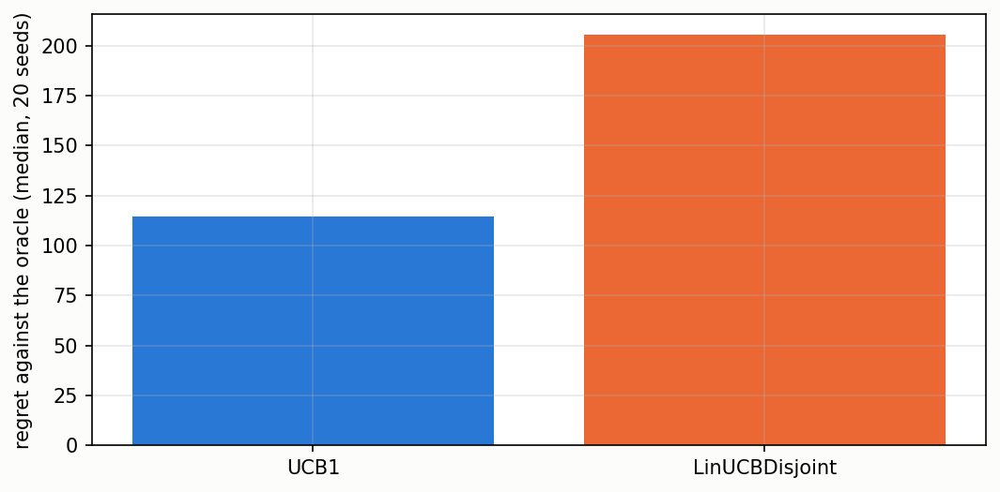

# Bandits: try one option, learn from the reward

## The map of bandits

Click a page to open it, or the job on the left (or the button at the top) to go back to the [map of the library](../index.md#the-library-folder-by-folder).

<object type="image/svg+xml" data="../assets/maps/bandit.svg" style="width:100%"></object>

## Gamestory

### Where the name comes from

The name comes from the old casino slot machines, which in America were nicknamed "one-armed bandits" (bandits with only one arm).

This joking nickname comes from two precise characteristics of those machines:

- They had only one "arm". To make them start you had to pull a big side lever that looked just like an arm.
- They were "bandits". They were programmed to make you win very little and take away all your money, just like a thief.

### From the casino to mathematics

Mathematicians took this image and used it to create a famous riddle called Multi-Armed Bandit (the bandit with multiple arms).

Imagine finding yourself in front of a row of 10 different slot machines (or a single giant machine with 10 different levers). Each lever has a secret probability of making you win, and you have a little bag with 100 coins.

The "bandit" problem is precisely this: how must you distribute your 100 coins among the various levers to understand which machine is more generous and leave the casino with as much money as possible? Here is why in computer code every option to choose from is still called "arm" (arm/lever) today.

### The example of the ice cream shops

Imagine arriving in a new city with three ice cream shops: A, B, and C. You don't know which one makes the best ice cream and you can buy only one cone per day.

- If you try A on the first day and the ice cream is good, you might decide to always go there. But this way you will never know if B was even better.
- If instead you keep changing them at random every day, you will end up often eating bad ice creams.

This is the algorithm's dilemma: to exploit what already seems good, or to explore new options to see if there is something better?

### The 3 keywords

In the text there are three very simple technical words:

- Arm (Arm). It is one of the possible choices. In our example, it is one of the three ice cream shops (in the original text, they are three programs to buy stocks on the stock exchange).
- Reward (Reward). It is the grade you give after trying. It is worth 1 if you liked it (good result) and 0 if you didn't like it (bad result).
- Regret (Regret). It is how many good ice creams you lost because of wrong attempts, compared to how happy you would have been if you had known from the first day which was the best ice cream shop. The lower this number is, the better you did.

### How the example code works

The text shows a program called UCB1 that has to choose between three options (twap, vwap, pov) for 500 times.

1. At the beginning it tries everything. In the first three days it tries them once each to get an idea.
2. Then it uses a smart rule. It gives a score to each option. The score is high if the option gave good results, but it also receives a bonus if it has been tried few times. In this way the computer never completely forgets about the other choices.
3. It learns from the results. In the second example, the third option (pov) works well 80% of the time. After 500 attempts, the computer figured out the trick: it chose the best option a good 389 times, leaving the crumbs to the other two.

Suppose a desk can send each order through one of three execution algorithms, and it does not know which one fills best. Every order is a try, and afterwards the desk knows only how the algorithm it used did that time: a good fill or a bad one. If it keeps using the algorithm that looks best so far, it may never find out that another one is better. If it keeps trying all of them, it wastes orders on the bad ones. A **bandit policy** is a rule for this choice: when to use what looks best, when to try something else, and how to learn from every result.

The pages below show the eight policies of the library, from the simplest (try something else with a fixed probability) to the one that reads a signal before it chooses. Then they show how to judge a policy on past data without running it, and the methods that every policy shares.

## The words

Three words come back on every page.

| Word | What it means here | In the example |
|---|---|---|
| arm | one option to choose from | one execution algorithm |
| reward | the result of one try | 1 for a good fill, 0 for a bad one |
| regret | how much less the policy won than if it had always used the best option; lower is better | the good fills that were lost by trying a worse algorithm |

In one line, as the papers put it: you have K arms. At each step you pick one arm, see a reward, and update what you know. You want the sum of rewards to be close to the sum of rewards of the best arm in hindsight.

## A first example, order by order

The desk has three execution algorithms. To see the policy at work, suppose we know what they do: `twap` always gives a bad fill (reward 0), `vwap` and `pov` always give a good one (reward 1). The policy does not know it. Each day it chooses an algorithm with `pull()`, sends the order, and tells the result with `update(arm, reward)`.

```python
from dense_armor.core.online.bandit import UCB1

good = {"twap": 0.0, "vwap": 1.0, "pov": 1.0}
desk = UCB1(arms=["twap", "vwap", "pov"], seed=0)
for day in range(1, 9):
    arm = desk.pull()
    desk.update(arm, good[arm])
    print(day, arm, good[arm])
print(desk.counts_)
```

```
1 twap 0.0
2 vwap 1.0
3 pov 1.0
4 vwap 1.0
5 pov 1.0
6 vwap 1.0
7 pov 1.0
8 vwap 1.0
{'twap': 1, 'vwap': 4, 'pov': 3}
```

Read it day by day. On days 1, 2 and 3 the policy knows nothing, so it tries each algorithm once: `twap` gave 0, `vwap` and `pov` gave 1. From day 4 it prefers the ones that paid: it alternates between `vwap` and `pov`, and it does not go back to `twap`, whose result was 0. At the end `desk.counts_` says how many orders each algorithm got: 1, 4 and 3. The policy, called UCB1, adds to the average result of each algorithm a bonus that is larger for the ones it has tried few times, and chooses the highest sum.

## The same, with results that vary

In real life a fill is not always good or always bad. Here a fill is good with probability 0.2 for `twap`, 0.5 for `vwap` and 0.8 for `pov`, and the desk does not know it. After 500 orders the policy has found the best algorithm.

```python
import numpy as np
from dense_armor.core.online.bandit import UCB1

rng = np.random.default_rng(0)
rate = {"twap": 0.2, "vwap": 0.5, "pov": 0.8}
desk = UCB1(arms=["twap", "vwap", "pov"], seed=0)
for _ in range(500):
    arm = desk.pull()
    desk.update(arm, float(rng.binomial(1, rate[arm])))
print(desk.pull(), desk.counts_)
```

```
pov {'twap': 29, 'vwap': 82, 'pov': 389}
```

Of the 500 orders, 389 went through `pov`, the algorithm that fills well 80% of the time, 82 through `vwap` and 29 through `twap`, the worst one. The policy still tried the others now and then, because a result can be bad by chance, and its next choice is `pov`. The pages below show the other policies on the same problem.

## The pages of the section

| Page | Classes | What it is for |
|---|---|---|
| [Epsilon-greedy](epsilon_greedy.md) | `EpsilonGreedy` | explore with a fixed probability |
| [UCB1 and UCB1-Tuned](ucb.md) | `UCB1`, `UCB1Tuned` | the mean plus a bonus for the arms tried few times |
| [Thompson sampling](thompson.md) | `ThompsonSampling` | draw from what you believe about each arm |
| [Bayes-UCB](bayes_ucb.md) | `BayesUCB` | play the arm with the highest quantile of its posterior |
| [Exp3](exp3.md) | `Exp3` | no assumption on how the rewards are produced |
| [LinUCB](linucb.md) | `LinUCBDisjoint` | use a context to choose the arm |
| [Offline replay](offline_replay.md) | `offline_replay` | judge a policy on a log, without running it |
| [The shared methods](policy.md) | `BanditPolicy` | the counters, the saved state, the settings and `fit`, which every policy inherits |
| [RobotKpSelector](robot_kp_selector.md) | `RobotKpSelector` | choose a controller gain with UCB1 on a simulated arm |

## What the numbers say


The regret is how much reward a policy loses against one that knew the best option from the start, so a lower number is better. Median regret against the oracle, 20 seeds: BayesUCB 74.0, UCB1Tuned 112.0, UCB1 114.5, ThompsonSampling 246.0, EpsilonGreedy 385.0, Exp3 394.0.




On the contextual stream LinUCBDisjoint gets 205.5, worse than UCB1 at 114.5 with the two-feature context used here. Reported, not hidden: the model needs a richer context to beat the context-free baseline on this stream.

## Details

- Benchmark: benchmarks/bandit_quality.py, JSON: benchmarks/bandit_quality.json, figures regenerated by docs/assets/bandit/make_figures.py.
- Machine: Intel Xeon 2.20 GHz, 2 cores, Python 3.13.16.
- Papers: Auer, Cesa-Bianchi and Fischer (2002) Machine Learning 47(2-3), UCB1 Figure 1 and Theorem 1 page 3, UCB1-TUNED page 11. Auer, Cesa-Bianchi, Freund and Schapire (2002) SIAM Journal on Computing 32(1), Exp3 Figure 1 page 6, Theorem 3.1 and Corollary 3.2 page 7. Chapelle and Li (2011) NIPS 24, Algorithm 2 page 3. Kaufmann, Cappe and Garivier (2012) AISTATS 15, Algorithm 1 page 3. Li, Chu, Langford and Schapire (2010) WWW 2010, Algorithm 1 page 4. Li, Chu, Langford and Wang (2011) WSDM 2011, Algorithm 1 and Theorem 1 page 4.
- The bootstrap interval of offline_replay is a choice of this implementation.
