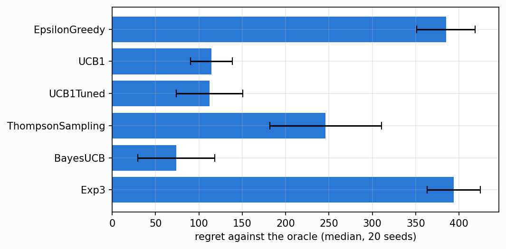
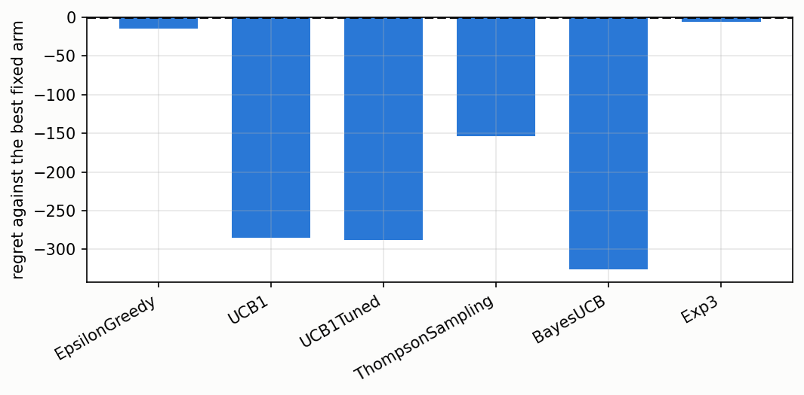

# Bandits: try one option, learn from the reward

## The map of bandits

Click a page to open it, or the job on the left (or the button at the top) to go back to the [map of the library](../index.md#the-library-folder-by-folder).

<object type="image/svg+xml" data="../assets/maps/bandit.svg" style="width:100%"></object>

A desk that sends orders through several execution algorithms has a small set of options and a reward after every try: the fill is good or it is not. Which algorithm to try next is a bandit problem: try the one that looks best, or try the ones you know less about, and learn from both. The pages below show the eight bandit policies of the library, from the simplest (explore with probability epsilon) to the contextual one, plus the offline evaluation of a policy on logged data and the methods that every policy shares.

## The problem, in one line

You have K arms. At each step you pick one arm, see a reward, and update what
you know. You want the sum of rewards to be close to the sum of rewards of the
best arm in hindsight.

## A first example: three execution algorithms

A desk can send an order through three execution algorithms. A fill is good with probability 0.2, 0.5 and 0.8, and the desk does not know it. After each order it learns the reward, and the policy chooses the algorithm for the next one.

```python
import numpy as np
from dense_armor.core.online.bandit import UCB1

rng = np.random.default_rng(0)
rate = {"twap": 0.2, "vwap": 0.5, "pov": 0.8}
desk = UCB1(arms=["twap", "vwap", "pov"], seed=0)
for _ in range(500):
    arm = desk.pull()
    desk.update(arm, float(rng.binomial(1, rate[arm])))
print(desk.pull())
```

```
pov
```

After 500 orders the policy chooses the third algorithm, `pov`, the one that fills well 80% of the time. The pages below show every policy on the same problem.

## The pages of the section

| Page | Classes | What it is for |
|---|---|---|
| [Epsilon-greedy](epsilon_greedy.md) | `EpsilonGreedy` | explore with a fixed probability |
| [UCB1 and UCB1-Tuned](ucb.md) | `UCB1`, `UCB1Tuned` | the mean plus a bonus for the arms tried few times |
| [Thompson sampling](thompson.md) | `ThompsonSampling` | draw from what you believe about each arm |
| [Bayes-UCB](bayes_ucb.md) | `BayesUCB` | play the arm with the highest quantile of its posterior |
| [Exp3](exp3.md) | `Exp3` | no assumption on how the rewards are produced |
| [LinUCB](linucb.md) | `LinUCBDisjoint` | use a context to choose the arm |
| [Offline replay](offline_replay.md) | `offline_replay` | judge a policy on a log, without running it |
| [The shared methods](policy.md) | `BanditPolicy` | the counters, the saved state, the settings and `fit`, which every policy inherits |
| [RobotKpSelector](robot_kp_selector.md) | `RobotKpSelector` | choose a controller gain with UCB1 on a simulated arm |

## What the numbers say



Median regret against the oracle, 20 seeds: BayesUCB 74.0, UCB1Tuned 112.0, UCB1 114.5, ThompsonSampling 246.0, EpsilonGreedy 385.0, Exp3 394.0.




On the contextual stream LinUCBDisjoint gets 205.5, worse than UCB1 at 114.5 with the two-feature context used here. Reported, not hidden: the model needs a richer context to beat the context-free baseline on this stream.

Robot test: UCB1 picked kp = 8.0 on all 20 seeds, median regret against the best fixed gain 0.0, median time per decision 0.54 s (dominated by the simulation).

## The same problem on a robot

A robot that tunes a controller gain has a small set of options and a reward
after every try. Which gain to try next is a bandit problem: try the one that
looks best, or try the ones you know less about, and learn from both. [RobotKpSelector](robot_kp_selector.md) runs it on a simulated arm: each round it picks a gain, tracks a trajectory with it and takes the negated tracking error as the reward.

## Details

- Benchmark: benchmarks/bandit_quality.py, JSON: benchmarks/bandit_quality.json, figures regenerated by docs/assets/bandit/make_figures.py.
- Machine: Intel Xeon 2.20 GHz, 2 cores, Python 3.13.16.
- Papers: Auer, Cesa-Bianchi and Fischer (2002) Machine Learning 47(2-3), UCB1 Figure 1 and Theorem 1 page 3, UCB1-TUNED page 11. Auer, Cesa-Bianchi, Freund and Schapire (2002) SIAM Journal on Computing 32(1), Exp3 Figure 1 page 6, Theorem 3.1 and Corollary 3.2 page 7. Chapelle and Li (2011) NIPS 24, Algorithm 2 page 3. Kaufmann, Cappe and Garivier (2012) AISTATS 15, Algorithm 1 page 3. Li, Chu, Langford and Schapire (2010) WWW 2010, Algorithm 1 page 4. Li, Chu, Langford and Wang (2011) WSDM 2011, Algorithm 1 and Theorem 1 page 4.
- The bootstrap interval of offline_replay is a choice of this implementation.
