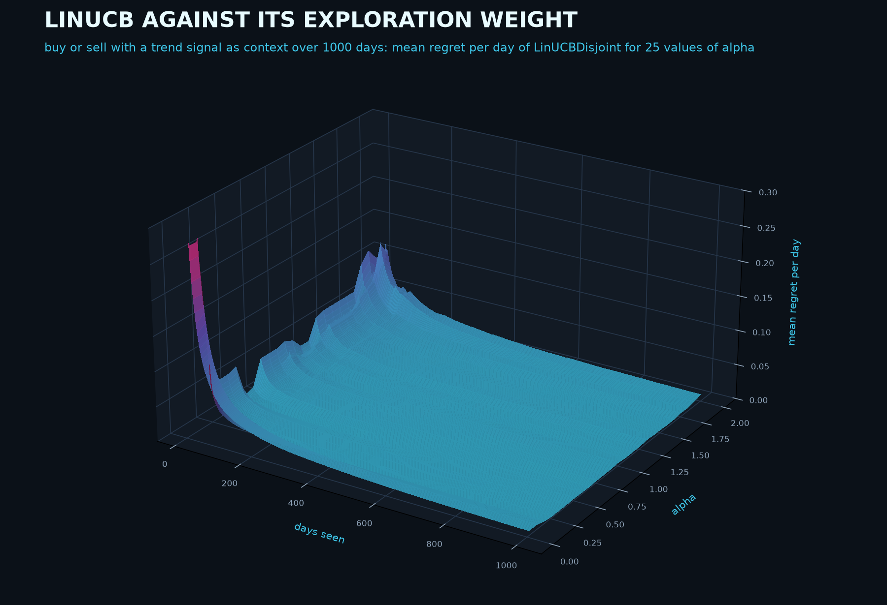
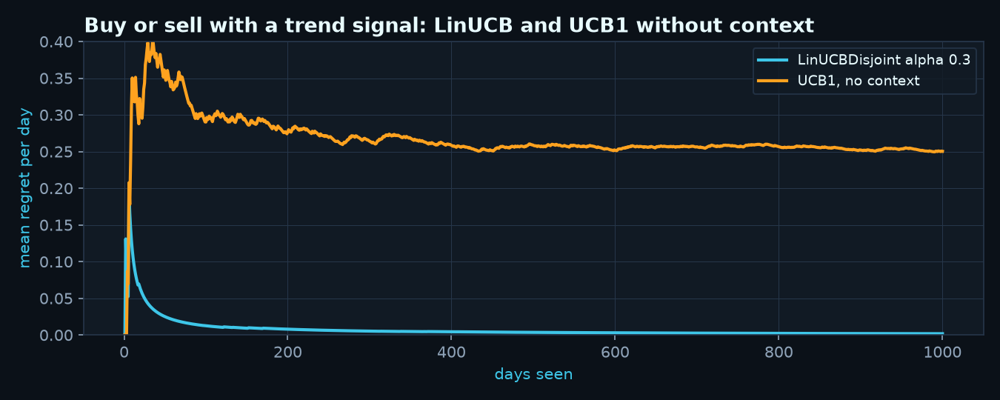

# LinUCB: use the context to choose the arm

[← Bandits](index.md)

A desk can buy or sell, and the better choice depends on a trend signal it sees before choosing. LinUCB keeps, for each choice, a linear model of the reward from the signal, and adds a bonus for what the model is not sure about. A robot that pushes left or right is in the last section.



## 1. A first example: five execution algorithms, one desk

The reward of buying is 1 plus the trend and the reward of selling is 1 minus the trend. After 300 days the policy sells on a negative trend and buys on a positive one.

```python
import numpy as np
from dense_armor.core.online.bandit import LinUCBDisjoint

rng = np.random.default_rng(0)
desk = LinUCBDisjoint(arms=["sell", "buy"], alpha=0.1, feature_keys=("trend", "bias"))
for _ in range(300):
    trend = float(rng.uniform(-1.0, 1.0))
    x = {"trend": trend, "bias": 1.0}
    arm = desk.pull(context=x)
    reward = (1.0 + trend) if arm == "buy" else (1.0 - trend)
    desk.update(arm, reward, context=x)
print(desk.pull(context={"trend": -0.5, "bias": 1.0}))
print(desk.pull(context={"trend": 0.5, "bias": 1.0}))
```

```
sell
buy
```

The index is `theta_a^T x + alpha * sqrt(x^T A_a^{-1} x)` (Li et al. 2010, Algorithm 1, page 4).



On a buy-or-sell choice where the better arm is given by a trend signal, the mean regret per day of LinUCB with alpha 0.3 reads 0.025, 0.008 and 0.002 after 50, 200 and 1000 days, and UCB1, which ignores the context, reads 0.354, 0.277 and 0.25.

The picture follows the same 1000 days for 25 values of alpha between 0.02 and 2. Each point of the surface is the mean regret per day so far. With alpha 0.02 it reads 0.116, 0.031 and 0.007 after 50, 200 and 1000 days, with alpha 0.268 it reads 0.025, 0.008 and 0.002, and with alpha 2.0 it reads 0.072, 0.03 and 0.01: a small bonus learns slowly and a large one keeps exploring.

| class or function | what it does |
|---|---|
| `LinUCBDisjoint` | one linear model per arm, an index `theta^T x` plus a confidence bonus |

## 2. What it does

Each arm has its own Bayesian linear regression. At each step the policy computes, for every arm `a`, `p_a = x^T theta_a + alpha * sqrt(x^T A_a^{-1} x)` where `theta_a` is the posterior mean of the regression and `A_a = I + sum_t x_t x_t^T` the precision matrix, and plays the arm with the highest `p_a`. The `alpha` is the confidence parameter of the paper (its only input), not the prior precision of the regression; the prior precision of the model is fixed to `1.0` so that `A_a` matches the paper's `I_d + X^T X`.

**Source:** Li, L., Chu, W., Langford, J., Schapire, R. E. (2010). A contextual-bandit approach to personalized news article recommendation. In WWW 2010. Algorithm 1, page 4: the index `p_{t,a} = theta_a^T x_{t,a} + alpha sqrt(x_{t,a}^T A_a^{-1} x_{t,a})` and the rank-one update of `A_a` and `b_a`.

## 3. The parameters

| Parameter | Meaning | Default |
|---|---|---|
| `arms` | the sequence of arms, any hashables | none |
| `alpha` | confidence parameter, in `(0, 1]` in practice, any positive value | 0.3 |
| `seed` | kept for symmetry with the other policies, unused (the algorithm is deterministic) | 0 |
| `feature_keys` | names of the context features to use, or `None` to take the keys of the first context seen | `None` |

`LinUCBDisjoint` raises `ValueError` if `alpha <= 0` or `arms` is empty. The methods that every policy shares (`pull`, `update`, `n_seen_`, `state_dict`, `clone`...) are on the [shared methods page](policy.md).

## 4. The same policy on a controller gain

A joint is pushed to the left or to the right, and the reward of each push depends on the side of the joint. The same policy learns it.

```python
import numpy as np
from dense_armor.core.online.bandit import LinUCBDisjoint

rng = np.random.default_rng(0)
p = LinUCBDisjoint(arms=["left", "right"], alpha=0.1, feature_keys=("side", "bias"))
for _ in range(300):
    s = float(rng.uniform(-1.0, 1.0))
    x = {"side": s, "bias": 1.0}
    a = p.pull(context=x)
    r = (1.0 + s) if a == "right" else (1.0 - s)
    _ = p.update(a, r, context=x)
print(p.pull(context={"side": -0.5, "bias": 1.0}))
print(p.pull(context={"side": 0.5, "bias": 1.0}))
```

```
left
right
```

A negative side is pushed left and a positive one right.

## API reference

::: dense_armor.core.online.bandit.linucb.LinUCBDisjoint

---

## Details

### Choices

- **The figures** are drawn with the library by `docs/assets/bandit/make_bandit_style_figures.py`. Five execution algorithms with success rates 0.2, 0.35, 0.5, 0.65 and 0.8 (or the stated gap), 1000 days, the regret of a day is the rate of the best algorithm minus the rate of the one that was pulled, and the surface is the mean over the days so far.
