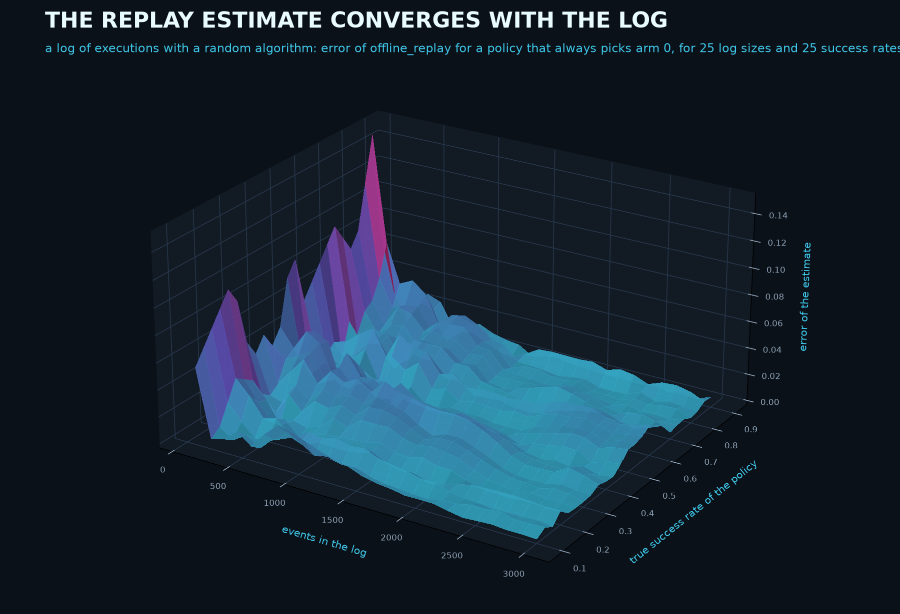
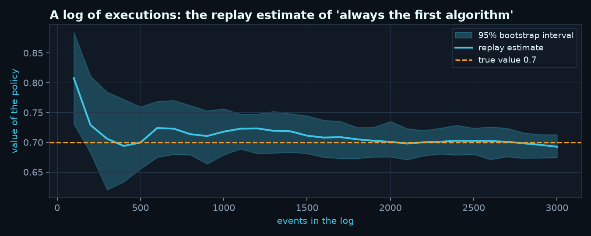

# Offline replay: judge a policy on a log

[← Bandits](index.md)

A desk has a log of executions where an algorithm was chosen at random each day and the reward was recorded. Before running a new policy for real, replay estimates what it would have earned: it keeps the days where the policy would have chosen the same algorithm and averages their rewards. A robot with a log of tuning runs is in the last section.



## 1. A first example: five execution algorithms, one desk

A log of 3000 executions: a random algorithm among two each day, and a reward of 1 for a good fill. The first algorithm fills well with probability 0.7 and the second with 0.2. The policy to judge always picks the first one.

```python
import numpy as np
from dense_armor.core.online.bandit import offline_replay

rng = np.random.default_rng(0)
log = []
for _ in range(3000):
    context = {"x": float(rng.uniform())}
    arm = int(rng.integers(2))
    log.append((context, arm, float(rng.binomial(1, [0.7, 0.2][arm]))))
out = offline_replay(log, lambda c: 0, seed=0)
print(round(out["mean"], 3), out["ci_low"] < 0.7 < out["ci_high"])
```

```
0.694 True
```

About half of the 3000 days chose the first algorithm, so the policy keeps them and averages their rewards: 0.694, close to the true 0.7, and the bootstrap interval contains 0.7 (Li et al. 2011, Algorithm 1 and Theorem 1, page 4).



On a log made by a random policy, with the first algorithm filling well 70% of the time, the replay estimate reads 0.808 with an interval from 0.731 to 0.885 after 100 events, 0.706 (0.62 to 0.784) after 300, 0.718 (0.679 to 0.756) after 1000 and 0.693 (0.674 to 0.713) after 3000.

The picture follows logs of 100 to 3000 events for 25 true success rates of the policy between 0.1 and 0.9, with 20 bootstrap resamples for the interval. Each point of the surface is the error of the estimate: for a rate of 0.5 it is 0.0909 with 100 events, 0.0033 with 945 events and 0.0137 with 3000; for a rate of 0.9 with 3000 events it is 0.0046. It falls with the size of the log, with the noise of a random sample.

| class or function | what it does |
|---|---|
| `offline_replay` | estimates the value of a policy from a log made by a random policy |

## 2. What it does

The estimator is the one of Li et al. (2011): keep the events where `policy(context) == arm_logged`, then average the rewards of the kept events. The interval is a bootstrap percentile interval, an addition to the paper that the paper does not fix; it is the choice of this implementation. The stream is an iterable of `(context, arm, reward)` triples, all logged by a uniformly random policy. The result is a dict with the keys `mean`, `ci_low`, `ci_high`, `n_retained` and `n_total`.

**Source:** Li, L., Chu, W., Langford, J., Wang, X. (2011). Unbiased offline evaluation of contextual-bandit-based news article recommendation algorithms. In WSDM 2011. Algorithm 1 and Theorem 1, page 4: the rejection-sampling estimator is unbiased when the logging policy is uniformly random. The docstring of the function calls it the estimator of Algorithm 2 in its first paragraph and Algorithm 1 in its references.

## 3. The parameters

| Parameter | Meaning | Default |
|---|---|---|
| `stream` | an iterable of `(context, arm, reward)` triples, all logged by a uniformly random policy | none |
| `policy` | a callable `policy(context) -> arm` | none |
| `n_bootstrap` | number of bootstrap resamples for the interval | 200 |
| `alpha` | two-sided level of the interval, 0.05 for 95% | 0.05 |
| `seed` | seed of the random generator for the bootstrap | 0 |

`offline_replay` raises `ValueError` if the stream is empty, if no event is retained, or if `alpha` is outside `(0, 1)` or `n_bootstrap < 1`. The methods that every policy shares (`pull`, `update`, `n_seen_`, `state_dict`, `clone`...) are on the [shared methods page](policy.md).

## 4. The same policy on a controller gain

A log of 3000 tuning runs of a controller: a random gain among two each run and a reward of 1 for a good run. The same replay judges the policy that always picks the first gain.

```python
import numpy as np
from dense_armor.core.online.bandit import offline_replay

rng = np.random.default_rng(0)
log = []
for _ in range(3000):
    context = {"load": float(rng.uniform())}
    gain = int(rng.integers(2))
    log.append((context, gain, float(rng.binomial(1, [0.7, 0.2][gain]))))
out = offline_replay(log, lambda c: 0, seed=0)
print(round(out["mean"], 3), out["ci_low"] < 0.7 < out["ci_high"])
```

```
0.694 True
```

The estimate is the same: the log is the same draws with other names.

## API reference

::: dense_armor.core.online.bandit.evaluate.offline_replay

---

## Details

### Choices

- **The figures** are drawn with the library by `docs/assets/bandit/make_bandit_style_figures.py`. Five execution algorithms with success rates 0.2, 0.35, 0.5, 0.65 and 0.8 (or the stated gap), 1000 days, the regret of a day is the rate of the best algorithm minus the rate of the one that was pulled, and the surface is the mean over the days so far.
